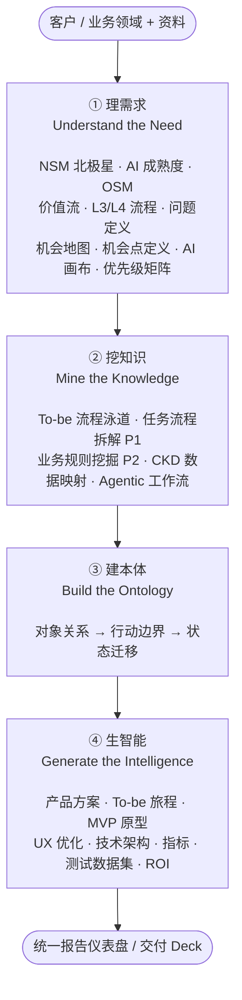
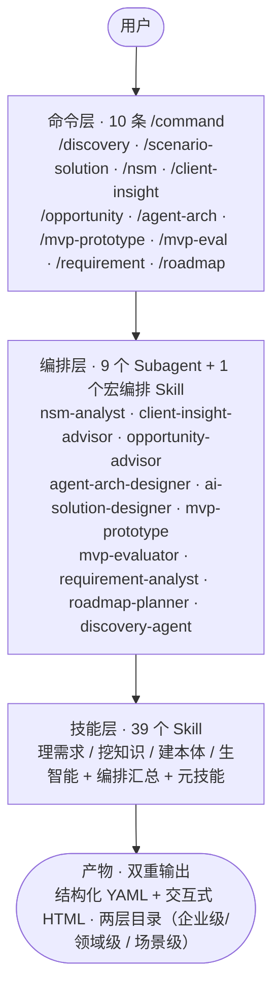

# FDE-Toolkit · FDE 四步法技能工具链与案例集

> 面向 FDE 课程学员：**课前环境准备**请按本说明操作。FDE-Toolkit 是「可迁移、无绝对路径」的工具包，专门为 FDE 四步法（理需求 → 挖知识 → 建本体 → 生智能）设计。

---

## 1. 这是什么

一套 **AI 场景分析与交付工具链（skills）+ 案例集**，帮你把每一步的交付物「一键生成」：

- **技能工具链（39 个 skills，不含第三方参考库 `skills/superpowers/`）**：覆盖四步法全流程，并含编排技能与元技能。从企业战略洞察（NSM 北极星、AI 成熟度、OSM）、现状梳理（价值流、L3/L4 流程、问题/机会定义、旅程图、服务蓝图、AI 机会地图、画布、优先级矩阵），到场景落地的全链路（任务流程挖掘 P1、To-be 流程泳道、业务规则挖掘 P2、CKD 数据映射、Agent 本体、Agentic 工作流、产品方案、Agent 落地技术架构、To-be 旅程、MVP 原型、UX 优化、成效指标、测试数据集、ROI），再到需求与规划（故事地图、MVP 迭代计划、路线图、里程碑）。
- **Agent / Command 编排层**：**10 条命令**（`/discovery`、`/nsm`、`/client-insight`、`/opportunity`、`/agent-arch`、`/scenario-solution`、`/mvp-prototype`、`/mvp-eval`、`/requirement`、`/roadmap`）把 **9 个 Subagent** 与 **1 个宏编排 Skill（discovery-agent）** 串联成标准工作流，另有单体 Skill 与元技能可按名称直接触发。
- **案例集**：`X电商订舱/`（航运电商智能订舱 Agent，含全套交付物）、`X采购发票/`（采购发票校验助手）、`X销售收入确认/`（POD 收入确认）、`铁路订票服务/`（战略规划阶段样例）等，作为演练的示例与数据底稿。

所有 Skill 遵循**双重输出**（结构化 YAML + 交互式 HTML）与**两层目录**（`[公司/业务名]/` 与 `[公司/业务名]/[场景名]/`）规范；各 Skill 详细 SOP 见其 `SKILL.md`，总索引见 `skills/index.md`。

### 1.1 全局视图：FDE 四步法



> 上一步产物（YAML）作为下一步输入；全链路可用 `/discovery` 一键编排，或按场景用 `/scenario-solution` 跑单场景端到端。

---

## 2. 技能工具链与编排总览



### 2.1 命令（`/command`）——推荐入口

每条命令封装「**命令 → Subagent → Skill 组合**」，用户只需输入一条命令即可自动串联整条链路。

| 命令 | 编排的 Subagent | 串联的 Skills | 用途 |
| --- | --- | --- | --- |
| `/discovery` | discovery-agent（宏编排 Skill） | FDE 四步法全链路（20 步） | 端到端 AI 场景探索，一次跑完四步法并汇总为交付 Deck |
| `/nsm` | nsm-analyst | `nsm-analysis`（business-research → swot-analysis → strategy-derivation） | 企业北极星战略全链路分析 |
| `/client-insight` | client-insight-advisor | `company-ai-maturity-research`、`osm-map-generator`、`business-process-deep-analyzer`、`journey-map-generator`、`blueprint-map-generator` | 客户洞察与现状业务梳理 |
| `/opportunity` | opportunity-advisor | `ai-opportunity-map-generator`、`ai-canvas-generator`、`ai-scenario-matrix-generator` | AI 机会挖掘与优先级评估（CKD 深度映射属 `/agent-arch`） |
| `/agent-arch` | agent-arch-designer | `to-be-process-designer`、`deep-task-flow-analyzer`、`business-rule-miner`、`agent-ontology-designer`、`agentic-workflow-designer`、`context-knowledge-data-analyzer`、`agent-tech-architecture` | Agent 系统设计（P1 任务流程 → P2 规则 → 结构/行为/资源三视图 → 落地技术架构） |
| `/scenario-solution` | ai-solution-designer | 17 个场景级 Skills（机会点定义 → 画布 → To-be 流程/CKD/P1/P2 → 本体 → 产品概念设计（客户确认）→ 用户画像与旅程 → 产品方案 → 旅程 → 原型 → UX → 技术架构 → 指标 → 测试数据集 → 场景级统一报告） | 单场景端到端解决方案 |
| `/mvp-prototype` | mvp-prototype | `agentic-product-proposal-generator`、`ai-product-journey-generator`、`prototype-generator`、`ux-optimizer` | 产品方案 → To-be 旅程 → MVP 原型 → UX 定制优化 |
| `/mvp-eval` | mvp-evaluator | `ai-test-dataset-generator`、`mvp-metrics-generator` | MVP 评测（测试数据集 / 成效指标 / Go-No-Go 上线门禁） |
| `/requirement` | requirement-analyst | `story-map-generator`、`mvp-plan-generator` | 需求拆解（故事地图 / MVP 迭代计划） |
| `/roadmap` | roadmap-planner | `roadmap-generator`、`milestone-plan-generator` | 战略规划（路线图 / 里程碑） |

### 2.2 Subagent（`@Agent`，共 9 个）

| Subagent | 职责 |
| --- | --- |
| nsm-analyst | 企业北极星战略全链路（调研 → SWOT → 战略推导） |
| client-insight-advisor | 客户洞察与现状业务梳理（AI 成熟度 / OSM / 流程 / 旅程 / 服务蓝图） |
| opportunity-advisor | AI 机会挖掘与优先级评估（机会地图 / 画布 / 矩阵） |
| agent-arch-designer | Agent 架构设计（任务流程挖掘 P1 + 规则挖掘 P2 + 本体/时序/CKD 三视图 + 技术架构） |
| ai-solution-designer | 单场景端到端解决方案（定方案 → 挖知识 → 建本体 → 生智能 → 场景级统一报告） |
| mvp-prototype | 产品方案 → To-be 旅程 → MVP 原型 → UX 定制优化 |
| mvp-evaluator | MVP 评测（测试数据集 / 成效指标 / 上线门禁） |
| requirement-analyst | 需求拆解（故事地图 / MVP 迭代计划） |
| roadmap-planner | 战略规划（路线图 / 里程碑） |

### 2.3 FDE 四步法技能地图

**① 理需求（Understand the Need）**——看懂现状，定义问题与场景
- `nsm-analysis`（北极星战略全景，宏技能）、`company-ai-maturity-research`（AI 成熟度与战略调研）、`osm-map-generator`（目标-策略-度量地图）、`value-stream-mapper`（L1 价值流与聚焦范围）、`business-process-deep-analyzer`（L3/L4 现状泳道图）、`problem-definition`（问题定义 8 要素）、`journey-map-generator`（体验旅程图）、`blueprint-map-generator`（服务蓝图）、`ai-opportunity-map-generator`（AI 机会场景地图）、`opportunity-definition`（机会点定义 5 要素）、`ai-canvas-generator`（10 维 AI 场景画布）、`ai-scenario-matrix-generator`（5x5 优先级矩阵）、`roadmap-generator`（产品演进路线图）、`milestone-plan-generator`（里程碑计划）。

**② 挖知识（Mine the Knowledge）**——拆解流程与规则
- `to-be-process-designer`（To-be 流程泳道图）、`deep-task-flow-analyzer`（L3→L4→L5 任务流程拆解，产出使用点）、`business-rule-miner`（五类业务规则挖掘 + P1↔P2 双向可追踪）、`agentic-workflow-designer`（AI 能力识别 + PlantUML 活动序列图）、`context-knowledge-data-analyzer`（CKD 上下文/知识/数据矩阵）。

**③ 建本体（Build the Ontology）**——沉淀业务语义
- `agent-ontology-designer`（对象关系 → 行动边界 → 状态迁移三层本体，可注入 System Prompt）。

**④ 生智能（Generate the Intelligence）**——方案、原型、评测
- `agentic-product-concept-designer`（面向客户确认的产品概念设计）、`persona-journey-designer`（用户画像与典型旅程）、`agentic-product-proposal-generator`（可施工的 产品方案）、`ai-product-journey-generator`（含 AI 交互细节的 To-be 旅程）、`agent-tech-architecture`（落地技术架构 + 编排图）、`prototype-generator`（可启动的前后端一体化 MVP 原型）、`ux-optimizer`（企业品牌 × 业务主题的定制设计系统）、`story-map-generator`（用户故事地图）、`mvp-plan-generator`（MVP 迭代计划）、`ai-test-dataset-generator`（三层三类测试数据集）、`mvp-metrics-generator`（成效指标与 Go/No-Go 门禁）、`ai-roi-calculator`（AI 项目 ROI 核算）、`plantuml-flow-generator`（PlantUML 时序图/活动图）。

**编排与汇总**：`discovery-agent`（全链路宏编排）、`unified-report-dashboard`（统一报告仪表盘，支持场景化两段式）。

**元技能（用于扩展本库）**：`skill-creator`、`agent-creator`、`command-creator`、`plugin-creator`、`frontend-design`、`get-started`。

> 单体 Skill 可直接按名称触发（如 `value-stream-mapper`、`problem-definition`、`ai-roi-calculator`、`unified-report-dashboard` 等）。

---

## 3. 环境准备（详细安装配置指南）

本课程用 **opencode**（AI 编程/分析 Agent）来运行 skills 工具链，推荐大家使用；也可以用 **Qoder**（国际版，见 3.5，API 已配好，装好即用）。请按以下步骤完成环境准备，**务必在你自己的电脑上装好并配置完成，课前我们会有环境自检**。

### 3.1 安装 opencode 桌面端

> 大部分学员使用 **Windows**，下面以 Windows 为主说明；macOS / Linux 学员操作类似。

1. 打开 opencode 官方下载页：**https://opencode.ai/download**
2. 按你的操作系统下载对应版本：
   - **Windows**：下载 `opencode-*-x64-setup.exe`（64 位安装包）
   - **macOS**：下载 `.dmg` 安装包
   - **Linux**：下载 `.AppImage` 或 `.deb`
3. 双击安装包，按提示完成安装（一路「下一步」即可）。
4. 安装完成后，启动 **OpenCode** 桌面应用，确认能正常打开主界面。

> 备选安装方式（熟悉命令行的学员）：
> ```bash
> # Windows（任选其一）
> choco install opencode     # 或
> scoop install opencode     # 或
> npm install -g opencode-ai
> # macOS
> brew install anomalyco/tap/opencode
> ```
> 桌面端与命令行共用同一套配置，用哪种安装都不影响后续步骤。

### 3.2 配置组织私有化部署的 API

本课程使用**组织内部私有化部署的大模型 API**（OpenAI 兼容网关），学员用自己的 API Key 接入，不需要注册任何外部服务。

#### 第 1 步 · 获取你的 API Key

向组织 IT / 课程管理员申请你的个人 API Key（形如 `sk-...`），同时拿到：

| 信息 | 示例 | 说明 |
| --- | --- | --- |
| 网关地址（baseURL） | `https://llm-gateway.组织域名.com/v1` | 私有化部署的入口 |
| API Key | `sk-xxxx...` | 你的个人密钥，**不要泄露** |
| 模型 ID | 如 `qwen3-coder`、`deepseek-v4` 等 | 组织已部署的模型名 |

#### 第 2 步 · 打开 opencode 配置文件

- **Windows**：`C:\Users\<你的用户名>\.config\opencode\opencode.json`
- **macOS / Linux**：`~/.config/opencode/opencode.json`

> 如果该文件不存在，手动创建即可；`.config` 目录是隐藏目录，Windows 下可在资源管理器地址栏直接输入路径回车，macOS 下用 `Cmd+Shift+.` 显示隐藏文件或直接用终端创建。

#### 第 3 步 · 粘贴配置

用记事本 / VS Code 打开 `opencode.json`，填入以下内容（**把示例值替换成你拿到的真实值**）：

```json
{
  "$schema": "https://opencode.ai/config.json",
  "provider": {
    "internal": {
      "npm": "@ai-sdk/openai-compatible",
      "name": "组织私有化 LLM",
      "options": {
        "baseURL": "https://llm-gateway.组织域名.com/v1",
        "apiKey": "sk-你的APIKey"
      },
      "models": {
        "模型ID": {
          "name": "模型显示名（可选）"
        }
      }
    }
  },
  "model": "internal/模型ID"
}
```

各字段说明：

| 字段 | 填什么 |
| --- | --- |
| `provider.internal` | 自定义 provider 名称，`internal` 可改成任意英文名 |
| `npm` | **保持 `@ai-sdk/openai-compatible` 不变**（适配 OpenAI 兼容网关） |
| `options.baseURL` | 第 1 步拿到的网关地址，**以 `/v1` 结尾** |
| `options.apiKey` | 第 1 步拿到的个人 API Key |
| `models` 下的键 | 第 1 步拿到的模型 ID |
| `model` | 设为 `internal/模型ID`，作为默认模型 |

#### 第 4 步 · 验证配置

1. 保存文件后**完全退出并重新打开** opencode 桌面端。
2. 在对话输入框发送任意消息（如「你好」），能收到正常回复即配置成功。
3. 若提示模型不存在或鉴权失败，检查：baseURL 是否以 `/v1` 结尾、模型 ID 是否和网关下发的一致、API Key 是否复制完整（无多余空格）。

> **安全提醒**：API Key 属于个人凭证，不要提交到任何 git 仓库、不要发到群里。配置文件在 `~/.config` 目录下，不会随本仓库提交。

### 3.3 安装 git

- **Windows**：下载安装 [Git for Windows](https://git-scm.com/download/win)，一路默认即可。
- **macOS**：安装 Xcode Command Line Tools（终端运行 `xcode-select --install`）。
- **Linux**：`sudo apt install git`（或对应包管理器）。

### 3.4 （可选）Node.js

需要启动可运行 MVP 原型时使用（Vite + Express）。

- 下载安装 [Node.js LTS](https://nodejs.org/)（v18+）。
- 验证：终端运行 `node -v` 能输出版本号。

> 环境受限也没关系：课上教练会用现成案例当示例，你先学方法，再逐步上手。

### 3.5 （可选）使用 Qoder（国际版）

如果你习惯用 **Qoder**，也可以直接用它运行本工具链（仓库已内置 `.qoder/` 的 commands / agents，克隆即可；skills 从全局 `~/.config/opencode/skills/` 同步）：

1. 安装 **Qoder 国际版**（从 [qoder.ai](https://qoder.ai) 下载，区别于 qoder.cn 中文版）。
2. Qoder 的模型 API 已由组织配置好，**无需额外设置**。
3. 用 Qoder 打开本仓库目录（`FDE-Toolkit/`），在对话里输入 `/agent-arch`、`/mvp-prototype` 等命令即可调用演练 Agent（与 opencode 的 `/command` 用法一致）。

> 主推 opencode 的原因：本工具链的 skills 以 opencode 目录（`.opencode/`）为基准同步，Qoder（`.qoder/`）为配套分发，两者体验一致；个别命令细节以课上实际演示为准。

---

## 4. 课前准备三步

```bash
# ① 克隆仓库
git clone <本仓库地址> FDE-Toolkit
cd FDE-Toolkit

# ② 用 opencode 桌面端打开本目录
#    在 opencode 中新建会话时选择「打开文件夹」，指向 FDE-Toolkit 目录
#    然后运行：/discovery 或 /nsm 确认命令可用（也可试 /agent-arch /mvp-prototype）

# ③ （可选）把技能库同步到全局，便于任意目录调用
#    Windows: 用 Git Bash 或 PowerShell 执行
rsync -a --delete skills/ ~/.config/opencode/skills/
```

## 5. 课前自检清单

- [ ] **opencode 桌面端已安装**（或用 Qoder 国际版），能正常打开主界面。
- [ ] **私有化 API 已配置**（opencode 需手动配置；Qoder 已配好），发消息能收到回复。
- [ ] **git 已安装**，能 `git clone` 本仓库。
- [ ] 能在这个工具里调用 skills 技能，跑通一次「生成报告」。
- [ ] （可选）Node.js 已安装，能启动 MVP 原型（`npm install && npm run dev`）并打开页面。
- [ ] 能访问到本仓库的案例集（`X电商订舱/`、`X采购发票/`、`X销售收入确认/`、`铁路订票服务/`）。

## 6. 目录地图

```
FDE-Toolkit/
├── skills/                       技能工具链（39 个，演练用，勿开发副本）
│   ├── index.md                  技能总索引 + 使用路线图
│   ├── discovery-agent/          全链路宏编排 Skill
│   ├── unified-report-dashboard/ 统一报告仪表盘
│   └── ...                       四步法各环节 Skill + 元技能
├── .opencode/                    演练 Agent / Command 定义（opencode，/command → Subagent → 技能 串联）
│   ├── agents/                   9 个 Subagent 定义
│   └── commands/                 10 条命令定义
├── .qoder/                       Qoder 国际版配套（仅 agents/、commands/，skills 从全局同步）
├── X电商订舱/                    案例：航运电商智能订舱 Agent（四步法真实样例，含 mvp-prototype）
├── X采购发票/                    案例：采购发票校验助手（含背景资料与全套交付物）
├── X销售收入确认/                案例：POD 收入确认（含背景资料与全套交付物）
├── 铁路订票服务/                 案例：铁路订票服务（战略规划阶段样例）
└── AGENTS.md                     工具包协作规范（可迁移、无绝对路径）
```

> 本地演示案例（默认不入库，`.gitignore` 已排除）：`X大客户销售/询价报价与成本测算/`，含多客户（小米 / 比亚迪 / 福耀）To-be 旅程与 ROI 报告，供课上演示参考。

## 7. 演练用法

- 演练步骤按「调用命令（`/command` → Subagent → 技能）」串联，例如：`/agent-arch` → To-be 流程 / 任务流程挖掘清单；`/scenario-solution` → 单场景端到端方案 + 场景级统一报告。
- 完整项目启动可用 `/discovery` 按四步法批量编排，最终汇总到 `unified-report-dashboard`。
- 产出物请放在自己小组的目录下，**不要**修改 `skills/` 与案例集内容。

## 8. 更新

```bash
git pull
```
