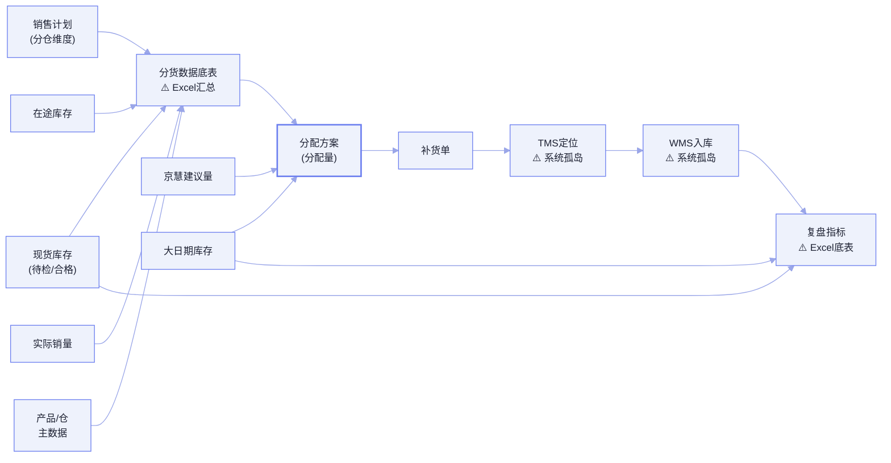

# X奶粉事业部 · 数据与知识资产盘点：分仓智能补货

> **版本：** v1.0 | **更新日期：** 2026-08-16
>
> **对应业务阶段：** 理需求（SRP）· 阶段2 数据与知识资产需求盘点 · 步骤2.1~2.2
>
> **方法论依据：** SRP 阶段2方法（数据血缘图 + 数据实体清单 → 知识资产清单）
>
> **输入依据：** 《01_场景定义画布_X奶粉事业部》、客户内部素材《奶粉分仓补货数据库表字段》《OSL场景信息采集表（含示例）》、上游 SLP《02_业务现状全景图》

## 1 总览

**这份盘点做了什么：** 承接阶段1画布的「数据需求（6.3）/ 知识需求（6.4）」，把场景依赖的数据与知识逐条落到「现状评估 + 需求规格」——数据侧先用血缘图看流转全景，再对每个数据实体评级「质量 A/B/C/D、可获取性、物理证据」；知识侧对每条隐性经验判「知识类型、状态、获取策略、加工工作量」。

**重点看什么：** 数据侧的「质量评级 / 可获取性」两列是客户最关心的落地可行性结论——核心分货数据（库存/在途/销量/主数据/大日期）已有数据库表但部分经 Excel 传递（评级 B、需导出），而执行闭环数据（TMS 定位、WMS 入库、复盘指标）目前是缺口（评级 C/D、需开发）。知识侧有 14 条经验，绝大多数是「决策模型类」的隐性经验、状态为「已识别待二轮验证」。

**为什么关注：** 这两份清单直接回答「AI 落地这个场景，数据层能不能做、知识要花多少功夫挖」——它决定了 A2「分仓智能补货」的数据就绪度（上游 SLP 判 B）到底卡在哪几个实体，以及隐性经验沉淀的排期。

**当前洞察：** ① 数据瓶颈不在「有没有」，而在「通不通」——分货核心数据已在库，但「待检/合格/在途/库存」经 Excel 传递、TMS/WMS 未与分货系统打通，这是系统孤岛痛点的数据侧印证；② 知识瓶颈在「隐性经验多且未固化」——14 条经验里 10 条是决策模型类，高度依赖老计划员，是「高经验」痛点的知识侧印证。

**需要 FDE 做什么：** ① 逐条核对数据实体的「质量评级/可获取性」是否与客户 IT 口径一致；② 带「知识资产清单」与业务专家做二轮访谈，把「积兆逻辑」等伪经验候选坐实或剔除；③ 确认 TMS/WMS/复盘指标这 3 个缺口数据的补建责任与排期。

## 2 数据血缘图

> 图例：`⚠️ 系统孤岛`＝跨系统无集成、依赖 Excel 汇总 / 人工搬运；`⚠️ Excel汇总`＝数据准备经 Excel 传递。主线「数据准备 → 分配方案 → 补货单 → 执行跟踪 → 入库 → 复盘」。

## 3 数据实体清单

| 数据实体名称 | 关联任务 | 数据形态 | 来源系统 | 数据需求 | 质量评级 | 可获取性 | 物理证据 |
|---|---|---|---|---|---|---|---|
| 产品主数据 | T2/T4/T6 | 结构化（数据库表） | 产品主数据表 | ①格式：编码/品牌/规格/事业部齐全；②完整性：必填 product_code；③合规：行业追溯要求；④安全：公开级；⑤性能：批量读取；⑥实时性：批量 | A | 直接获取 | 奶粉分仓补货数据库表字段·产品主数据 |
| 仓主数据 | T2/T4/T6 | 结构化（数据库表） | 仓主数据表 | ①格式：基地仓(0)/销售仓(1)编码；②完整性：仓编码+事业部；③合规：—；④安全：内部级；⑤性能：批量；⑥实时性：批量 | A | 直接获取 | 奶粉分仓补货数据库表字段·仓主数据 |
| 销售计划 | T1/T3/T4 | 结构化（数据库表） | 销售计划表 | ①格式：分仓×SKU×月度/日均；②完整性：plan_num/avg_plan_num 必填；③合规：—；④安全：脱敏；⑤性能：批量；⑥实时性：批量 | B | 需导出 | 奶粉分仓补货数据库表字段·销售计划 |
| 现货库存 | T1/T2/T4 | 结构化（数据库表） | 现货库存表 | ①格式：待检/合格/可发量/抵扣后库存；②完整性：produce_date/status/store_num；③合规：效期追溯；④安全：隔离；⑤性能：准实时刷新；⑥实时性：准实时 | B | 需导出 | 奶粉分仓补货数据库表字段·现货库存 |
| 在途库存 | T1/T2/T8 | 结构化（数据库表） | 在途库存表 | ①格式：收发仓/在途总量/已下发未发货；②完整性：from/to_site_code；③合规：—；④安全：隔离；⑤性能：准实时刷新；⑥实时性：准实时 | B | 需导出 | 奶粉分仓补货数据库表字段·在途库存 |
| 实际销量 | T1/T3/T12 | 结构化（数据库表） | 实际销量表 | ①格式：当月订单/已出库/前3月均销/未发货；②完整性：sell_num/out_put_num；③合规：—；④安全：脱敏；⑤性能：批量；⑥实时性：批量 | B | 需导出 | 奶粉分仓补货数据库表字段·实际销量 |
| 分仓大日期库存 | T11 | 结构化（数据库表） | 分仓大日期库存表 | ①格式：效期/大日期数量；②完整性：site_code/product_code；③合规：效期追溯；④安全：内部级；⑤性能：准实时；⑥实时性：准实时 | B | 需导出 | 奶粉分仓补货数据库表字段·分仓大日期库存 |
| 库存监控报表 | T1/T10/T11 | 结构化（派生报表） | 基地仓/全国销售仓/销售仓库存监控报表 | ①格式：备货率/订单完成率/发货缺口；②完整性：发货仓编码+产品编码；③合规：—；④安全：内部级；⑤性能：批量；⑥实时性：批量 | B | 需导出 | 奶粉分仓补货数据库表字段·业务指标数据 |
| 运输定位（GPS） | T8 | 结构化 | 运输管理系统(TMS) | ①格式：定位/速度/里程/状态/天气；②完整性：定位时间/车牌/司机；③合规：—；④安全：内部级；⑤性能：4h 刷新；⑥实时性：实时 | C | 需开发 | 奶粉分仓补货数据库表字段·GPS相关（TMS） |
| WMS 入库验收 | T9 | 结构化 | WMS | ①格式：运单/实收/差异率；②完整性：运单号/ERP单号；③合规：—；④安全：内部级；⑤性能：准实时；⑥实时性：准实时 | D | 需开发 | 奶粉分仓补货数据库表字段·GPS相关（WMS） |
| 复盘指标（时效达成率等） | T12 | 结构化（Excel 底表） | Excel 复盘底表 | ①格式：时效达成率/缺货缓解率/周转率；②完整性：历史参数值；③合规：—；④安全：内部级；⑤性能：批量；⑥实时性：批量 | C | 需开发 | OSL采集表·步骤7（全新需要补充） |

## 4 知识资产清单

| 经验名称 | 关联任务 | 关联数据 | 业务专家持有人 | 触发场景 | 知识类型 | 知识需求 | 获取策略 | 预计加工工作量 | 状态 |
|---|---|---|---|---|---|---|---|---|---|
| 缺口分级规则（DOS 分级） | T1 | 现货库存、在途库存、销售计划 | 物流计划岗老计划员（姓名待确认） | 判断全国货源是否充足、单仓是否缺货/积压 | 决策模型类 | ①覆盖：全国仓网分级；②更新：随规则变化；③质量：专家盲测一致率≥90% | 访谈萃取 | 2 人天 | 已识别 |
| 备货率分配规则 | T3 | 备货率、销售计划 | 物流计划岗老计划员（姓名待确认） | 计算各收货仓补货优先级 | 决策模型类 | ①覆盖：核心/偏远区域；②更新：月度复核；③质量：专家盲测一致率≥90% | 访谈萃取 | 2 人天 | 已识别 |
| 分配量调整经验 | T4 | 京慧建议量、可发量、分配量 | 物流计划岗老计划员（姓名待确认） | 京慧建议量基础上人工微调分配量 | 决策模型类 | ①覆盖：典型+异常分配；②更新：月度复核；③质量：专家盲测一致率≥90% | 访谈萃取 | 3 人天 | 已识别 |
| 积兆逻辑（异常诊断） | T5 | 仓网距离、物流预警、安全水位 | 物流计划岗老计划员（姓名待确认） | 基地仓缺货/物流受阻时生成备选方案 | 决策模型类 | ①覆盖：异常分支；②更新：季度复核；③质量：专家盲测一致率≥90% | 访谈萃取 | 2 人天 | [伪经验候选·待业务专家二轮验证] |
| 安全水位设置经验 | T10 | 库存天数、安全水位 | 物流计划岗老计划员（姓名待确认） | 设置各仓差异化安全水位 | 决策模型类 | ①覆盖：分仓差异化；②更新：季度复核；③质量：专家验证 | 访谈萃取 | 2 人天 | 已识别 |
| 入库差异判定规则 | T9 | WMS 入库验收 | 仓储岗（姓名待确认） | 实收数量≠调拨数量时判定处理 | 决策模型类 | ①覆盖：差异率≤0.5%/＞0.5% 分支；②更新：规则变化时；③质量：专家验证 | SOP 转化 | 1 人天 | 已识别 |
| 大日期判定经验 | T11 | 分仓大日期库存 | 仓储岗（姓名待确认） | 判断临期/大日期风险阈值 | 决策模型类 | ①覆盖：临期判定口径；②更新：随效期规则；③质量：专家验证 | 访谈萃取 | 1 人天 | [类型待定·待业务专家二轮验证] |
| 复盘调参经验 | T12 | 复盘指标 | 物流计划岗老计划员（姓名待确认） | 指标不达标时迭代参数 | 决策模型类 | ①覆盖：时效/缺货/周转三条调参规则；②更新：月度复核；③质量：专家盲测一致率≥90% | 访谈萃取 | 2 人天 | 已识别 |
| 分货计划编制流程 | T1~T7 | 全流程数据 | 物流计划岗老计划员（姓名待确认） | 每轮分货从货源评估到下发 | 操作流程类 | ①覆盖：全流程步骤；②更新：流程变更时；③质量：专家验证 | 访谈萃取+SOP 转化 | 2 人天 | 已识别 |
| 补货单校验规则 | T6 | 调拨单、SKU、收发仓 | 物流计划岗（姓名待确认） | 生成补货单时校验 | 操作流程类 | ①覆盖：收发仓/SKU/数量/时效校验项；②更新：规则变化时；③质量：专家验证 | SOP 转化 | 1 人天 | 已识别 |
| 分货方案/复盘报告模版 | T4/T12 | 分配方案、复盘指标 | 物流计划岗老计划员（姓名待确认） | 出分货方案、月度复盘报告 | 模版范例类 | ①覆盖：方案与报告模版；②更新：季度复核；③质量：专家验证 | 访谈萃取+模版收集 | 1 人天 | 已识别 |
| 待检/合格/可发量/DOS 等口径定义 | T1/T2 | 现货库存、分货数据底表 | 调度组（姓名待确认） | 理解底表字段含义与口径 | 术语字典类 | ①覆盖：本场景全部口径；②更新：口径变化时；③质量：专家验证 | 系统字段梳理 | 1 人天 | 已识别 |
| 分货数据关键字段识别要点 | T2 | 分货数据底表 | 调度组（姓名待确认） | 准备分货数据底表 | 关键信息提取要点 | ①覆盖：底表关键字段；②更新：字段变化时；③质量：专家验证 | 访谈萃取 | 1 人天 | 已识别 |
| 基地仓—销售仓—产品—SKU—渠道关联 | T1/T4 | 仓主数据、产品主数据 | 物流计划岗（姓名待确认） | 分货对象与归属识别 | 关联关系类 | ①覆盖：全仓网仓—品—渠道关联；②更新：仓网/渠道变化时；③质量：专家验证 | 系统字段梳理+访谈 | 1 人天 | 已识别 |

> 说明：`状态`列中「已识别」＝已从客户素材/上游确认该经验存在，但内部业务内容仍需下游 SKP 深挖；「[伪经验候选·待业务专家二轮验证]」＝专家暂时说不清触发场景与判断依据（如「积兆逻辑」）；「[类型待定·待业务专家二轮验证]」＝能说出场景但无法判定业务用途（如「大日期判定」）。业务专家持有人姓名均待客户确认。

## 5 待确认问题清单

| # | 待确认问题 | 用途与影响 |
|---|---|---|
| 1 | 各数据实体的「质量评级/可获取性」是否与客户 IT 口径一致（尤其现货库存的待检/合格是否已系统化，还是仍靠 Excel） | 决定数据就绪度 B 评级是否成立；不确认会导致「需导出 vs 需开发」的落地工作量错估 |
| 2 | TMS 定位、WMS 入库、复盘指标这 3 个缺口数据由谁补建、排期如何 | 决定执行跟踪/入库同步/效果复盘（P4/P5）能否落地；不确认会导致 To-Be 旅程后两段成空头设计 |
| 3 | 14 条知识经验中「积兆逻辑」「大日期判定」能否经二轮访谈坐实或剔除 | 决定隐性经验沉淀的真实范围与工作量；不确认会导致知识资产清单含伪经验 |
| 4 | 隐性经验的持有人与可用访谈时间 | 决定「访谈萃取」的排期；不确认会导致知识获取策略无法执行 |
