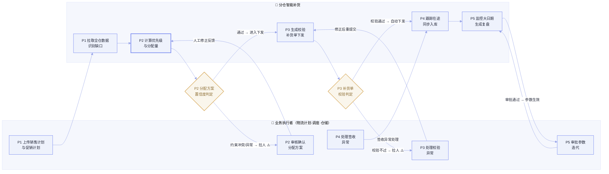

# X奶粉事业部 · 场景定义画布：分仓智能补货

> **版本：** v1.1 | **更新日期：** 2026-08-16
>
> **对应业务阶段：** 理需求（SRP）· 阶段1 场景定义画布生成 · 步骤1.1~1.5
>
> **方法论依据：** SRP 阶段1方法（场景基座定义 → 现状流程全景 → 现状痛点汇总 → To-Be 用户旅程 → AI 场景功能需求）
>
> **输入依据：** 上游 SLP《02_业务现状全景图_X奶粉事业部》《03_AI需求场景全景图_X奶粉事业部》、业务 Agent 场景卡「分仓智能补货」（A2）、客户内部素材《OSL场景信息采集表（含示例）》《奶粉分仓补货数据库表字段》

## 1 总览

**这份画布做了什么：** 把 SLP 阶段 3 已确认的业务 Agent 场景「分仓智能补货」（A2）从一张场景卡片，下钻为一份可审阅、可对齐的场景需求画布——先锁定场景身份与边界，再还原现状流程全景、汇总现状痛点，最后给出 To-Be 用户旅程与 AI 功能需求。

**重点看什么：** 主线是「基地仓 → 销售分仓」的正向补货分货这一条价值链，共 12 个 L4 任务、6 段业务流程；核心任务「T4 基地仓→销售仓分配方案编制」是全场景唯一的 P0，其余任务围绕它做约束输入（库存天数/安全库存/大日期）与执行闭环（下单、下发、跟踪、入库、复盘）。

**为什么关注：** 分货补货计划是X奶粉事业部整条供应链的枢纽，商机五大经营指标（分货效率、分仓有货率、周转率、新鲜度、跨仓履约率）几乎全部由它决定；本场景是「四个提高、一个降低」四个提高的主战场。

**当前洞察（本轮基于客户素材的重要修正）：** 客户内部素材显示，现状并非 SLP 描述的纯「人工 Excel 推式分货」——已存在「京慧建议量 + 奶粉分仓补调系统（正向/横向调拨）」给出初始建议量，但**最终分配量仍由计划员人工调整、分货数据准备（待检/合格/在途/库存）仍经 Excel 传递、执行跟踪与效果复盘缺系统支撑**。因此本场景的真实起点是「半自动化的推式分货」，改造方向是把它升级为「推拉结合 + 多约束全局优化的智能分仓补货」。

**需要 FDE 做什么：** ① 核准 12 个任务的流程主干与执行角色是否真实在跑；② 补齐任务级量化基线（分货耗时/人力、现货率、周转天数、新鲜度、跨仓履约率），把痛点从「推断」升级为「实证」；③ 重点确认「京慧建议量 + 奶粉分仓补调系统」在奶粉侧的实际覆盖边界，避免重复建设。

## 2 场景基座定义

### 2.1 场景身份卡

| 字段 | 内容 |
|---|---|
| 场景名称（业务 Agent 名） | 分仓智能补货 |
| 所属应用 / 价值段 | 应用「智能分仓补货计划」；价值流② 需求与供应计划 · 聚焦范围①「销售计划与需求预测 → 分货与补货计划 → 库存计划与安全库存」 |
| 在场景关系全景图中的位置 | 业务 Agent「分仓智能补货」（A2）· ✨ 创新类 · 落地阶段 🟡 深化（Q3–Q4） |
| 面向角色 | 物流计划、调度组（协同：仓储、物流/承运） |
| 关联系统 | Excel、APS、奶粉分仓补调系统（正向/横向调拨）、京慧一盘货、TMS、WMS |

### 2.2 场景边界声明

**场景边界：**

- **包含：**
  - 基地仓 → 销售分仓的**正向补货分货**全流程：货源与缺口识别、分货数据准备、分仓优先级与备货率计算、分配方案编制、异常诊断与备选方案、补货单生成与校验、分货结果下发；
  - **库存约束输入**：库存天数计算、安全库存设置、大日期（临期/效期）库存监控，作为补货分配的多约束输入；
  - **执行闭环**：调拨执行跟踪与在途监控、入库验收与库存同步、补货效果复盘与参数迭代。
- **不包含：**
  - 产销协同与生产排程 → 属上游 S&OP / APS；
  - 销售计划与需求预测 → 属 A1「销售计划精细化」；
  - 销售仓间横向调拨 → 属 A3「销售仓横向调拨」；
  - 订单履约与配送 → 属价值流④「仓储物流与履约」。

**业务触发条件：** 物流计划岗在每个分货周期，拿到「分仓维度销售计划（需求）+ 各仓现货/在途/待检/合格库存数据 + 促销计划」后，启动本轮分货计划编制。

**业务终止条件：** 分货/补货单完成校验并下发至物流调度系统与财务核算系统，调入仓库存指标（可发量、库存天数）完成同步，形成可复盘的分货执行结果。

### 2.3 业务目标与 KPI 体系

本场景的量化目标对应商机「四个提高、一个降低」中的**四个提高**（即 A2 的目标 KPI）；「降低跨仓履约」属 A3「销售仓横向调拨」的下游度量，本场景作为其上游输入改善而间接贡献。

| 目标 | 定义 | 达成路径 | 量化口径（当前状态） |
|---|---|---|---|
| 提高分货效率 | 通过系统化规则和智能计算，减少人工整理 Excel、人工判断和跨部门反复沟通，提高基地仓到销售仓的分货效率 | 系统化规则 + 智能计算 | 分货耗时 / 人力 [待客户确认] |
| 提高分仓有货率 | 通过更准确的需求识别和更合理的补货计划，让各销售仓更及时获得适配货源，减少区域性缺货 | 需求识别 + 补货优化 | 分仓现货率 / 订单满足率 [待客户确认] |
| 提高库存周转率 | 通过优化库存分布，减少货品在不合适仓库中沉淀，提高整体库存周转效率 | 库存分布优化 | 库存周转天数 [待客户确认] |
| 提高新鲜度 | 奶粉商品对日期敏感，补货计划需兼顾库存数量和商品日期，减少临期、大日期库存风险，提高终端可售商品新鲜度 | 批次 / 效期管理 | 新鲜度 / 临期占比 [待客户确认] |

> 说明：四个目标的「定义」与「达成路径」为客户明确给出的需求口径（见上游 SLP 2.4 与 FDE 提供的 KPI 说明）；量化口径的具体数值（分货耗时、现货率、周转天数、新鲜度）仍缺任务级基线，已登记现场调研待办，未编造数值。

## 3 现状流程全景（As-Is）

### 3.1 现状价值流泳道图

痛点类型🔴 高耗时　🟡 高经验依赖　🟠 高频错误　🔵 系统孤岛

知识类型<b style="color:#6b46c9">隐</b>＝口传经验　<b style="color:#2f8a55">显</b>＝有文档/系统　<b style="color:#5366c4">混</b>＝两者皆有

流程走向<b style="color:#6b7eef">↪ 角色交接</b>＝任务跨岗位流转　<b style="color:#c0506a">⟲ 返工回环</b>＝校验不通过退回调整

信息置信度✅ 已校准（客户系统字段/采集表印证）　⚠ 部分印证（上游 SLP 转述、未见系统实物）

① 货源评估<small>与分货数据准备</small>

② 分货计划<small>编制</small>

③ 补货单<small>生成与下发</small>

④ 执行跟踪<small>与入库同步</small>

⑤ 库存计划<small>与监控</small>

⑥ 补货效果<small>复盘</small>

客户·外部

📥 分仓销售计划输入 (来自 A1 销售计划精细化)

📢 促销计划输入 (140+ 广促品指标)

计划层 物流计划

3优先级与备货率计算✅

⏱ 约 0.5 天/轮

🟡🔴隐

备货率运输时效区域类型

4基地仓→销售仓分配方案✅

⟲ 人工反复调整分配量

⏱ 约 1 天/轮 · P0

🔴🟡🟠隐

京慧建议量可发量分配量

5异常诊断与备选方案⚠

⏱ 约 0.5 天/异常

🟡隐

仓网距离物流预警安全水位

6补货单生成与校验✅

⟲ 校验不过退回调整

⏱ 约 0.5 天/批

🟠混

调拨单SKU 编码收发仓

7分货结果下发✅

↪ →物流调度/财务

⏱ 秒级

🔵显

补货单下发指令

10库存天数与安全库存⚠

⏱ 约 0.5 天/月

🟡隐

库存天数安全水位

12效果复盘与参数迭代⚠

⏱ 约 1 天/月

🟡隐

时效达成率缺货缓解率周转率

数据层 调度组

1货源与缺口识别✅

⏱ 约 0.5 天/轮

🔴🔵隐

现货库存在途销售计划

2分货数据底表准备✅

⟲ 待检/合格/在途/库存经 Excel 汇总

⏱ 约 1 天/轮

🔴🔵隐

待检合格在途Excel

仓储执行层 仓储·物流

8执行跟踪与在途监控⚠

⏱ 持续 · 4h 人工刷新

🔴🔵显

TMS GPS车辆定位

9入库验收与库存同步⚠

⏱ 约 0.5 天/批

🟠🔴隐

WMS 运单实收数量差异单

11大日期库存监控⚠

⏱ 持续 · 人工巡检

🔴🟠隐

大日期效期临期预警

系统· 自动化

现货/在途库存 销售计划 · 未发订单

京慧建议量 奶粉分仓补调系统

物流调度系统 财务核算系统

TMS GPS WMS 入库验收

库存监控报表 大日期库存

Excel 复盘底表

泳道归并：客户·外部 / 计划层(物流计划) / 数据层(调度组) / 仓储执行层(仓储·物流) / 系统·自动化。主线 ① → ② → ③ → ④；⑤ 库存约束作为 ② 分配的多约束输入，⑥ 复盘形成下一轮参数回馈。

### 3.2 任务主表

| 序号 | 业务流程(L3) | 任务(L4) | 任务说明（补全） | 执行者 | 系统数据 | 知识资产 | 耗时 | 痛点标识 | 实例校准 |
|---|---|---|---|---|---|---|---|---|---|
| 1 | 货源评估与分货数据准备 | 全国货源与需求缺口识别 | 汇总全国基地仓可分配库存 + 在途，匹配未来 14 天需求，按 DOS 分级判断货源是否充足 | 调度组 | 现货库存、在途库存、销售计划、未发订单（Excel） | 缺口分级规则（隐） | 约 0.5 天/轮 | 🔴🔵 | ✅ |
| 2 | 货源评估与分货数据准备 | 分货数据底表准备 | 把各仓待检/合格/在途/库存数据汇总成一张分货数据底表 | 调度组 | 待检/合格/在途/库存（Excel） | 数据口径（隐） | 约 1 天/轮 | 🔴🔵 | ✅ |
| 3 | 分货计划编制 | 分仓优先级与备货率计算 | 按备货率、运输时效、区域类型计算各收货仓补货优先级 | 物流计划 | 备货率、运输时效、区域类型（奶粉分仓补调系统） | 备货率分配规则（隐） | 约 0.5 天/轮 | 🟡🔴 | ✅ |
| 4 | 分货计划编制 | 基地仓→销售仓分配方案编制 | 基于京慧建议量 + 人工经验，测算各仓分配量，形成多版分货方案 | 物流计划 | 京慧建议量、可发量、分配量（奶粉分仓补调系统） | 分货决策经验（隐） | 约 1 天/轮 | 🔴🟡🟠 | ✅ |
| 5 | 分货计划编制 | 异常诊断与备选方案生成 | 基地仓缺货/物流受阻时，参考「积兆逻辑」检索周边资源生成备选方案 | 物流计划 | 仓网距离、物流预警、安全水位（经验） | 积兆逻辑（隐） | 约 0.5 天/异常 | 🟡 | ⚠ |
| 6 | 补货单生成与下发 | 补货单生成与初审校验 | 按确认的分货方案生成标准化调拨单，校验收发仓/SKU/数量/时效 | 物流计划 | 调拨单、SKU 编码、收发仓（奶粉分仓补调系统） | 校验规则（混） | 约 0.5 天/批 | 🟠 | ✅ |
| 7 | 补货单生成与下发 | 分货结果下发 | 校验通过后推送至物流调度与财务核算系统 | 物流计划 | 补货单（系统→物流调度/财务） | — | 秒级 | 🔵 | ✅ |
| 8 | 执行跟踪与入库同步 | 调拨执行跟踪与在途监控 | 对接 TMS 抓取车辆定位与运输状态，人工刷新在途台账 | 仓储/物流 | TMS GPS 定位（运输管理系统） | — | 持续·4h 人工刷新 | 🔴🔵 | ⚠ |
| 9 | 执行跟踪与入库同步 | 入库验收与库存同步 | 对接 WMS 读取验收数据，核对实收与调拨数量，标记差异 | 仓储 | WMS 入库验收（运单） | 差异判定规则（隐） | 约 0.5 天/批 | 🟠🔴 | ⚠ |
| 10 | 库存计划与监控 | 库存天数与安全库存设置 | 按日均需求算库存天数，凭经验设各仓安全水位 | 物流计划 | 库存天数、安全水位（Excel） | 安全水位经验（隐） | 约 0.5 天/月 | 🟡 | ⚠ |
| 11 | 库存计划与监控 | 大日期库存监控 | 人工巡检各仓临期/大日期库存，发现临期风险 | 仓储 | 大日期库存、效期（库存监控报表） | 大日期判定（隐） | 持续·人工巡检 | 🔴🟠 | ⚠ |
| 12 | 补货效果复盘 | 补货效果复盘与参数迭代 | 月度统计时效达成率/缺货缓解率/周转率，人工复盘并调参 | 物流计划 | 时效达成率、缺货缓解率、周转率（Excel） | 复盘调参经验（隐） | 约 1 天/月 | 🟡 | ⚠ |

### 3.3 关键事实补充

**业务量级（来自 SLP 上游，待客户复核）：** 仓网为「工厂仓 → 基地仓（4）→ 销售分仓（9+）→ 六类渠道」；SKU 近 700 个，涉及段位/配方/包装多维度组合；促销品与礼盒有独立分货逻辑。

**典型 vs 异常分布（来自客户采集表示例，数值为脱敏参考样例）：** 典型分货周期内，单仓备货率分布在 80%~95% 区间（如北京顺义仓 80%、天津武清仓 95%）；缺口按 DOS 分级——DOS<7 天红色（紧急补货）、7≤DOS<14 天黄色（常规补货）、DOS>60 天且无促销为蓝色积压预警。

**显性 vs 隐性知识清单分组：**
- 显性：分货数据底表字段口径（现货/待检/合格/在途/可发量/分配量定义）、补货单校验规则、库存监控报表字段定义；
- 隐性：缺口分级规则、备货率分配规则、分配量调整经验、「积兆逻辑」异常诊断、安全水位经验、大日期判定经验、复盘调参经验。

**校准证据清单：** 本步骤引用了客户内部素材《奶粉分仓补货数据库表字段》（现货库存/在途库存/销售计划/实际销量/正向调拨/横向调拨/分仓大日期库存/TMS/WMS 字段）与《OSL场景信息采集表（含示例）》（7 个关键业务活动 + 决策规则 + 样本数据）；任务级耗时与错误率为 [基于访谈估算 · 待客户回填]。

## 4 现状痛点汇总

| 痛点类型 | 现状问题（含量化） | 频次 / 影响 | Agent 机会点 |
|---|---|---|---|
| 🔴 高耗时 | 分货覆盖 4 基地仓 × 9+ 销售分仓 × 近 700 SKU，待检/合格/在途/库存经 Excel 传递汇总，人工逐仓逐 SKU 核算分配与执行跟踪；分货周期与人力工时 [量化待客户确认] | 每轮分货周期发生，占计划员核心工时 | 自动化（数据汇总 + 分配测算 + 跟踪刷新） |
| 🟡 高经验 | 分配量、备货率、安全水位、异常诊断（积兆逻辑）、复盘调参均依赖老计划员经验，隐性规则未固化、难传承 | 关键决策高度集中在少数老计划员 | 知识沉淀（经验结构化 + 规则固化） |
| 🟠 高频错误 | 人工分货易错，导致部分仓缺货、部分仓积压；入库差异核对与返工 [错误率/返工成本待客户确认] | 直接影响有货率、周转率与新鲜度 | 质量闸门（校验 + 全局约束兜底） |
| 🔵 系统孤岛 | 待检/合格/在途/库存经 Excel 传递；分货与促销计划未实时联动（140+ 广促品 vs 80+ 供应指标）；TMS/WMS 与分货系统未打通 | 数据多次搬运、大促放量击穿补货节奏 | 集成（系统打通 + 促销联动） |

**关键痛点详情与客户原话：**

- 🔴 **高耗时 · 分货数据准备与分配人工核算** —— 关联任务 T2、T4、T8
  - 现状：分货数据底表靠 Excel 汇总，分配量在「京慧建议量」基础上人工逐仓逐 SKU 调整，执行跟踪靠人工 4 小时刷新一次。
  - 一线原话（FDE 商机转述 · 客户内部信息）："现在是从人工 Excel 推式分货，升级为推拉结合的智能分仓补货计划体系。"
- 🟡 **高经验 · 分货决策依赖老计划员** —— 关联任务 T3、T4、T5、T10、T12
  - 现状：备货率分配规则、分配量调整、异常诊断的「积兆逻辑」、安全水位、复盘调参均为口传经验，未文档化。
  - 一线原话（SLP 上游转述）："分货决策依赖老计划员经验，隐性规则未固化、难传承。"
- 🟠 **高频错误 · 人工分货易错导致有货率不足或积压** —— 关联任务 T4、T6、T9
  - 现状：多仓 × 多 SKU × 多约束（库存/在途/待检/合格/新鲜度/促销）下人工无法全局最优，易多补或缺补；入库差异（>0.5% 需生成差异单追责）人工核对。
  - 一线原话（SLP 上游转述）："人工分货易错，导致有货率不足或积压。"
- 🔵 **系统孤岛 · 数据经 Excel 传递、促销与分货脱节** —— 关联任务 T2、T7、T8、T11
  - 现状：待检/合格/在途/库存经 Excel 传递（系统未直连）；分货计划未与前端促销计划实时联动；TMS/WMS 与分货系统、复盘底表各自独立。
  - 一线原话（SLP 上游转述）："分货计划未与前端促销计划实时联动，大促放量直接击穿补货节奏。"

> 说明：痛点中涉及耗时、人力、错误率、返工成本、现货率、周转天数等任务级量化基线目前缺失，均标注 [量化待客户确认]，并已登记现场调研待办，不编造具体数值。

## 5 To-Be 用户旅程

### 5.1 旅程泳道图

> ⚠️ HITL 断点 · 实线 = 主路径 · 边标签 = 流转条件

### 5.2 阶段详情表

| 序号 | 阶段名称 | 业务目标 | 需求优先级 | As-Is 基准 | To-Be 目标 | 业务执行者·核心动作 | AI 动作占位 | 人机分工边界 | 节点确认设计 | 进度观测设计 | 批量支持度 | HITL 触发条件 |
|---|---|---|---|---|---|---|---|---|---|---|---|---|
| P1 | 货源评估与缺口识别 | 自动生成全仓网供需视图，提前识别缺货/积压 | P0 | 约 0.5 天/轮 [基线待确认] | DOS 分级（<7 红 / 7-14 黄 / >60 蓝）自动生成 | 物流计划上传销售计划与促销计划；调度组复核缺口清单 | 拉取全仓现货/在途/待检/合格数据，按 DOS 分级识别缺口 | AI 做数据拉取与缺口识别，人工确认分货周期参数 | 启动确认（计划员确认参数） | 播报（长耗时分步播报） | 批量 | 数据缺失/口径异常时拉人 |
| P2 | 分货方案编制 | 多约束全局优化，替代人工核算分配 | P0 | 约 1.5 天/轮 [基线待确认] | 生成多版分配方案，分配后库存天数达标 | 物流计划审核并确认/微调分配方案 | 计算优先级/备货率/分配量，生成多版方案与异常备选 | AI 算方案、人工做最终确认与微调 | 结果确认（计划员确认方案） | 看板（批量并发多仓） | 批量 | 京慧建议量偏离预期 / 约束冲突无法求解时拉人 |
| P3 | 补货单生成与下发 | 自动生成标准化补货单并推送下游 | P0 | 约 0.5 天/批 [基线待确认] | 秒级生成校验，校验通过自动下发 | 物流计划处理校验异常单 | 生成调拨单并校验收发仓/SKU/数量/时效，通过后下发 | AI 自动生成与下发，异常才拉人 | 无（自动下发） | 进度条（单件流） | 批量 | 库存不足 / 时效超期 / 字段缺失时拉人 |
| P4 | 执行跟踪与入库同步 | 实时跟踪在途、自动同步入库 | P1 | 4h 人工刷新 [基线待确认] | 4h 自动刷新，延误/破损自动预警 | 仓储/物流处理签收异常 | 跟踪 TMS 定位与在途台账，同步 WMS 入库与库存指标 | AI 自动跟踪与同步，异常才拉人 | 无（自动跟踪） | 播报（长耗时分步播报） | 混合 | 延误>24h/48h、破损率>1%、差异率>0.5% 时拉人 |
| P5 | 库存监控与效果复盘 | 自动监控大日期、生成复盘并建议调参 | P1 | 约 1 天/月 [基线待确认] | 时效达成率≥90%、缺货缓解率≥85%、周转率同比降幅≤10% | 物流计划审批参数迭代 | 监控大日期/临期，统计复盘指标并建议调参 | AI 生成复盘与调参建议，人工审批生效 | 参数迭代审批（计划员审批） | 看板（批量报表） | 批量 | 指标异常恶化时拉人 |

> To-Be 目标中的阈值（DOS 分级、时效达成率≥90%、缺货缓解率≥85%、周转率降幅≤10%、破损率>1%、差异率>0.5%、延误>24h/48h）均取自客户《OSL场景信息采集表》的现有决策规则，属真实业务口径；「分货耗时/人力」等 As-Is 基线仍缺客户量化数据，标注 [基线待确认]。

## 6 AI 场景功能需求列表

### 6.1 用户功能需求（人机界面）

| 序号 | 需求描述 | 验收标准 | 性能需求 | 安全需求 | 可用性 |
|---|---|---|---|---|---|
| 1 | 全仓网供需全景仪表盘 | 覆盖 4 基地仓 × 9+ 销售分仓，缺口/积压分级（红/黄/蓝）完整展示 | <3 秒响应 | 权限控制（按岗位） | >99.9% |
| 2 | 缺口告警清单 | 按 DOS 分级生成告警，支持钻取到仓×SKU | <3 秒响应 | 权限控制 | >99.9% |
| 3 | 分货方案编辑器 | 支持多版方案对比、分配量人工微调、修改原因留痕 | <3 秒响应 | 操作留痕/权限隔离 | >99.9% |
| 4 | 补货单审核与异常处理界面 | 校验异常单可定位原因并退回重算 | <3 秒响应 | 权限控制 | >99.9% |
| 5 | 执行跟踪看板 | 在途定位/延误/破损预警可视化 | <3 秒响应 | 数据脱敏 | >99.9% |
| 6 | 复盘报告与参数迭代审批 | 月度复盘报告 + 参数审批流 | <3 秒响应 | 审批留痕 | >99.9% |

### 6.2 Agent 功能需求（后台智能）

| 序号 | 需求描述 | 验收标准 | 性能需求 | 安全需求 | 可用性 | 追溯 |
|---|---|---|---|---|---|---|
| 1 | 全仓网缺口识别 | DOS 分级准确率 ≥ 95% | 分钟级完成全仓网扫描 | 数据加密 | 故障转移 | 🔴🔵 → P1 |
| 2 | 分仓优先级与备货率计算 | 优先级/备货率与人工结论一致率 ≥ 90% | 分钟级 | 数据加密 | 故障转移 | 🟡🔴 → P2 |
| 3 | 多约束分配量优化 | 分配后库存天数达标、无约束违反（库存/在途/待检/合格/新鲜度/促销） | <5 分钟生成多版方案 | 数据加密 | 故障转移 | 🔴🟡🟠 → P2 |
| 4 | 异常诊断与备选方案 | 异常时自动生成 ≥3 套备选（成本/时效/库存均衡维度） | <5 分钟 | 数据加密 | 故障转移 | 🟡 → P2 |
| 5 | 补货单生成与校验 | 校验通过率准确，库存不足/时效超期/字段缺失不漏判 | 秒级 | 数据加密 | 故障转移 | 🟠 → P3 |
| 6 | 执行跟踪与入库同步 | 延误>24h/48h、破损率>1%、差异率>0.5% 自动预警 | 4h 自动刷新 | 数据加密 | 故障转移 | 🔴🔵 → P4 |
| 7 | 效果复盘与调参建议 | 时效达成率≥90%、缺货缓解率≥85% 目标达成，调参建议可审批 | 分钟级生成月报 | 数据加密 | 故障转移 | 🟡 → P5 |

### 6.3 数据需求

| 序号 | 数据实体 | 数据类型 | 质量要求 | 实时性 | 安全需求 |
|---|---|---|---|---|---|
| 1 | 销售计划 | 结构化 | 完整性（分仓×SKU×月度/日均） | 批量 | 脱敏 |
| 2 | 现货库存 | 结构化 | 完整性（待检/合格/可发量/抵扣后库存） | 准实时 | 隔离 |
| 3 | 在途库存 | 结构化 | 完整性（在途/已下发未发货/调拨单未发货） | 准实时 | 隔离 |
| 4 | 实际销量 | 结构化 | 完整性（当月订单/已出库/前3月均销/未发货） | 批量 | 脱敏 |
| 5 | 产品主数据 | 结构化 | 完整性（编码/品牌/规格/事业部） | 批量 | 公开级 |
| 6 | 仓主数据 | 结构化 | 完整性（基地仓/销售仓编码） | 批量 | 内部级 |
| 7 | 分仓大日期库存 | 结构化 | 完整性（效期/大日期数量） | 准实时 | 内部级 |
| 8 | 库存监控报表 | 结构化（派生） | 完整性（备货率/订单完成率/发货缺口） | 批量 | 内部级 |
| 9 | 运输定位（GPS） | 结构化 | 完整性（定位/状态/里程/天气） | 实时 | 内部级 |
| 10 | WMS 入库验收 | 结构化 | 完整性（运单/实收/差异率） | 准实时 | 内部级 |

### 6.4 知识需求

| 序号 | 知识对象 | 知识类型 | 覆盖度 | 更新频率 | 质量评估 |
|---|---|---|---|---|---|
| 1 | 缺口分级规则（DOS 分级） | 决策模型类 | 覆盖全国仓网全部基地仓×销售仓 | 随规则变化更新 | 专家盲测一致率 ≥ 90% |
| 2 | 备货率分配规则 | 决策模型类 | 覆盖核心/偏远区域类型 | 月度复核 | 专家盲测一致率 ≥ 90% |
| 3 | 分配量调整经验 | 决策模型类 | 覆盖典型 + 异常分配场景 | 月度复核 | 专家盲测一致率 ≥ 90% |
| 4 | 积兆逻辑（异常诊断） | 决策模型类 | 覆盖缺货/物流受阻/订单激增异常分支 | 季度复核 | 专家盲测一致率 ≥ 90% |
| 5 | 安全水位设置经验 | 决策模型类 | 覆盖分仓差异化安全水位 | 季度复核 | 专家验证 |
| 6 | 分货计划编制流程 | 操作流程类 | 覆盖从货源评估到下发全流程 | 流程变更时更新 | 专家验证 |
| 7 | 补货单校验规则 | 操作流程类 | 覆盖收发仓/SKU/数量/时效校验项 | 规则变化时更新 | 专家验证 |
| 8 | 分货方案/复盘报告模版 | 模版范例类 | 覆盖分货方案与月度复盘报告 | 季度复核 | 专家验证 |
| 9 | 待检/合格/可发量/DOS 等口径定义 | 术语字典类 | 覆盖本场景全部业务口径 | 口径变化时更新 | 专家验证 |
| 10 | 分货数据关键字段识别要点 | 关键信息提取要点 | 覆盖底表关键字段 | 字段变化时更新 | 专家验证 |
| 11 | 基地仓—销售仓—产品—SKU—渠道关联 | 关联关系类 | 覆盖全仓网仓—品—渠道关联 | 仓网/渠道变化时更新 | 专家验证 |

## 7 待确认问题清单

| # | 待确认问题 | 用途与影响 |
|---|---|---|
| 1 | 五大指标的**任务级量化基线**（分货耗时/人力、现货率、周转天数、新鲜度、跨仓履约率） | 用于把痛点从「推断」升级为「实证」，并校准 To-Be 目标与验收标准；不确认会导致 1.4/1.5 的量化目标缺可比口径 |
| 2 | 「京慧建议量 + 奶粉分仓补调系统」在奶粉侧的实际覆盖边界（是否已替代部分人工分货、建议量准确率如何） | 决定本场景是「能力移植深化」还是「部分新建」，影响 P2 的改造起点与数据就绪度判断；不确认会导致方案起点失真或重复建设 |
| 3 | 12 个 L4 任务的流程主干、执行角色、业务规则是否真实在跑（有无遗漏/多余/顺序错位） | 影响现状流程全景的准确性，进而影响痛点锚定与 To-Be 设计；不确认会导致下游 SKP 建立在错误的任务骨架上 |
| 4 | 分货与促销计划当前是否已有任何联动机制（140+ 广促品 vs 80+ 供应指标如何衔接） | 决定「促销联动」是集成需求还是全新建设；不确认会导致 P2 分配约束（促销）的输入路径无法收敛 |
| 5 | 大日期/效期数据在分货决策中的实际使用方式（是否已作为约束输入，还是仅事后监控） | 决定「新鲜度」约束是分配优化的一阶约束还是复盘后置指标；不确认会导致多约束优化的目标函数定义不稳 |
