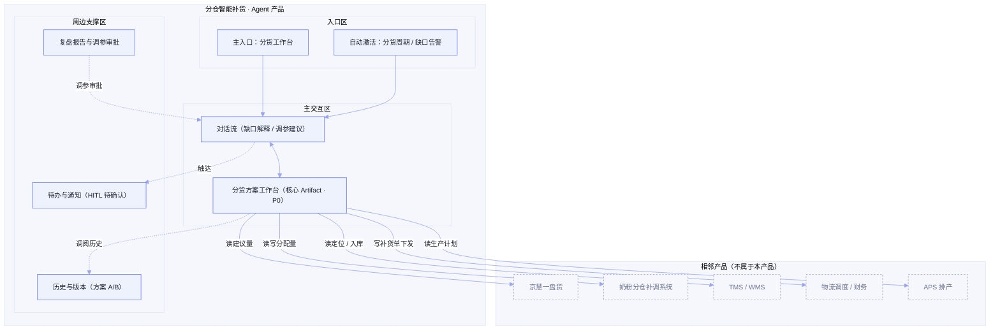

# X奶粉事业部 · Agent 产品方案：分仓智能补货

> **版本：** v2.0 | **更新日期：** 2026-09-10
>
> **对应业务阶段：** 设计方案（SDP-Product）· 阶段1 Agent产品方案设计 · 步骤1.1~1.6
>
> **方法论依据：** SDP-Product 阶段1方法（产品定位 → 形态架构 → 故事线 → 功能清单 → Agent行为 → 规则消费门禁）
>
> **输入依据：** 场景定义《X奶粉-分仓智能补货-机会点定义》《X奶粉-分仓智能补货-AI画布》《X奶粉-分仓智能补货-CKD矩阵分析》、挖知识《X奶粉-分仓智能补货-To-be流程》《X奶粉-分仓智能补货-任务流程拆解》（P1，21 个 L5 使用点）《X奶粉-分仓智能补货-业务规则挖掘》（P2，14 条五类规则）、梳理本体《X奶粉-分仓智能补货-本体设计》

## 1 总览

**这份方案做了什么：** 在 v1.0 概念级方案基础上，用已完成的上游四项产出（任务流程拆解 P1 的 21 个 L5 使用点、业务规则挖掘 P2 的 14 条五类规则、本体设计的三层模型、CKD 数据/知识资产）**回填精化**，把「分仓智能补货」翻译成一份原型作者可照单施工的产品方案——产品定位、形态架构图、4 条演示故事线、13 项功能与 UI 组件、Agent 行为设计、**14 条规则逐条可追溯的消费门禁**。

**重点看什么：** 核心是「分货方案工作台」——它是 Agent 多约束分配优化的交付载体（Artifact），全场景唯一 P0（对应 P1 焦点 L4「基地仓→销售仓分配方案编制」，下钻为 L5-1 算量 / L5-2 选仓 / L5-3 出版本 / L5-4 确认四个可独立挂规则的动作）。4 条故事线分别演示「缺口识别 / 方案编制（含 HITL）/ 异常备选（含错误态）/ 下发与复盘（含撤销）」四个业务价值高光。**本版关键升级：** 第 7 段门禁表从「概念级代理」升级为「14 条真实规则逐条绑定到使用点」。

**为什么关注：** 商机五大经营指标里「四个提高」（分货效率/分仓有货率/周转率/新鲜度）全由分货方案决定；本产品的价值主张是「把老计划员的 Excel 推式分货，升级为 AI 多约束全局优化的推拉结合分货」。规则是否「挖到位、接得住」决定系统是否**可解释 / 可复核 / 可验收**——例如 DOS 阈值（红<7/黄7-14/蓝>60）、目标备货率（订单进度+20% 封顶100%）、可发量硬约束、差异率>0.5%、破损率>1% 等，必须从「专家隐性经验」落成「产品可执行门禁」。

**当前洞察：** 14 条规则中**决策模型类 8 条（占 57%）高度集中**——缺口分级、备货率、分配量优化、补货单校验、入库差异、复盘调参、安全水位、大日期；其中**硬约束 3 条**（可发量不可突破、对外下发必停、目标备货率封顶 100%）应落成「写入前必停 + 撤销窗口」，**软优先级 5 条**（急缺优先/积压控量/促销上浮/时效优先/服务水平优先）落成「提示 + 出处引用」。HITL 需覆盖 4 类：对外下发（gate）、京慧建议量偏离（写入前必停）、阈值边界冲突（DOS 7/14/60、目标备货率>100%）、数据降级（TMS 未接通按历史时效估算）。**『积兆逻辑』『大日期判定』仍为待业务专家二轮验证经验**，产品中如实标注概念级。

**需要 FDE 做什么：** ① 核对故事线 mock 数据与 14 条规则的阈值一致性；② 确认「积兆逻辑 / 大日期判定」二轮验证口径能否坐实；③ 确认「京慧一盘货 + 奶粉分仓补调系统」的实际产品边界（本方案默认它们是相邻系统、只读建议量/读写分配量）；④ 视觉基底 P0~P3 锚定（阶段2 前置项）。

## 2 产品定位

### 2.1 迭代范围

**功能迭代优化（上游精化）：** v1.0 为概念级（无 SKP）；本版基于 P1 任务流程拆解 + P2 业务规则挖掘，将 4 条故事线的 mock 数据、功能清单的上游来源、HITL 触发条件、规则门禁全部回填为可追溯的真实规则。

**首版 PoC / MVP：** 从 0 到 1，验证「推拉结合 + 多约束优化」的分仓补货能否在分货效率与有货率/周转/新鲜度之间取得全局平衡（对应场景卡 PoC：1 个基地仓 + 2–3 个销售分仓、核心 SKU 试点）。

### 2.2 产品形态

**B2B 自用型**：客户 = X奶粉事业部，用户 = 事业部内部物流计划/调度/仓储岗，交付物不外流。与京慧一盘货、奶粉分仓补调系统相邻：**只读建议量、读写分配量**，不替代其库存/调拨能力。

### 2.3 四件套

| 子项 | 内容 |
|---|---|
| 产品定位一句话 | 为X奶粉事业部的物流计划岗，在「基地仓 → 销售分仓」分货补货场景下，通过 AI 多约束全局优化，把分货效率、分仓有货率、库存周转率、商品新鲜度四个指标一起往上拉。 |
| 非目标 | ① 不做销售计划与需求预测（属 A1 销售计划精细化）；② 不做销售仓间横向调拨（属 A3 销售仓横向调拨）；③ 不做订单履约与配送（属价值流④）；④ 不做生产排程（属 APS）；⑤ 原型阶段不接真实后端与模型。 |
| 主要使用者 | 物流计划岗——在每轮分货周期，把「分仓销售计划 + 各仓库存/在途/待检/合格数据 + 促销计划」变成一份可直接下发的分货方案；调度组复核分货数据底表口径；仓储/物流岗处理执行跟踪与入库差异。 |
| Agent 人格 | 身份定位：一名懂分货计划的分货方案助理；语气基调：专业、克制、数字驱动（用备货率/DOS/库存天数说话）；能力边界：我能做缺口识别、优先级计算、分配量测算、补货单生成校验、执行跟踪、复盘调参建议，不能替你做最终拍板、不能脱离库存/在途/效期约束乱分货、不能跳过对外下发确认。 |

## 3 产品形态架构图

> 三大区齐全；相邻产品 5 个，均只标接触面（读/写），不画协议与字段。

## 4 原型演示故事线

> 共 4 条，1:1 对应阶段2 `moments/*.html`。mock 数据均取自「任务处理规则挖掘清单」（P2）的真实决策因子/阈值（脱敏）。

### 故事线 1 · 全仓网缺口识别与分级告警

| 字段 | 内容 |
|---|---|
| 业务价值高光 | AI 一屏识别全国仓网谁缺货、谁积压，把老计划员要半天比对的多张 Excel 变成一张红黄蓝分级图 |
| 对应阶段 | L3「货源评估与分货数据准备」· L5 汇总全国可分配库存与在途 / 计算各仓库存天数并判定缺口等级 / 校验底表字段口径完整性 |
| 演示剧本 | 用户：「帮我看看全国仓网现在的货源情况。」→ Agent 思考（拉取 4 基地仓可分配库存+在途，匹配未来 14 天销售计划，按 DOS 分级）→ 调工具（读现货库存/在途库存/销售计划）→ 输出供需全景 + 缺口告警（红/黄/蓝），标注 **DOS<7 红、7≤DOS<14 黄、DOS>60 且无促销 蓝积压**；底表口径校验 6 项（可发量/待检/合格/在途/生产备货率/大日期）→ 数据缺失/口径异常时拉调度组复核 |
| UI 组件 + 必备交互 | 供需全景看板 + 缺口告警清单 + 状态徽章 + 术语 hover 卡；#1 流式 #2 工具调用 #7 出处引用 #8 状态徽章 |
| 业务内容来源 | L5「汇总全国可分配库存与在途」「计算各仓库存天数并判定缺口等级」「校验底表字段口径完整性」；规则 **rd_01 缺口分级规则（DOS 分级）**、**rext_01 分货数据底表字段提取要点**、**rdict_01 分仓补货业务口径词典** |

### 故事线 2 · 多约束分货方案生成与人工确认（含 HITL）

| 字段 | 内容 |
|---|---|
| 业务价值高光 | 从京慧建议量到全局最优分配方案，多仓×多SKU×多约束一次算完，计划员只需确认 |
| 对应阶段 | L3「分货方案编制」（全场景 P0）· L5 计算生产备货率与订单完成率 / 计算各仓目标备货率与补货优先级 / 计算建议补货量 / 选择发货仓并拆分多仓补足 / 生成多版分配方案 / 人工确认与微调分配量 |
| 演示剧本 | 用户：「按这周销售计划帮我出分货方案。」→ 调工具（读京慧建议量/可发量/备货率）→ 思考（计算优先级/备货率/分配量，按 **可发量约束 > 时效优先 > 京慧建议量** 多约束求解；目标备货率=订单进度+20% 封顶100%）→ 输出多版分配方案（均衡版/优先版）→ **HITL 拦截**：「北京顺义仓分配量较京慧建议量上调 12%（因促销放量），请确认。」→ 用户：「确认，并把天津武清仓改到 800 罐。」→ Agent 更新方案并**重新校验库存/在途/效期/促销多约束**，修改原因必填留痕 |
| UI 组件 + 必备交互 | 分货方案工作台 + 方案对比（A/B）+ HITL 拦截横幅 + 出处引用悬浮卡；#1 #2 #3 思考折叠 #4 内联组件 #5 HITL #7 #8 |
| 业务内容来源 | L5 焦点四动作（算量/选仓/出版本/确认）；规则 **rd_02 备货率与目标备货率计算规则**、**rd_03 多约束分配量优化规则**、**rt_01 分货方案模板**、**rrel_01 基地仓—销售仓—产品—SKU—渠道关联** |

### 故事线 3 · 异常诊断与备选方案（含错误态）

| 字段 | 内容 |
|---|---|
| 业务价值高光 | 基地仓缺货时，AI 自动检索周边资源，给出 3 套备选（成本/时效/库存均衡维度） |
| 对应阶段 | L3「分货方案编制」（异常分支）· L5 诊断异常并生成备选方案 / 人工选定备选方案 |
| 演示剧本 | 用户：「华北基地仓可发量不足，怎么办？」→ 调工具（读仓网距离/物流预警/安全水位）→ 输出 3 套备选（华东大仓/华中大仓/京慧跨仓调拨，对比距离/时效/备货率/物流预警）→ **错误态降级**：「TMS 物流预警数据暂未接通，已按历史时效估算，建议人工复核后下发。」→ 备选均不可行时升级人工并建议调整周期 |
| UI 组件 + 必备交互 | 备选方案对比表 + 错误态提示 + 出处引用；#2 #7 #9 错误态 |
| 业务内容来源 | L5「诊断异常并生成备选方案」「人工选定备选方案」；规则 **rd_03 多约束分配量优化规则**（异常分支）、**rd_07 安全水位设置规则**；『积兆逻辑』标注 **[伪经验候选·待二轮验证]** |

### 故事线 4 · 补货单生成下发与执行复盘（含撤销）

| 字段 | 内容 |
|---|---|
| 业务价值高光 | 方案确认后一键生成标准补货单并下发，全程跟踪到入库，月末自动出复盘 |
| 对应阶段 | L3「补货单生成与下发」+「执行跟踪与入库同步」+「库存监控与效果复盘」· L5 生成标准化补货单 / 校验收发仓·SKU·数量·时效 / 确认并下发补货单 / 抓取在途定位并判定预警 / 核对入库实收与差异 / 同步库存指标并关闭调拨单 / 计算库存天数并设置安全水位 / 巡检大日期库存 / 统计复盘指标并生成调参建议 |
| 演示剧本 | 用户：「方案确认，生成补货单并下发。」→ 调工具（校验收发仓/SKU/数量/时效 **4 项**）→ 生成补货单，校验通过已下发物流调度+财务 → **撤销 Toast**：「已下发，10 秒内可撤销。」→ 执行跟踪（在途定位、延误>24h/48h 预警、破损率>1% 异常、入库差异 0.33%≤0.5% 记正常损耗）→ 月度复盘（时效达成率 92%≥90%、缺货缓解率 88%≥85%、周转 24 天同比-8%、差异率 0.33%≤0.5%，建议华北安全水位 14 天→12 天，审批后下一周期生效） |
| UI 组件 + 必备交互 | 补货单 + 撤销 Toast + 执行跟踪看板 + 复盘报告 + Artifact 空态；#2 #6 撤销 #8 #10 空态 |
| 业务内容来源 | L5 对应 9 个使用点；规则 **rt_03 标准补货单模板**、**rd_04 补货单校验规则**、**rd_05 入库差异判定规则**、**rd_06 复盘调参规则**、**rd_07 安全水位设置规则**、**rd_08 大日期库存判定规则**、**rt_02 月度复盘报告模板**、**rdict_01 分仓补货业务口径词典** |

## 5 业务功能与 UI 组件清单

| 功能名 | 一句话价值 | 绑定角色 | 渲染层 | 触发方式 | UI 组件名 + 组件内容 | 用户操作 | 关联故事线 | 上游来源 |
|---|---|---|---|---|---|---|---|---|
| 全仓网供需全景 | 一屏看清谁缺货谁积压 | 物流计划/调度 | Artifact Pane | 用户点击召唤 | 供需全景看板（各仓可发量/在途/DOS/缺口等级，引现货库存/在途库存/销售计划） | 只读 | 故事线1 | L5 汇总全国可分配库存与在途；rrel_01 |
| 缺口分级告警 | 缺货/积压自动分级提示 | 物流计划 | Artifact Pane | Agent 主动渲染 | 缺口告警清单（红/黄/蓝分级，DOS 阈值） | 只读/可钻取到仓×SKU | 故事线1 | L5 计算各仓库存天数并判定缺口等级；rd_01 |
| 分货底表准备与口径校验 | 底表自动汇总并校验 6 项口径 | 调度组 | Artifact Pane | Agent 主动渲染 | 分货数据底表 + 口径校验结果（可发量/待检/合格/在途/生产备货率/大日期） | 复核/标红处理 | 故事线1 | L5 汇总分货数据底表、校验底表字段口径完整性；rt_01·rext_01·rdict_01 |
| 分货方案编制 | 多约束一次算出分配量 | 物流计划 | Artifact Pane | 用户点击召唤 | 分货方案工作台（分配量、分配后库存天数，引京慧建议量/可发量/分配量） | 只读 | 故事线2 | L5 计算建议补货量、选择发货仓并拆分多仓补足、生成多版分配方案；rd_02·rd_03·rt_01 |
| 方案对比与微调 | 多版方案对比、人工可微调 | 物流计划 | Artifact Pane | 用户点击召唤 | 方案对比表（均衡版/优先版）+ 分配量可编辑 + 修改原因留痕 | 可编辑/可撤销 | 故事线2 | L5 人工确认与微调分配量；rd_03·rt_01 |
| 异常诊断与备选 | 缺货时给出备选方案 | 物流计划 | Artifact Pane | Agent 主动渲染 | 备选方案对比表（距离/时效/备货率/物流预警） | 只读/可触发下发 | 故事线3 | L5 诊断异常并生成备选方案、人工选定备选方案；rd_03·rd_07 |
| 补货单生成与校验 | 一键生成标准补货单 | 物流计划 | Artifact Pane | Agent 主动渲染 | 补货单（收发仓/SKU/数量/时效，4 项校验结果） | 只读/可下发 | 故事线4 | L5 生成标准化补货单、校验收发仓/SKU/数量/时效；rt_03·rd_04 |
| 下发确认与撤销 | 对外下发必停 + 10 秒撤销 | 物流计划 | Artifact Pane | Agent 主动渲染 | 下发确认横幅 + 撤销 Toast（10 秒窗口） | 确认/撤销 | 故事线4 | L5 确认并下发补货单；rd_04 |
| 执行跟踪与在途监控 | 在途定位/延误/破损预警 | 仓储/物流 | Artifact Pane | Agent 主动渲染 | 执行跟踪看板（车辆定位/运输状态/延误预警/破损） | 只读 | 故事线4 | L5 抓取在途定位并判定预警；rrel_01 |
| 入库差异处理 | 实收核对与差异判定 | 仓储/物流 | Artifact Pane | Agent 主动渲染 | 入库验收表 + 差异处理单（差异率/破损率判定） | 只读/生成差异单 | 故事线4 | L5 核对入库实收与差异、同步库存指标并关闭调拨单；rd_05·rdict_01 |
| 安全水位审批 | 区域+渠道差异化水位建议 | 物流计划 | Artifact Pane | Agent 主动渲染 | 安全水位建议表（电商低水位/线下高水位/偏远+3天）+ 审批按钮 | 可审批 | 故事线4 | L5 计算库存天数并设置安全水位；rd_07 |
| 复盘报告与调参建议 | 月末自动出复盘并建议调参 | 物流计划 | Artifact Pane | 用户点击召唤 | 复盘报告（时效达成率/缺货缓解率/周转率/差异率 + 调参建议） | 只读/可审批 | 故事线4 | L5 统计复盘指标并生成调参建议、巡检大日期库存；rd_06·rd_08·rt_02 |
| 术语口径标注 | 鼠标悬停看懂字段口径 | 物流计划 | Conversation Pane | 自动激活 | 术语 hover 卡（可发量/待检/合格/在途总量/DOS/生产备货率/目标备货率/大日期 8 条） | 只读 | 故事线1/2/4 | rdict_01 分仓补货业务口径词典 |

**必备交互 10 项（产品承诺）：** #1 流式输出 / #2 工具调用可视化 / #3 思考过程可折叠 / #4 内联组件 / #5 HITL 拦截 / #6 撤销回滚 / #7 出处引用 / #8 状态徽章 / #9 错误态 / #10 空态。

## 6 Agent 行为设计

### 6.1 Agent 是谁

- **开场话术草稿**：「我是分货方案助理，能帮你识别全仓网缺口、算各仓分配量、生成补货单并跟踪执行。分配方案我会给建议，最终下发由你确认。」
- **语气基调**：专业但不死板（用数字说话）；克制不卖弄（不夸「最优」，说「满足约束下的可行方案」）。
- **能力边界承诺**：我能——识别缺口（DOS 分级）、算优先级/备货率/分配量、生成校验补货单、跟踪在途/入库、出复盘调参建议；我不能——替你拍板最终分配量、脱离库存/在途/效期/促销约束、跳过对外下发的确认、静默覆盖京慧建议量。

### 6.2 Agent 让用户看到什么

| 事件类型 | 默认行为 | 来源 / 落到交互 |
|---|---|---|
| Agent 正在做什么（进度） | 实时可见 | #8 状态徽章（idle/thinking/tool_calling/awaiting_human/error） |
| 使用了哪些数据/知识 | 始终标注来源 | L5 使用点 + 14 条规则 + CKD 资产 → #7 出处引用 |
| Agent 不确定/置信度低 | 显式标注 | 边界冲突/降级（DOS 7/14/60、TMS 未接通）→ #5 HITL + #7 |
| 触发工具/外部行为 | 告知 + 可查看 | #2 工具调用卡片（读库存/京慧/仓网，写分配量/补货单） |
| 思考过程 | 默认折叠可展开 | #3 思考过程可折叠 |
| 口径解释 | 悬停即得 | rdict_01 8 条术语 → 术语 hover 卡 |

### 6.3 Agent 何时停下等用户

| 触发类别 | 触发条件 | 默认拦截形态 | 理由/来源 |
|---|---|---|---|
| 对外发送/下发 | 补货单下发物流调度/财务 | 下发前必停（10 秒撤销窗口） | L5「确认并下发补货单」+ rd_04 硬约束（对外动作） |
| 修改关键业务数据 | 分配量偏离京慧建议量 | 写入前必停 | rd_03 硬约束；本体行动边界 ab_jinghui_deviation |
| Agent 自判不确定 | DOS 落在 7/14/60 边界；目标备货率>100%；约束冲突无法求解 | 提示用户决策（标注冲突项） | rd_01/rd_02/rd_03 例外分支 |
| 连续失败/重试超限 | TMS 物流预警未接通、WMS 数据缺失 | 给降级建议（按历史时效估算）+ 升级人工 | rd_03/rd_05 降级分支；CKD 评级 C/D 需开发 |

### 6.4 用户怎么撤销与兜底

| 问题 | 内容 | 落到交互 |
|---|---|---|
| 撤销范围 | 当前动作（下发后 10 秒窗口）/ 本轮会话 | #6 撤销/回滚 |
| 追问深度 | 可追问「为什么这么分」到一层依据（决策因子 + 来源字段 + 规则 id） | #7 出处引用 |
| 完全失败时怎么办 | 给 ≥2 明确选项：切人工 / 按历史经验估算（显式标注降级）/ 放弃并保留上下文 | #9 错误态 |

## 75 类规则消费门禁

> 上游 P2《业务规则挖掘》共产出 **14 条规则**（决策 8 / 模版 3 / 术语 1 / 提取 1 / 关联 1），全部绑定到 P1 使用点。本表逐类列出产品方案承接点与承接内容，做到**可解释 / 可复核 / 可验收**。

| 规则类型 | 是否识别 | 产品方案承接点 | 承接的业务内容（规则 id） | 备注 |
|---|---|---|---|---|
| 决策模型类 | ✅ | 第6章·何时停下等用户；第5章·分货方案工作台/缺口告警/复盘报告 | **rd_01 缺口分级（DOS<7 红 / 7-14 黄 / >60 且无促销 蓝；可发量约束>时效优先>优先级）**；**rd_02 备货率与目标备货率（=订单进度+20% 封顶100%）**；**rd_03 多约束分配量优化（可发量约束>时效优先>京慧建议量；凑车±200件）**；**rd_04 补货单校验（收发仓/SKU/数量≤可发量/时效 4 项）**；**rd_05 入库差异判定（差异率≤0.5% 正常损耗 / >0.5% 差异单；破损率>1% 异常工单）**；**rd_06 复盘调参（时效≥90% / 缺货缓解≥85% / 周转同比降幅≤10% / 差异≤0.5%）**；**rd_07 安全水位设置（电商低水位/线下高水位/偏远+3天）**；**rd_08 大日期库存判定[待二轮验证]** | 必须承接（硬约束→必停+撤销；软优先级→提示+出处） |
| 模版范例类 | ✅ | 第5章·分货方案工作台 / 补货单 / 复盘报告（Artifact 渲染，可变字段可编辑） | **rt_01 分货方案模板**（①方案头 ②分配明细表 ③效果预估 ④待确认项）；**rt_02 月度复盘报告模板**（①指标总览 ②短板分析 ③调参建议 ④审批）；**rt_03 标准补货单模板**（①单据头 ②收发明细 ③校验结果） | 必须承接 |
| 术语字典类 | ✅ | 第5章·术语 hover 卡 | **rdict_01 分仓补货业务口径词典**：可发量 / 待检 / 合格 / 在途总量 / DOS / 生产备货率 / 目标备货率 / 大日期（8 条，防待检-合格混用、在途口径混淆） | 必须承接 |
| 关键信息提取要点 | ✅ | 第5章·出处引用悬浮卡（字段典型位置 + 易错变体） | **rext_01 分货数据底表字段提取要点**：可发量（现货库存「可发量」列）/ 待检-合格（status 列）/ 在途总量（store_transit 列）/ 生产备货率 / 大日期（big_date_num 列）；验收：关键字段识别准确率≥98%、待检合格混用漏标率 0 | 必须强化承接 |
| 关联关系类 | ✅ | 第5章·供需全景看板 + 执行跟踪（仓—品—渠道关联展示） | **rrel_01 基地仓—销售仓—产品—SKU—渠道关联**：site_code 贯通收发仓、product_code 贯通产品、调拨单号贯通「补货单→在途→入库」、site_code×product_code 为最小分析粒度 | 必须承接 |

> 操作流程类已由 P1「任务流程拆解」的 21 个 L5 使用点承载（本表不重复）；其在第5章功能清单的「上游来源」列通过 L5 业务名引用。P1↔P2 双向核对已在《业务规则挖掘》`reconciliation` 段完成（6 组任务×规则 checks 全 true）。

## 8 待确认问题清单

| # | 待确认问题 | 用途与影响 |
|---|---|---|
| 1 | 决策阈值（DOS 7/14/60、目标备货率+20%封顶100%、差异率0.5%、破损率1%、时效90%/缺货缓解85%/周转10%）与业务专家口径是否一致 | 决定故事线 mock 与 HITL 是否可信；决定门禁是否可验收 |
| 2 | 「积兆逻辑（异常诊断）」「大日期判定经验」两处伪经验候选能否经二轮访谈坐实 | 影响故事线3 异常诊断与 rd_08 的决策依据是否真实；当前标注概念级 |
| 3 | 「京慧一盘货」与「奶粉分仓补调系统」与本产品的边界（本方案默认相邻系统、只读建议量/读写分配量） | 决定形态架构图接触面与 rd_03 京慧建议量的接口口径是否准确 |
| 4 | 视觉基底 P0/P1/P2/P3 锚定（客户有无品牌手册/设计系统/参照产品） | 决定阶段2 DESIGN.md 与定制设计系统的视觉来源 |
| 5 | As-Is 量化基线（分货数据准备/方案编制约 2.5 天/轮、补货单 0.5 天/批等）待客户确认 | 决定收益测算与 MVP 指标的目标值设定 |
