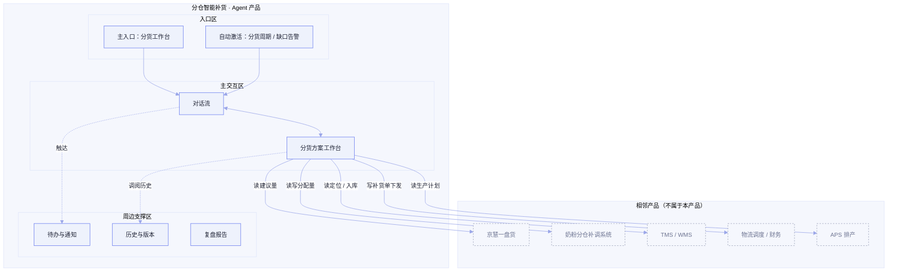

# X奶粉事业部 · Agent 产品方案：分仓智能补货

> **版本：** v1.0 | **更新日期：** 2026-08-16
>
> **对应业务阶段：** 设计方案（SDP-Product）· 阶段1 Agent产品方案设计 · 步骤1.1~1.6
>
> **方法论依据：** SDP-Product 阶段1方法（产品定位 → 形态架构 → 故事线 → 功能清单 → Agent行为 → 规则消费门禁）
>
> **输入依据：** 上游 SLP《01企业画像/02业务现状全景/03AI需求场景全景》、SRP《01场景定义画布》《02数据与知识资产盘点》、业务 Agent 场景卡「分仓智能补货」（A2）
>
> **⚠️ 上游状态：** 本方案为**概念级**（FDE 已确认跳过 SKP）。SKP「深度任务序列 + 5 类规则深挖」尚未产出，「SKP 5 类规则消费门禁」暂以 SRP「知识资产清单」为代理，SKP 完成后需复核。

## 1 总览

**这份方案做了什么：** 把 SRP 已挖透的「分仓智能补货」To-Be 旅程（5 阶段、12 任务）与知识/数据资产，翻译成一份原型作者可照单施工的产品方案——产品定位、形态架构图、4 条演示故事线、10 项功能与 UI 组件、Agent 行为设计、规则消费门禁。

**重点看什么：** 核心是「分货方案工作台」——它是 Agent 多约束分配优化的交付载体（Artifact），全场景唯一 P0；4 条故事线分别演示「缺口识别 / 方案编制（含 HITL）/ 异常备选（含错误态）/ 下发与复盘（含撤销）」四个业务价值高光。

**为什么关注：** 商机五大经营指标里「四个提高」（分货效率/分仓有货率/周转率/新鲜度）全由分货方案决定，本产品的价值主张就是「把老计划员的 Excel 推式分货，升级为 AI 多约束全局优化的推拉结合分货」。

**当前洞察（概念级方案的边界声明）：** 本方案能给出「产品长什么样、演示哪几段高光、Agent 体验如何」，但决策因子的具体矩阵、模版固定/可变部分、术语条目、提取字段清单等**深度业务内容尚未经 SKP 挖掘**，故故事线 mock 数据暂以 SRP 已识别的决策阈值（DOS 分级、备货率、破损率>1%、差异率>0.5% 等）与数据实体字段为据，SKP 完成后需回填精化。

**需要 FDE 做什么：** ① 审阅本方案是否与客户预期一致；② 确认视觉基底（阶段2 DESIGN.md 的 P0/P1/P2/P3 锚定）；③ 确认「京慧建议量 + 奶粉分仓补调系统」的实际产品边界（本方案默认它们是相邻系统、本产品只读/写分配量）。

## 2 产品定位

### 2.1 迭代范围

**首版 PoC / MVP**：从 0 到 1，验证「推拉结合 + 多约束优化」的分仓补货能否在分货效率与有货率/周转/新鲜度之间取得全局平衡（对应场景卡 PoC：1 个基地仓 + 2–3 个销售分仓、核心 SKU 试点）。

### 2.2 产品形态

**B2B 自用型**：客户 = X奶粉事业部，用户 = 事业部内部物流计划/调度/仓储岗，交付物不外流。

### 2.3 四件套

| 子项 | 内容 |
|---|---|
| 产品定位一句话 | 为X奶粉事业部的物流计划岗，在「基地仓 → 销售分仓」分货补货场景下，通过 AI 多约束全局优化，把分货效率、分仓有货率、库存周转率、商品新鲜度四个指标一起往上拉。 |
| 非目标 | ① 不做销售计划与需求预测（属 A1 销售计划精细化）；② 不做销售仓间横向调拨（属 A3 销售仓横向调拨）；③ 不做订单履约与配送（属价值流④）；④ 不做生产排程（属 APS）；⑤ 原型阶段不接真实后端与模型。 |
| 主要使用者 | 物流计划岗——在每轮分货周期，把「分仓销售计划 + 各仓库存/在途/待检/合格数据 + 促销计划」变成一份可直接下发的分货方案。 |
| Agent 人格 | 身份定位：一名懂分货计划的分货方案助理；语气基调：专业、克制、数字驱动（用备货率/DOS/库存天数说话）；能力边界：我能做缺口识别、优先级计算、分配量测算、补货单生成校验、执行跟踪、复盘调参建议，不能替你做最终拍板、不能脱离库存/在途/效期约束乱分货。 |

## 3 产品形态架构图

> 三大区齐全；相邻产品 5 个，均只标接触面（读/写），不画协议与字段。

## 4 原型演示故事线

> 共 4 条，1:1 对应阶段2 `moments/*.html`。SKP 未做，mock 数据暂以 SRP 决策阈值与数据实体字段为据（脱敏）。

### 故事线 1 · 全仓网缺口识别与分级告警

| 字段 | 内容 |
|---|---|
| 业务价值高光 | AI 一屏识别全国仓网谁缺货、谁积压，把老计划员要半天比对的多张 Excel 变成一张红黄蓝分级图 |
| 对应 SRP 阶段 | P1 货源评估与缺口识别 |
| 演示剧本 | 用户：「帮我看看全国仓网现在的货源情况。」→ Agent 思考（拉取 4 基地仓可分配库存+在途，匹配未来 14 天销售计划，按 DOS 分级）→ 调工具（读现货库存/在途库存/销售计划）→ 输出供需全景 + 缺口告警（红/黄/蓝），标注 DOS<7 红、7-14 黄、>60 蓝积压 |
| UI 组件 + 必备交互 | 供需全景看板 + 缺口告警清单 + 状态徽章；#1 流式 #2 工具调用 #7 出处引用 #8 状态徽章 |
| 业务内容来源 | SRP 数据实体·现货库存/在途库存/销售计划；SRP 知识资产·缺口分级规则（DOS 分级） |

### 故事线 2 · 多约束分货方案生成与人工确认（含 HITL）

| 字段 | 内容 |
|---|---|
| 业务价值高光 | 从京慧建议量到全局最优分配方案，多仓×多SKU×多约束一次算完，计划员只需确认 |
| 对应 SRP 阶段 | P2 分货方案编制 |
| 演示剧本 | 用户：「按这周销售计划帮我出分货方案。」→ 调工具（读京慧建议量/可发量/备货率）→ 思考（计算优先级/备货率/分配量，多约束求解）→ 输出多版分配方案 → **HITL 拦截**：「北京顺义仓分配量较京慧建议量上调 12%（因促销放量），请确认。」→ 用户：「确认，并把天津武清仓改到 800 罐。」→ Agent 更新方案并重新校验约束 |
| UI 组件 + 必备交互 | 分货方案工作台 + 方案对比 + HITL 拦截横幅 + 出处引用悬浮卡；#1 #2 #4 内联 #5 HITL #7 #8 |
| 业务内容来源 | SRP 数据实体·京慧建议量/可发量/分配量；SRP 知识资产·备货率分配规则、分配量调整经验 |

### 故事线 3 · 异常诊断与备选方案（含错误态）

| 字段 | 内容 |
|---|---|
| 业务价值高光 | 基地仓缺货时，AI 自动检索周边资源，给出 3 套备选（成本/时效/库存均衡维度） |
| 对应 SRP 阶段 | P2 分货方案编制（异常分支） |
| 演示剧本 | 用户：「华北基地仓可发量不足，怎么办？」→ 调工具（读仓网距离/物流预警/安全水位）→ 输出 3 套备选（华东大仓/华中大仓…，对比距离/时效/备货率/物流预警）→ **错误态降级**：「TMS 物流预警数据暂未接通，已按历史时效估算，建议人工复核后下发。」 |
| UI 组件 + 必备交互 | 备选方案对比表 + 错误态提示 + 出处引用；#2 #7 #9 错误态 |
| 业务内容来源 | SRP 数据实体·仓网距离/物流预警/安全水位；SRP 知识资产·积兆逻辑（[伪经验候选·待二轮验证]，故事线中显式标注待确认） |

### 故事线 4 · 补货单生成下发与执行复盘（含撤销）

| 字段 | 内容 |
|---|---|
| 业务价值高光 | 方案确认后一键生成标准补货单并下发，全程跟踪到入库，月末自动出复盘 |
| 对应 SRP 阶段 | P3 补货单生成与下发 + P4 执行跟踪与入库同步 + P5 效果复盘 |
| 演示剧本 | 用户：「方案确认，生成补货单并下发。」→ 调工具（校验收发仓/SKU/数量/时效）→ 生成补货单，校验通过已下发物流调度+财务 → **撤销 Toast**：「已下发，10 秒内可撤销。」→ 执行跟踪（在途定位、延误预警、入库差异 0.33% 正常损耗）→ 月度复盘（时效达成率 92%、缺货缓解率 88%，建议华北安全水位 14 天→12 天） |
| UI 组件 + 必备交互 | 补货单 + 撤销 Toast + 执行跟踪看板 + 复盘报告 + Artifact 空态；#2 #6 撤销 #8 #10 空态 |
| 业务内容来源 | SRP 数据实体·补货单/TMS/WMS/复盘指标；SRP 知识资产·补货单校验规则、复盘调参经验 |

## 5 业务功能与 UI 组件清单

| 功能名 | 一句话价值 | 绑定角色 | 渲染层 | 触发方式 | UI 组件名 + 组件内容 | 用户操作 | 关联故事线 | 上游来源 |
|---|---|---|---|---|---|---|---|---|
| 全仓网供需全景 | 一屏看清谁缺货谁积压 | 物流计划 | Artifact Pane | 用户点击召唤 | 供需全景看板（展示各仓可发量/在途/DOS/缺口等级，引数据实体·现货库存/在途库存/销售计划） | 只读 | 故事线1 | SRP 功能需求·缺口识别 |
| 缺口分级告警 | 缺货/积压自动分级提示 | 物流计划 | Artifact Pane | Agent 主动渲染 | 缺口告警清单（红/黄/蓝分级，DOS 阈值） | 只读/可钻取到仓×SKU | 故事线1 | SRP 功能需求·缺口识别 |
| 分货方案编制 | 多约束一次算出分配量 | 物流计划 | Artifact Pane | 用户点击召唤 | 分货方案工作台（分配量、分配后库存天数，引数据实体·京慧建议量/可发量/分配量） | 只读 | 故事线2 | SRP 功能需求·分配量优化 |
| 方案对比与微调 | 多版方案对比、人工可微调 | 物流计划 | Artifact Pane | 用户点击召唤 | 方案对比表 + 分配量可编辑 + 修改原因留痕 | 可编辑/可撤销 | 故事线2 | SRP 功能需求·分货方案编辑器 |
| 异常诊断与备选 | 缺货时给出备选方案 | 物流计划 | Artifact Pane | Agent 主动渲染 | 备选方案对比表（距离/时效/备货率/物流预警） | 只读/可触发下发 | 故事线3 | SRP 功能需求·异常诊断 |
| 补货单生成与校验 | 一键生成标准补货单 | 物流计划 | Artifact Pane | Agent 主动渲染 | 补货单（收发仓/SKU/数量/时效，校验结果） | 只读/可下发 | 故事线4 | SRP 功能需求·补货单生成校验 |
| 执行跟踪与在途监控 | 在途定位/延误/破损预警 | 仓储/物流 | Artifact Pane | Agent 主动渲染 | 执行跟踪看板（车辆定位/运输状态/延误预警） | 只读 | 故事线4 | SRP 功能需求·执行跟踪 |
| 复盘报告与调参建议 | 月末自动出复盘并建议调参 | 物流计划 | Artifact Pane | 用户点击召唤 | 复盘报告（时效达成率/缺货缓解率/周转率 + 调参建议） | 只读/可审批 | 故事线4 | SRP 功能需求·效果复盘 |
| 术语口径标注 | 鼠标悬停看懂字段口径 | 物流计划 | Conversation Pane | 自动激活 | 术语 hover 卡（待检/合格/可发量/DOS 定义） | 只读 | 故事线1/2 | SRP 知识资产·口径定义 |
| 出处引用 | 决策依据可追溯 | 物流计划 | Conversation Pane | Agent 主动渲染 | 出处引用悬浮卡（字段典型位置 + 决策因子确定性） | 只读 | 故事线1/2/3 | SRP 知识资产·关键字段识别 |

**必备交互 10 项（产品承诺）：** #1 流式输出 / #2 工具调用可视化 / #3 思考过程可折叠 / #4 内联组件 / #5 HITL 拦截 / #6 撤销回滚 / #7 出处引用 / #8 状态徽章 / #9 错误态 / #10 空态。

## 6 Agent 行为设计

### 6.1 Agent 是谁

- **开场话术草稿**：「我是分货方案助理，能帮你识别全仓网缺口、算各仓分配量、生成补货单并跟踪执行。分配方案我会给建议，最终下发由你确认。」
- **语气基调**：专业但不死板（用数字说话）；克制不卖弄（不夸「最优」，说「满足约束下的可行方案」）。
- **能力边界承诺**：我能——识别缺口、算优先级/备货率/分配量、生成校验补货单、跟踪在途/入库、出复盘；我不能——替你拍板最终分配量、脱离库存/在途/效期约束、跳过对外下发的确认。

### 6.2 Agent 让用户看到什么

| 事件类型 | 默认行为 | 来源 / 落到交互 |
|---|---|---|
| Agent 正在做什么（进度） | 实时可见 | #8 状态徽章（idle/thinking/tool_calling/awaiting_human/error） |
| 使用了哪些数据/知识 | 始终标注来源 | SRP 数据实体/知识资产 → #7 出处引用 |
| Agent 不确定/置信度低 | 显式标注 | SRP 决策规则 → #5 HITL + #7 |
| 触发工具/外部行为 | 告知 + 可查看 | #2 工具调用卡片 |
| 思考过程 | 默认折叠可展开 | #3 思考过程可折叠 |

### 6.3 Agent 何时停下等用户

| 触发类别 | 触发条件 | 默认拦截形态 | 理由/来源 |
|---|---|---|---|
| 对外发送/下发 | 补货单下发物流调度/财务 | 下发前必停（撤销窗口） | SLP 合规要求 |
| 修改关键业务数据 | 分配量偏离京慧建议量 | 写入前必停 | SRP 分配量调整经验 |
| Agent 自判不确定 | 建议量偏离预期/约束冲突无法求解 | 提示用户决策 | SRP 知识资产·分配量调整（待 SKP 精化） |
| 连续失败/重试超限 | TMS 数据未接通等 | 给降级建议 + 升级人工 | SRP 数据实体·TMS（评级C/需开发） |

### 6.4 用户怎么撤销与兜底

| 问题 | 内容 | 落到交互 |
|---|---|---|
| 撤销范围 | 当前动作（下发后 10 秒窗口）/ 本轮会话 | #6 撤销/回滚 |
| 追问深度 | 可追问「为什么这么分」到一层依据（决策因子 + 来源字段） | #7 出处引用 |
| 完全失败时怎么办 | 给 ≥2 明确选项：切人工 / 按历史经验估算 / 放弃并保留上下文 | #9 错误态 |

## 7 SKP 5 类规则消费门禁

> ⚠️ SKP 未做，本表以 SRP「知识资产清单」识别的知识类型为代理；SKP 产出「任务处理规则挖掘清单」后需逐条复核承接点。

| SKP 规则类型 | SRP 是否识别 | 产品方案承接点 | 承接的业务内容 | 备注 |
|---|---|---|---|---|
| 决策模型类 | ✅ | 第6章·Agent 何时停下等用户；第5章·出处引用悬浮卡 | 决策因子确定性、HITL 触发、兜底路径 | 必须承接 |
| 模版范例类 | ✅ | 第5章·分货方案工作台（Artifact 渲染，可变字段可编辑） | 分货方案/复盘报告模版固定部分 + 可变字段 | 必须承接 |
| 术语字典类 | ✅ | 第5章·术语 hover 卡 | 待检/合格/可发量/DOS 口径对照 | 必须承接 |
| 关键信息提取要点 | ✅ | 第5章·出处引用悬浮卡（字段典型位置 + 易错变体） | 分货数据关键字段识别要点 | 必须强化承接 |
| 关联关系类 | ✅ | 第5章·供需全景看板（仓—品—渠道关联展示） | 基地仓—销售仓—产品—SKU—渠道关联 | 必须承接 |

> 操作流程类由 SKP「深度任务序列」承载（本方案暂以 SRP 12 个 L4 任务为代理，未下拆 L5）；SKP 完成后在本表补回。

## 8 待确认问题清单

| # | 待确认问题 | 用途与影响 |
|---|---|---|
| 1 | SKP 何时补做（深度任务序列 + 5 类规则深挖） | 本方案的故事线 mock 数据与规则承接目前是概念级代理，SKP 完成后需回填精化 |
| 2 | 视觉基底 P0/P1/P2/P3 锚定（客户有无品牌手册/设计系统/参照产品） | 决定阶段2 DESIGN.md 与 tokens.css 的视觉来源 |
| 3 | 「京慧一盘货」与「奶粉分仓补调系统」与本产品的边界（本方案默认它们是相邻系统、只读/写分配量） | 决定产品形态架构图的接触面是否准确 |
| 4 | 「积兆逻辑」等伪经验候选经客户二轮访谈后能否坐实 | 影响故事线3 异常诊断的决策依据是否真实 |
