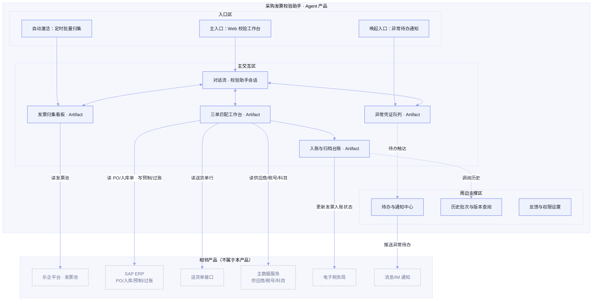

# 采购发票校验助手 · Agent 产品方案（X）

> **版本：** v1.0 | **更新日期：** 2026-09-09
>
> **对应业务阶段：** 设计方案 — SDP-Product — 阶段1 Agent 产品方案设计
>
> **方法论依据：** SDP-Product 阶段1方法（产品定位 / 产品形态架构图 / 原型演示故事线 / 业务功能与 UI 组件清单 / Agent 行为设计 / SKP 5 类规则消费门禁）
>
> **输入依据：** SLP「03_AI需求场景全景图_X」、SRP「采购发票校验助手_场景定义画布_v1.0」、SRP「采购发票校验助手_数据与知识资产盘点_v1.0」、SKP「01_任务流程挖掘清单_X」、SKP「02_任务处理规则挖掘清单_X」、场景简报「采购发票校验助手」（A1 · P0 速赢）

---

## 一、产品定位

### 1.1 本次迭代范围

**首版 PoC / MVP**：从 0 到 1 验证「乐企批量采集 + AI 三单匹配 + 异常分流人工复核」核心价值闭环，选定部分供应商与发票单据做试点（来源：场景简报「采购发票校验助手」· PoC 切片）。

### 1.2 产品形态判定

**B2B 自用型**：客户即用户组织（X财务部 / 采购部），Agent 交付物（匹配结果、预制凭证、台账、归档）不外流，仅在企业内网使用。入口形态以「独立 Web 工作台」为主入口，辅以「消息通知唤起」与「定时批量激活」两类自动入口。

### 1.3 产品定位四件套

| 子项 | 内容 |
| --- | --- |
| **产品定位一句话** | 为X的应付会计在采购发票校验场景下，通过多源归集 + AI 三单匹配 + 异常分流，把单票校验耗时压降、把三单匹配错误率降至目标值、让自动匹配通过率达到无需人工介入的水平（指标锚定：SRP「AI 场景功能需求列表」· 自动匹配通过率 Z% / 匹配错误率 Y% / 单票校验耗时下降 X%，X/Y/Z 待客户基线回填）。 |
| **非目标** | ① 不做来料收货与检验、不做付款执行与银行支付（上下游价值段 3.3 / 3.5，来源：SRP「场景边界声明」）；② 不在本平台落地金额比对规则（由 ERP 模拟校验接口承载，来源：SKP「金额比对规则」· 冲突仲裁）；③ 不做供应商主数据维护与对账争议正式仲裁；④ 不做发票真伪查验的税务机关直连（沿用乐企/电子税务局通道）；⑤ 本次不演示电子税务局直连后的全自动乐企状态更新（过渡期财务手工勾选入账标识）。 |
| **主要使用者** | **应付会计**——JTBD：把每天多渠道进来的采购发票，在最短时间内完成三单匹配并安全入账，不被异常票和补漏票拖住。协作角色（采购业务员、财务负责人）在「四、业务功能与 UI 组件清单」的「绑定角色」列体现。 |
| **Agent 人格** | 身份定位：一名懂财务、懂采购的「发票校验搭档」，坐在应付会计旁边先把票收齐、把能对的都对掉，把拿不准的整理好递过来。/ 语气基调：专业、克制、可核查——报数字必带来源，给结论必带依据，不抢财务负责人的审核权。/ 能力边界承诺：我能归集、识别、匹配、预制、归档并给出异常建议；我不做最终过账决策、不改主数据、不与供应商直接沟通。 |

---

## 二、产品形态架构图

**图注**：三大区齐全。主交互区按 SRP「To-Be 用户旅程」五个阶段（P1 发票多源采集归集 → P2 用途确认与识别校验 → P3 三单匹配 → P4 异常凭证确认 → P5 自动入账与归档）布局四类工作台；相邻产品只标接触面（读 / 写 / 推送），不画接口与字段。

---

## 三、原型演示故事线

> 共 4 条故事线；故事线 2 中穿插 1 处 HITL 负面演示（低置信识别转人工 + 匹配差异超容忍必拉人），满足「至少 1 处穿插负面演示」约束。

### 故事线 1：多渠道发票一键归集 → 归集看板零漏票

| 字段 | 内容 |
| --- | --- |
| **故事线名称** | 多渠道发票一键归集 → 归集看板零漏票 |
| **业务价值高光（一句话）** | 应付会计早上一键触发，乐企同步、供应商上传、采购补录三通道发票全部入池并自动查重查漏，系统孤岛在界面上消失（锚定：SRP · 采集归集覆盖率 100%）。 |
| **对应 SRP 阶段** | P1 发票多源采集归集 |
| **演示剧本** | 用户（应付会计）打开工作台点「开始今日归集」→ Agent 流式回报：「正在同步乐企发票池…已拉取 38 张」「正在归集供应商上传区…新增 6 张」「检测到采购补录 2 张纸质票」→ Agent 调用归集完整性校验：「共 46 张，无重复；发现 1 张发票号与昨日批次重复，已标记」→ 归集看板刷新，按渠道分栏展示，重复票带黄色标记，用户点开标记看比对详情。 |
| **要展示的 UI 组件 + 必备交互** | 发票归集看板（渠道分栏 + 重复/漏票标记）+ 对话流进度回报；演示交互 #1 流式 + #2 工具调用可视化 + #8 状态徽章。 |
| **SKP / SRP 业务内容来源** | SKP「深度任务序列」· 同步乐企发票数据 / 归集供应商上传发票 / 归集采购补录发票 / 核验发票归集完整性；SRP「数据实体清单」· 采购发票（乐企平台 IF001、供应商数电文件）。 |

### 故事线 2：票面识别 + 三单匹配一气呵成，异常票自动分流（含 HITL 穿插）

| 字段 | 内容 |
| --- | --- |
| **故事线名称** | 票面识别 + 三单匹配一气呵成，异常票自动分流 |
| **业务价值高光（一句话）** | 46 张票批量跑完「识别 → 真伪/抬头校验 → 行级三单匹配」，41 张直接判通过、5 张按差异类型自动分流——数量超差、金额超尾差、模糊票各归各位，应付会计只看拿不准的（锚定：SRP · 识别准确率 >95%、自动匹配通过率 Z%、匹配错误率 Y%；本线穿插 2 处 HITL：低置信识别转人工 + 超容忍差异必拉人）。 |
| **对应 SRP 阶段** | P2 用途确认与识别校验 → P3 三单匹配（→ P4 异常凭证确认入口） |
| **演示剧本** | 用户在看板勾选本批 46 张点「开始校验」→ Agent 流式推进并展示工具调用：「正在识别票面关键字段…」「正在校验供应商/税号…」「正在获取 PO/入库单/送货单…」「正在行级数量扣减…」→ ⚠️ 第 1 处 HITL：「发票 INV-2026-0312 票面金额字段模糊，识别置信度 82%（低于 95% 阈值），已转识别复核」，用户点开看到标红的金额字段与票面截图对照，手工补录后继续 → Agent 继续匹配：「41 张三单匹配通过」「4 张差异已入异常队列」→ ⚠️ 第 2 处 HITL：「发票 INV-2026-0327 行 2 数量超差：发票 500 件 > 入库 480 件，超容忍（数量无容忍区间），按规则必拉人」，用户点开差异高亮面板，看到四数量报表（PO 500 / 送货 480 / 入库 480 / 发票 500）并列对照 → 用户选择「确认异常并转采购」。 |
| **要展示的 UI 组件 + 必备交互** | 三单匹配工作台（行级匹配工作集 + 差异高亮 + 四数量对照报表）+ 识别复核卡片 + HITL 拦截面板；演示交互 #1 流式 + #2 工具调用可视化 + #3 思考折叠 + #5 HITL ×2 + #7 出处引用（票面字段位置对照）。 |
| **SKP / SRP 业务内容来源** | SKP「关键信息提取要点」· 发票票面关键字段提取要点（发票号/金额/税额/供应商税号/开票日期，置信度阈值 95%）；SKP「决策模型类」· 三单匹配口径与数量扣减规则（发票行为主线、行级扣减、数量无容忍区间）· 差异容忍与异常判定经验（数量超差必拉人、金额尾差 ≤1 元自动容忍——领域专家假设值，待二轮访谈回填）；SRP「数据实体清单」· 采购订单/入库单/送货单。 |

### 故事线 3：异常凭证队列 → 处理建议 + 沟通升级路径一站看清

| 字段 | 内容 |
| --- | --- |
| **故事线名称** | 异常凭证队列 → 处理建议 + 沟通升级路径一站看清 |
| **业务价值高光（一句话）** | 5 张异常票进入统一队列，每张都带「异常类型 + 处理建议 + 沟通对象 + 升级路径」，采购业务员照着建议直接跟供应商沟通补单/换票，经验不再只存在资深会计脑子里（锚定：SRP · 异常处理周期缩短；承接隐性经验「异常沟通与升级路径」知识化）。 |
| **对应 SRP 阶段** | P4 异常凭证确认 |
| **演示剧本** | 用户（采购业务员）从异常待办通知进入异常队列 → 看到 5 张异常票按类型分组：数量超差 ×1、金额超尾差 ×1、抬头/税号不符 ×1、单价不符 ×1、跨期发票 ×1 → 点开「INV-2026-0327 数量超差」：Agent 给出建议「与供应商 XX 电子确认少送 20 件 → 走补单流程；沟通对象：采购员张三；若 2 个工作日未响应升级财务负责人」→ 用户采纳建议，点「已联系供应商」，在队列里登记沟通结果「供应商确认补单，预计 9/12 重开送货单」→ Agent 自动挂起该票并设提醒：「补单到货后自动重跑三单匹配」→ 另一张「抬头/税号不符」Agent 建议「换票」，用户确认后系统生成换票说明备注，发票状态置为「换票中」。 |
| **要展示的 UI 组件 + 必备交互** | 异常凭证队列（类型分组 + 处理建议卡 + 沟通登记）+ 处理建议内联卡；演示交互 #4 内联组件 + #5 HITL + #6 撤销/回滚（撤销沟通登记）+ #8 状态徽章。 |
| **SKP / SRP 业务内容来源** | SKP「深度任务序列」· 判定异常类型并生成处理建议 / 生成沟通对象与升级路径建议 / 人工确认异常凭证 / 与供应商沟通处理异常 / 返回三单匹配重跑；SKP「任务流程挖掘」· 操作流程类经验承接对照表 · 异常沟通与升级路径；SKP「差异容忍与异常判定经验」· 异常类型清单（补单/换票/冲红/退票/抬头税号不符/单价不符/数量超差/金额超尾差/跨期发票，领域专家假设值）。 |

### 故事线 4：通过票批量预制过账 → 台账归档状态全链路更新

| 字段 | 内容 |
| --- | --- |
| **故事线名称** | 通过票批量预制过账 → 台账归档状态全链路更新 |
| **业务价值高光（一句话）** | 41 张匹配通过的票一键批量预制，前置条件全绿才放行；过账确认后凭证号、乐企状态、台账、归档索引一次到位，财务负责人在同屏完成过账审核留痕（锚定：SRP · 入账自动化覆盖率 100%、单票校验耗时下降 X%）。 |
| **对应 SRP 阶段** | P5 自动入账与归档 |
| **演示剧本** | 用户回到匹配工作台，「匹配通过」页签下 41 张全选 → 点「批量预制」→ Agent 逐票检查前置规则：「发票已识别 ✓ 匹配关系已建立 ✓ 供应商/PO/入库完整 ✓ 预制权限 ✓」→ 39 张预制成功拿到 ERP 预制凭证号；2 张因「成本中心缺失」预制失败进入待补队列 → 用户（财务负责人账号切换演示）在「待过账」页签看到 39 张，逐票抽查 2 张后全选过账 → Agent 调用 ERP 过账，凭证号逐票返回 → 过账确认点：「确认将 39 张凭证状态同步乐企并更新台账？」用户确认 → 台账页签实时刷新：凭证号、入账状态「已更新」、归档索引按发票编号生成，归档文件可预览。 |
| **要展示的 UI 组件 + 必备交互** | 入账与归档台账（前置条件检查列 + 凭证号回填 + 乐企状态 + 归档索引）+ 过账确认对话框；演示交互 #2 工具调用可视化 + #5 HITL（过账前必停确认）+ #9 错误态（2 张预制失败 + 降级建议）+ #10 空态（台账初始为空）。 |
| **SKP / SRP 业务内容来源** | SKP「状态机与预制/过账/乐企前置规则」（发票识别状态/匹配状态/预制状态/过账状态/乐企状态；预制、过账、乐企更新三类硬门禁）；SKP「术语字典类」· 供应商/税号/科目映射字典（预制凭证的税码/成本中心/付款条件来源）；SRP「数据实体清单」· 预制发票/会计凭证/入账状态/归档文件。 |

---

## 四、业务功能与 UI 组件清单

### 4.1 统一清单（8 条）

| 功能名 | 一句话价值 | 绑定角色 | 渲染层 | 触发方式 | UI 组件名 + 组件内容 | 用户能做的操作 | 关联故事线 | 上游来源 |
| --- | --- | --- | --- | --- | --- | --- | --- | --- |
| 发票多源归集 | 一键把三个渠道的发票收齐查重，不漏不重 | 应付会计 | Artifact Pane | 用户点击召唤 / 定时自动激活 | **发票归集看板**：按渠道分栏展示本批发票（发票号、供应商、金额、开票日期、渠道来源），重复/漏票黄色标记——字段引 SRP「数据实体清单」· 采购发票 | 可触发新动作（开始归集）、可编辑（补录登记）、只读 | 故事线 1 | SRP「用户功能需求」· 发票采集归集工作台；SKP「深度任务」· 同步乐企发票数据/归集供应商上传发票/归集采购补录发票/核验发票归集完整性 |
| 识别结果复核 | 模糊票和低置信字段标红，我补一下就行 | 应付会计 / 采购业务员（仅自有权限 PO） | Conversation Pane（内联） | Agent 主动渲染 | **识别复核卡片**：票面截图与结构化字段左右对照，低置信字段标红（发票号/金额/税额/供应商税号/开票日期）——引 SKP「关键信息提取要点」· 发票票面关键字段提取要点 | 可编辑（补录字段）、可触发新动作（确认继续） | 故事线 2 | SRP「用户功能需求」· 识别结果补充界面；SKP「深度任务」· 识别发票票面关键字段与行项目/确认发票用途 |
| 三单匹配审阅 | 匹配结果行级摊开，差异一眼定位 | 应付会计 | Artifact Pane | Agent 主动渲染 / 用户点击召唤 | **三单匹配工作台**：行级匹配工作集（发票行 ↔ PO 行 ↔ 入库行 ↔ 送货单行），差异类型/差异金额/差异数量高亮，四数量对照报表（PO 数/送货数/入库数/发票数）并列——引 SKP「决策模型类」· 三单匹配口径与数量扣减规则 · 匹配关系表 | 只读、可触发新动作（转异常确认/批量预制） | 故事线 2、4 | SRP「用户功能需求」· 三单匹配结果与差异高亮审阅；SKP「深度任务」· 以发票行为主线汇入三单行信息/行级核对数量并扣减/行级核对金额与差异/判定行级匹配结果并记录匹配关系 |
| 异常凭证队列 | 异常按类型分组，每张都带处理建议 | 采购业务员 / 应付会计 | Artifact Pane | Agent 主动渲染 / 通知唤起 | **异常凭证队列**：按异常类型分组（补单/换票/冲红/抬头税号不符/单价不符/数量超差/金额超尾差/跨期发票），每票展示异常类型、差异明细、处理建议、沟通对象、升级路径、处理留痕——引 SKP「决策模型类」· 差异容忍与异常判定经验 + SKP「操作流程类」· 异常沟通与升级路径 | 可编辑（登记沟通结果）、可触发新动作（采纳建议/转供应商沟通/重跑匹配） | 故事线 3 | SRP「用户功能需求」· 异常凭证确认工作台；SKP「深度任务」· 判定异常类型并生成处理建议/生成沟通对象与升级路径建议/人工确认异常凭证 |
| 术语与字典标注 | 供应商、税号、科目悬停即见标准口径 | 应付会计 | Conversation Pane（内联） | 用户悬停召唤 | **术语 hover 卡**：供应商标准名/供应商代码/统一社会信用代码、SAP 会计科目/成本中心/付款条件对照——引 SKP「术语字典类」· 供应商/税号/科目映射字典 | 只读 | 故事线 2、3、4 | SKP「术语字典类」· 供应商/税号/科目映射字典（被「校验发票真伪与购方抬头」「预制发票凭证」「过账生成会计凭证」引用） |
| 出处引用悬浮卡 | 每个识别字段和判定结论都能追到来源 | 应付会计 | Conversation Pane（内联） | 用户点击召唤 | **出处引用悬浮卡**：票面字段典型位置（发票号右上角/金额右下角大小写以大写为准）、决策因子确定性标注（高/中）、规则依据名称——引 SKP「关键信息提取要点」· 字段典型位置 + SKP「决策模型类」· 决策因子矩阵 | 只读 | 故事线 2、3 | SKP「关键信息提取要点」· 发票票面关键字段提取要点；SKP「决策模型类」· 金额比对规则/差异容忍与异常判定经验 · 决策因子矩阵 |
| 批量预制与过账确认 | 前置条件全绿才放行，过账前必停确认 | 应付会计（预制）/ 财务负责人（过账审核） | Artifact Pane | 用户点击召唤 | **入账与归档台账**：前置条件检查列（已识别/匹配关系/信息完整/权限）、预制状态、ERP 凭证号、过账状态、乐企状态、台账记录、归档索引（按发票编号）——引 SKP「状态机与预制/过账/乐企前置规则」 | 可触发新动作（批量预制/批量过账/状态同步确认）、只读 | 故事线 4 | SRP「Agent 功能需求」· 自动记账与状态/台账更新、归档；SKP「深度任务」· 预制发票凭证/过账生成会计凭证/更新电子税务局发票状态/更新发票台账/归档发票文件 |
| 待办与进度通知 | 异常、待复核、待过账主动推给我 | 应付会计 / 采购业务员 / 财务负责人 | Shell | Agent 主动触达 | **待办与通知中心**：异常待办、识别复核待办、预制失败待补、过账待审四类，带任务链接——引 SRP「数据实体清单」· 消息通知 | 可触发新动作（跳转处理） | 故事线 2、3、4 | SRP「To-Be 用户旅程」· 节点确认设计/进度观测设计；SRP「数据实体清单」· 消息通知 |

### 4.2 必备交互 10 项（产品承诺 · 阶段 2 原型必演示）

| # | 必备交互 | 本场景落点 |
| --- | --- | --- |
| 1 | 流式输出 | 故事线 1/2 归集与校验进度逐条回报 |
| 2 | 工具调用可视化 | 故事线 2「正在识别票面 / 正在获取 PO / 正在行级扣减」状态卡片 |
| 3 | 思考过程可折叠 | 故事线 2 匹配判定推理默认折叠、可展开 |
| 4 | 内联组件 | 故事线 3 处理建议卡、术语 hover 卡嵌入对话流 |
| 5 | HITL 拦截 | 故事线 2 低置信识别 + 数量超差必拉人；故事线 4 过账前确认 |
| 6 | 撤销 / 回滚 | 故事线 3 撤销沟通登记（窗口期 Toast） |
| 7 | 出处引用 | 故事线 2 票面字段位置对照 + 决策因子确定性悬浮卡 |
| 8 | 状态徽章 | idle / thinking / calling_tool / awaiting_human 全程可见 |
| 9 | 错误态 | 故事线 4 两张票预制失败 + 降级建议（补成本中心后重试） |
| 10 | 空态 | 故事线 4 台账初始为空态，归集完成后填充 |

---

## 五、Agent 行为设计

### 5.1 Agent 是谁

| 字段 | 内容 |
| --- | --- |
| **身份定位** | 发票校验搭档。开场话术草稿（体验意图）：「我是你的发票校验搭档。每天早上我可以先把乐企、供应商上传和补录的发票收齐查重，逐张识别、验真、跑三单匹配；对得上的直接给你过目，拿不准的我整理好差异和建议再请你定。」 |
| **语气基调** | 专业但不死板：「41 张通过，5 张需要你定」而不是「任务执行完毕」；克制不卖弄：报数字必带批次与来源，不堆术语；可核查：每个结论旁边都有「查看依据」。 |
| **能力边界承诺** | 我能：① 归集多渠道发票并查重查漏；② 识别票面、验真、校抬头；③ 行级三单匹配并给出差异判定与处理建议；④ 批量预制、更新台账与归档。我不能：① 替你做过账终审（财务负责人确认后才过账）；② 修改供应商/科目主数据；③ 替你与供应商沟通（我只给建议和路径）；④ 容忍区间外的差异我不会自动放行。 |

### 5.2 Agent 让用户看到什么

| 事件类型 | 默认行为 | 例外 / 来源说明 |
| --- | --- | --- |
| Agent 正在做什么（进度） | 实时可见：归集、识别、匹配、预制逐票/逐批进度流式展示 | 落到必备交互 #1/#8；来源：SRP「To-Be 用户旅程」· 进度观测设计（看板 + 进度条） |
| Agent 使用了哪些数据 / 知识 | 始终标注来源：匹配判定标注规则名（三单匹配口径/数量扣减规则/差异容忍经验），字段识别标注票面位置，预制标注字典来源 | 来源：SKP「任务处理规则挖掘清单」· 三单匹配口径与数量扣减规则 / 差异容忍与异常判定经验 / 发票票面关键字段提取要点 / 供应商/税号/科目映射字典；落到必备交互 #7 |
| Agent 不确定 / 置信度低 | 显式标注：识别置信度 <95% 标红转人工；决策因子确定性「中」的（数量差异/金额尾差/异常类型）在判定卡上标注 | 来源：SKP「决策模型类」· 决策因子矩阵（确定性列）+「关键信息提取要点」· 验收准则 ≥95%；落到必备交互 #5/#7 |
| Agent 触发工具 / 外部行为 | 告知 + 可查看：调乐企同步、ERP 接口、OCR 时展示状态卡片，可点开看入出参摘要 | 落到必备交互 #2；来源：SRP「数据实体清单」· 接口映射（IF001–IF006、IF013） |
| Agent 的思考过程 | 默认折叠可展开：匹配判定推理折叠为「查看判定依据」 | 落到必备交互 #3（⚠️ 推荐性设计：面向财务用户避免信息过载） |

### 5.3 Agent 何时停下等用户

| 触发类别 | 触发条件 | 默认拦截形态 | 理由 / 来源 |
| --- | --- | --- | --- |
| 识别置信度不足 | 票面关键字段识别置信度 <95%，或字段缺失/模糊/新版式 | 识别复核卡片标红，补录确认后继续 | SKP「关键信息提取要点」· 异常情况处理（字段缺失、模糊票、新版式 → 识别复核点转人工） |
| 匹配差异超容忍 | 数量超差（发票数量 > 入库/送货数量，无容忍区间）或金额尾差 > 阈值（≤1 元且 ≤0.5% 自动容忍——领域专家假设值，待二轮访谈回填） | 差异高亮面板 + 四数量对照，必拉人确认 | SKP「决策模型类」· 差异容忍与异常判定经验 · 逻辑分支表（必拉人异常）· HITL 触发：匹配差异确认点 |
| 预制/过账/乐企前置未满足 | 预制前置（已识别/匹配关系/信息完整/权限）任一项不满足；过账前必须财务负责人确认 | 前置条件检查列标红 + 过账确认对话框 | SKP「状态机与预制/过账/乐企前置规则」· 硬门禁（客户开发方案确认） |
| 连续失败 / 接口异常 | ERP/乐企接口返回失败且重试无果 | 给降级建议（稍后重试 / 转人工线下处理）+ 失败票入待补队列 | SKP「决策模型类」· 兜底路径（转人工确认）；SRP「AI 场景功能需求」· 故障转移 |
| 跨权限操作 | 采购业务员试图查看/操作非自有权限 PO 行项 | 不展示该部分数据，提示权限边界 | SRP「用户功能需求」· 识别结果补充界面（采购员仅可见/操作自己权限 PO）；SKP「冲突仲裁假设」· 跨 PO 权限 |

### 5.4 用户怎么撤销与兜底

| 问题 | 内容 | 来源说明 |
| --- | --- | --- |
| **撤销范围** | 可撤销当前动作：补录字段、沟通登记、匹配结论人工修正，窗口期内一键 Undo；预制后未过账可申请冲销重来；已过账凭证不可在产品内撤销，走 ERP 冲销流程 | 客户内部撤销实践（预制+过账两阶段模式，来源：SRP「场景边界声明」· 沿用预制+过账）；落到必备交互 #6 |
| **追问深度** | 三层：① 一层依据（这条判定用了哪条规则）；② 完整推理链（数量扣减过程、差异判定分支）；③ 源数据（PO/入库/送货/发票原始行与票面影像） | 来源：SKP「任务处理规则挖掘清单」· 三单匹配口径与数量扣减规则 / 差异容忍与异常判定经验 + SKP「深度任务序列」· 判定行级匹配结果并记录匹配关系（匹配关系表不覆盖原始单据）；落到必备交互 #7 |
| **完全失败时怎么办** | 默认给 ≥2 个明确选项：① 「转人工处理」——该票转入人工队列并保留全部已识别上下文；② 「稍后重试」——挂起并设提醒；接口级失败时另给「导出待处理清单」线下继续 | 来源：SKP「决策模型类」· 兜底路径（默认路径指向人工确认的安全行为）；SRP「Agent 功能需求」· 故障转移；落到必备交互 #9 |

---

## 六、SKP 5 类规则消费门禁

| SKP 规则类型 | SRP 是否识别 | 产品方案承接点（具体到组件名 / 设计章节） | 承接的业务内容 | 备注 |
| --- | --- | --- | --- | --- |
| **决策模型类** | ✅（3 条：三单匹配口径与数量扣减规则 / 金额比对规则 / 差异容忍与异常判定经验） | 第四章 · 三单匹配工作台（行级差异高亮 + 四数量对照报表）；第四章 · 出处引用悬浮卡（决策因子确定性）；第五章 · 让用户看到什么 · 不确定显式标注；第五章 · 何时停下等用户 · 匹配差异超容忍必拉人 | 发票行为主线行级扣减、6 条匹配规则、数量无容忍区间、金额尾差容忍假设值、决策因子确定性分级 | 已承接；金额比对规则本体由 ERP 模拟校验接口承载，产品侧只感知通过/差异结果（SKP 冲突仲裁已确认） |
| **模版范例类** | ❌ 本场景无此类（来源：SRP「知识资产清单」未识别；SKP「任务处理规则挖掘清单」§3 显式标注） | — | — | 无需承接 |
| **术语字典类** | ✅（1 条：供应商/税号/科目映射字典） | 第四章 · 术语 hover 卡（供应商标准名/代码/统一社会信用代码、SAP 科目/成本中心/付款条件）；第五章 · 让用户看到什么 · 使用了哪些数据/知识（预制凭证标注字典来源） | 别名对照 + 上下文标注；被「校验发票真伪与购方抬头」「预制发票凭证」「过账生成会计凭证」引用 | 已承接；实例条目待 SAP 主数据取回回填 |
| **关键信息提取要点** | ✅（1 条：发票票面关键字段提取要点） | 第四章 · 识别复核卡片（票面截图与字段对照、低置信标红）；第四章 · 出处引用悬浮卡（字段典型位置：发票号右上角、金额右下角大小写以大写为准）；第五章 · 何时停下等用户 · 识别置信度 <95% 转人工；第五章 · 用户怎么撤销与兜底 · 追问深度（源数据层） | 5 个目标字段、置信度阈值 95%、模糊票/新版式转人工、字段典型位置与易错变体提示 | 已强化承接 |
| **关联关系类** | ❌ 本场景无此类（来源：SRP「知识资产清单」未识别；SKP「任务处理规则挖掘清单」§6 显式标注） | — | — | 无需承接 |

**操作流程类说明**：「异常沟通与升级路径」已由 SKP 阶段 1「深度任务序列」承载，在第四章「异常凭证队列」「待办与进度通知」的「上游来源」列通过深度任务业务名引用（生成沟通对象与升级路径建议 → 人工确认异常凭证 → 与供应商沟通处理异常 → 返回三单匹配重跑）。

**门禁结论**：SRP 识别的 3 类规则（决策模型类 / 术语字典类 / 关键信息提取要点）均有具体承接点；未识别的 2 类（模版范例类 / 关联关系类）已显式说明。**门禁通过。**

---

## 七、待确认问题清单

| # | 问题 | 用途与影响 |
| --- | --- | --- |
| 1 | 差异容忍阈值（金额尾差 ≤1 元且 ≤0.5%）与数量无容忍区间为领域专家假设值 | 影响故事线 2/3 演示剧本与「何时停下等用户」触发条件的最终口径；客户二轮访谈回填后需同步修订本文档 v1.1 |
| 2 | 单票校验耗时、三单匹配错误率、月度量级三项基线（X/Y/Z） | 影响产品定位一句话与故事线价值高光的量化承诺；不确认则 PoC 验收无法标定 |
| 3 | 异常类型清单（补单/换票/冲红/退票/抬头税号不符/单价不符/数量超差/金额超尾差/跨期发票）为假设值 | 影响故事线 3 异常队列分组与处理建议内容；待业务专家访谈回填 |
| 4 | 供应商/税号/科目映射字典实例条目 | 影响术语 hover 卡与预制凭证字段的真实感；待 SAP 主数据取回 |
| 5 | 发票票面样本（脱敏）与版式变体 | 影响识别复核卡片与出处引用悬浮卡的 mock 数据真实度；阶段 2 原型施工前建议取回 |
