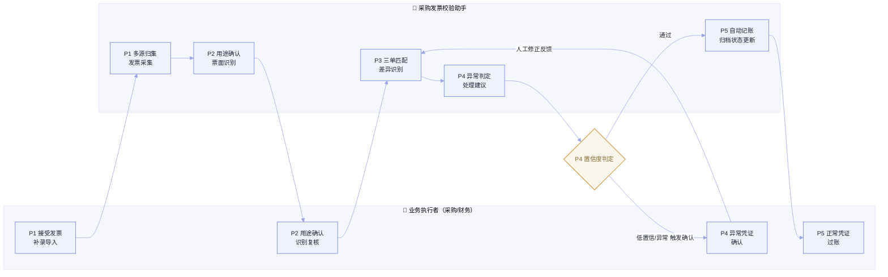

# 采购发票校验助手 · 场景定义画布（草稿）

> **版本：** v1.0 | **更新日期：** 2026-09-09
>
> **对应业务阶段：** 理需求 — SRP — 阶段1 场景定义画布生成
>
> **方法论依据：** SRP 阶段1方法（场景基座定义 / 现状流程全景 As-Is / 现状痛点汇总 / To-Be 用户旅程 / AI 场景功能需求）
>
> **输入依据：** 03_AI需求场景全景图_X.md、场景简报「采购发票校验助手」（A1）、采购发票校验业务流程图（客户提供，已解析）

---

## 1 总览

本画布为「采购发票校验助手」场景建立可交接的需求定义：以「场景基座定义」锁定身份与边界，以「现状流程全景（As-Is）」还原发票从采集到入账的现状作业，以「现状痛点汇总」显性化三大痛点，再以「To-Be 用户旅程」与「AI 场景功能需求」勾勒 AI 介入后的目标分工与能力要求。

**主线判断**：价值集中在三处——① 发票多渠道采集归集（消除系统孤岛）；② 三单匹配自动化（压缩高耗时、降低高频错误）；③ 异常识别经验沉淀（缓解高经验依赖）。对应 AI 机会是「集成归集 + 规则匹配 + 经验知识化」。作业骨架与「销售收入确认助手」高度同构，是可沉淀通用能力的首选落点。

**当前洞察**：客户流程图与研讨记录已获取，关键规则明确——三单以「发票为索引、发票数量扣减入库/送货数量」、不校验送货单与 ERP 入库单一致性、金额比对走 ERP 模拟校验接口、沿用「预制+过账」、识别结果补充由采购员按 PO 权限操作。规则边界清晰，是 P0 速赢的有利条件；但单票校验耗时、三单匹配错误率、月度量级等基线数据仍未获取，正文相关数值均标注「待回填」。

**FDE 下一步**：① 回填单票校验耗时、三单匹配错误率、月度量级三项基线；② 确认异常凭证确认的判定边界；③ 进入阶段 2 完成数据与知识资产需求盘点。

---

## 2 场景基座定义

### 2.1 场景身份卡

| 字段 | 内容 |
|---|---|
| 场景名称（业务 Agent 名） | 采购发票校验助手 |
| 所属应用 / 价值段 | 采购到付款财务自动化 · 价值流③ 采购到付款 · 聚焦范围①「来料收货与检验 → 发票校验与应付 → 付款」中的「发票校验与应付」（价值段3.4） |
| 在场景关系全景图中的位置 | ① 所属应用：采购到付款财务自动化；② 业务 Agent：采购发票校验助手（A1）；③ 标签：—；④ 落地阶段：🟢 速赢 |

> 业务 Agent 是客户汇报用的业务概念，不是工程实现单位；实现方式由下游 SDP 决定，本步骤不重新拆分 Agent。

### 2.2 场景边界声明

| 字段 | 内容 |
|---|---|
| 场景边界（包含） | 发票多渠道采集归集（电子税务局拉取、乐企平台同步、供应商数电发票/平台上传）；票面识别与真伪/抬头校验；三单匹配（发票—采购订单—入库单/送货单，以发票为索引、发票数量扣减入库/送货数量）与差异识别；异常识别与异常凭证确认（人工复核）；发票校验记账（沿用预制+过账）；发票状态更新、台账更新、单据归档 |
| 场景边界（不包含） | 来料收货与检验、入库单/送货单生成（属上游「来料收货与检验」价值段3.3）；付款执行与银行支付（属下游「付款」价值段3.5）；金额比对规则落地（发票金额≤合同金额等由 ERP 模拟校验接口检查，不落本平台）；供应商主数据维护与对账争议的正式仲裁 |
| 业务触发条件 | 角色：应付会计（或采购代收）；输入：供应商发票（电子税务局/乐企/供应商平台/数电文件等多渠道）；动作：采集发票并启动校验 |
| 业务终止条件 | 状态：三单匹配通过或异常凭证已确认；产物：发票入账（ERP）+ 发票状态更新（电子税务局）+ 台账更新 + 单据归档；同步目标：进入应付账款（AP），触发下游付款流程 |

---

## 3 现状流程全景（As-Is）

### 3.1 现状价值流泳道图

痛点类型🔴 高耗时　🟡 高经验依赖　🟠 高频错误　🔵 系统孤岛

知识类型<b style="color:#6b46c9">隐性</b>＝口传经验　<b style="color:#2f8a55">显性</b>＝有文档/法规

流程走向<b style="color:#6b7eef">↪ 角色交接</b>＝任务跨岗位流转　<b style="color:#c0506a">⟲ 返工回环</b>＝打回重做

信息置信度⚠ 部分印证＝流程图/访谈转述、未见 Walkthrough 一手实物（耗时条待基线回填后补齐）

① 单据采集与识别<small>发票 · 入库单 · PO</small>

② 三单匹配<small>获取PO/入库/发票 · 核对</small>

③ 异常处理<small>异常确认 · 返工</small>

④ 入账与归档<small>记账 · 台账 · 状态更新</small>

客户·外部

📨 供应商提交发票 (数电/平台/纸质)

🔎 电子税务局 拉取/验真

应付会计 执行层

1发票拉取与读取⚠

⏱ 待回填

🔵显

电子税务局发票池

2入库单/送货单读取识别⚠

⏱ 待回填

🔴🟠显

ERP公盘

3采购订单读取⚠

⏱ 待回填

🔴显

ERP(PO)

4三单信息汇入与匹配⚠

⏱ 待回填

🔴显

发票PO入库单

5数量核对（发票扣减入库/送货）⚠

⏱ 待回填

🔴🟠显

ERP

6金额/差异核对（ERP接口）⚠

⏱ 待回填

🟡隐

ERP

7匹配结果判定⚠

⏱ 待回填

🟡隐

—

8异常确认与返工⚠

⟲ 返回三单匹配

⏱ 待回填

🔴🟡隐

邮件ERP

9发票校验记账⚠

↪ 应付会计→财务负责人

⏱ 待回填

🔴🟠显

ERP

10台账更新·单据归档·状态更新⚠

⏱ 待回填

🔴显

台账电子税务局

财务负责人 审核层

9b过账审核⚠

⏱ 待回填

🔴隐

ERP

系统· 自动化

电子税务局 · 发票池(公盘) ERP(入库单/PO)

ERP(三单匹配)

邮件 · ERP

ERP(记账) · 台账 · 电子税务局

泳道归并：客户·外部 / 应付会计(执行层) / 财务负责人(审核层) / 系统·自动化。主线 ① → ② → ③(异常返工) → ④。9b 为「发票校验记账」对应的过账审核，由财务负责人执行。

### 3.2 任务主表

| 序号 | 业务流程(L3) | 任务(L4) | 任务说明（补全） | 执行者 | 系统数据 | 知识资产 | 耗时 | 痛点标识 | 实例校准状态 |
|---|---|---|---|---|---|---|---|---|---|
| 1 | 单据采集与识别 | 发票拉取与读取 | 从电子税务局拉取发票到发票池（公盘），再读取发票影像 | 应付会计 | 发票影像（电子税务局、发票池） | 采集渠道清单（显性） | 待回填 | 🔵 | ⚠ |
| 2 | 单据采集与识别 | 入库单/送货单读取识别 | 从 ERP/公盘读取入库单、送货单并识别关键字段 | 应付会计 | 入库单/送货单（ERP、公盘） | 单据识别要点（显性） | 待回填 | 🔴🟠 | ⚠ |
| 3 | 单据采集与识别 | 采购订单读取 | 从 ERP 读取采购订单（PO）信息 | 应付会计 | PO（ERP） | PO 读取要点（显性） | 待回填 | 🔴 | ⚠ |
| 4 | 三单匹配 | 三单信息汇入与匹配 | 获取 PO、入库、发票三方信息，以发票为索引汇入匹配 | 应付会计 | 发票/PO/入库单 | 三单匹配口径（显性） | 待回填 | 🔴 | ⚠ |
| 5 | 三单匹配 | 数量核对 | 以发票数量扣减入库单/送货单数量，不校验入库单与送货单一致性 | 应付会计 | 数量（ERP） | 数量扣减规则（显性） | 待回填 | 🔴🟠 | ⚠ |
| 6 | 三单匹配 | 金额/差异核对 | 发票金额与合同/PO 金额比对，经 ERP 模拟校验接口检查 | 应付会计 | 金额（ERP） | 金额比对规则（隐性，持有人：资深应付会计） | 待回填 | 🟡 | ⚠ |
| 7 | 三单匹配 | 匹配结果判定 | 判定匹配成功或异常，异常进入异常处理 | 应付会计 | 匹配结果 | 异常判定经验（隐性） | 待回填 | 🟡 | ⚠ |
| 8 | 异常处理 | 异常确认与返工 | 对异常做确认，返回三单匹配或与供应商/采购沟通处理 | 应付会计→采购业务员 | 邮件、ERP | 异常沟通与升级路径（隐性） | 待回填 | 🔴🟡 | ⚠ |
| 9 | 入账与归档 | 发票校验记账 | 通过 ERP 接口完成发票校验，沿用预制+过账模式 | 应付会计→财务负责人 | 预制凭证（ERP） | 预制/过账 SOP（显性） | 待回填 | 🔴🟠 | ⚠ |
| 10 | 入账与归档 | 台账更新·单据归档·状态更新 | 更新台账、整理命名打印归档发票文件、更新电子税务局发票状态 | 应付会计 | 台账、发票文件、电子税务局 | 归档命名规则（显性） | 待回填 | 🔴 | ⚠ |

### 3.3 关键事实补充

- **业务量级**：采购发票月度量级、峰值量待客户提供 [待回填]。
- **典型 vs 异常分布**：典型/异常客户耗时与操作差异待基线回填 [待回填]。
- **显性知识清单**：三单匹配口径/数量扣减规则、发票预制/过账 SOP、归档命名规则（具体文档名待确认）。
- **隐性经验清单**：金额比对规则（持有人：资深应付会计）；异常判定与升级路径（持有人：应付会计/采购业务员）。
- **校准证据清单**：采购发票校验业务流程图（客户提供，已解析）；暂无 Walkthrough 一手印证。

---

## 4 现状痛点汇总

| 痛点类型 | 现状问题 | 频次/影响 | Agent 机会点 | 关联任务 |
|---|---|---|---|---|
| 🔴 高耗时 | 三单匹配人工逐票比对，单票校验耗时基线待客户量化 [待回填] | 逐票人工比对，月度量级待回填 | 规则匹配自动化 | 任务4/5/9/10 |
| 🟠 高频错误 | 三单匹配错误率基线待客户量化，返工成本待回填 [待回填] | 匹配错误导致冲销/重做 | 质量闸门 | 任务2/5/9 |
| 🟡 高经验 | 异常识别依赖资深应付会计经验，可容忍差异范围无书面标准 [待确认] | 经验集中于少数人，人员流动即断层 | 知识沉淀 | 任务6/7/8 |
| 🔵 系统孤岛 | 发票、入库单/送货单、PO 分处电子税务局/公盘/ERP 多系统，人工归集 | 采集分散，易漏票、重复 | 集成归集 | 任务1/2/3 |

> **一线原话引用**：待现场问卷/Walkthrough 采集 [来源：待现场调研]，采集后回填至本表。
>
> **研讨遗留问题（来自客户流程图「问题与讨论」）**：送货单与 ERP 入库单是否一致、多对多时校验规则、哪些单据需在发票校验阶段打印、发票校验后存档处理方式——多数已在「研讨结果记录」中收敛，其余待确认见「待确认问题清单」。

---

## 5 To-Be 用户旅程

### 5.1 旅程泳道图

> ⚠️ HITL 断点 · 实线 = 主路径 · 边标签 = 流转条件

### 5.2 阶段详情表

| 序号 | 阶段名称 | 业务目标 | 需求优先级 | As-Is 基准 | To-Be 目标 | 业务执行者·核心动作 | AI 动作占位 | 人机分工边界 | 节点确认设计 | 进度观测设计 | 批量支持度 | HITL 触发条件（业务） |
|---|---|---|---|---|---|---|---|---|---|---|---|---|
| P1 | 发票多源采集归集 | 消除多渠道采集孤岛，统一归集 | P1 | 多源人工下载归集，耗时待回填 | 采集归集覆盖率 100%，漏票率待回填 | 采购/应付会计：补录导入、接受数电发票 | 多源归集（乐企同步/供应商上传/采购导入） | AI 归集，人工补充缺失/异常渠道 | 启动确认（触发采集时确认渠道范围） | 看板（批量并发） | 批量 | — |
| P2 | 用途确认与识别校验 | 提高识别准确率、自动真伪校验 | P1 | 人工读取识别关键字段，耗时待回填 | 识别准确率 >95%，校验覆盖率 100% | 采购：复核用途与识别结果 | 票面识别 + 用途确认 + 真伪/抬头校验 | AI 识别校验，低置信转人工 | 结果确认（抽查） | 看板（批量并发） | 批量 | 低置信识别（模糊票/新模板）转人工 |
| P3 | 三单匹配 | 匹配自动化，压缩耗时、降低错误 | P0 | 人工逐票比对，耗时/错误率待回填 | 自动匹配通过率达 Z%（待回填），匹配错误率降至 Y% | 应付会计：确认匹配结果 | 三单匹配 + 数量扣减 + 差异识别 | AI 匹配，差异转 P4 | 结果确认（批量结果确认） | 进度条（单件流）+ 看板 | 批量 | 匹配差异超容忍范围转人工 |
| P4 | 异常凭证确认 | 异常快速分流、经验可复用 | P1 | 异常人工沟通处理，耗时待回填 | 异常处理周期缩短（待回填） | 采购：异常凭证确认、与供应商沟通 | 异常判定 + 处理建议生成 | AI 判定+建议，采购拍板+外部沟通 | 计划性中途确认（异常升级确认） | 看板（异常队列） | 混合 | 低置信/超容忍范围异常必拉人 |
| P5 | 自动入账与归档 | 入账自动化、审核留痕 | P1 | 人工预制+审核过账+归档，耗时待回填 | 入账自动化覆盖率 100%，单票耗时下降 X% | 采购：正常凭证过账；财务：过渡期勾选入账标识 | 自动记账 + 更新发票状态 + 更新台账 + 归档 | AI 自动记账/归档，采购确认过账 | 结果确认（过账确认） | 看板（批量并发） | 批量 | 记账字段缺失/规则冲突转人工 |

---

## 6 AI 场景功能需求列表

### 6.1 用户功能需求（人机界面）

| 序号 | 需求描述 | 验收标准 | 性能需求 | 安全需求 | 可用性 |
|---|---|---|---|---|---|
| 1 | 发票采集归集工作台（多渠道汇总展示） | 全渠道发票可见、无遗漏 | <3 秒响应 | 权限控制 | >99.9% |
| 2 | 识别结果补充界面（仅采购员、按 PO 权限） | 采购员仅可见/操作自己权限 PO | <3 秒响应 | 权限控制 | >99.9% |
| 3 | 三单匹配结果与差异高亮审阅 | 差异 100% 可见可追溯 | <3 秒响应 | 权限控制 | >99.9% |
| 4 | 异常凭证确认工作台（队列+留痕） | 异常 100% 进入队列、可留痕 | <3 秒响应 | 权限控制 | >99.9% |

### 6.2 Agent 功能需求（后台智能）

| 序号 | 需求描述 | 验收标准 | 性能需求 | 安全需求 | 可用性 |
|---|---|---|---|---|---|
| 1 | 发票多渠道采集归集 | 采集覆盖率 100% | 批量处理 | 数据加密 | 故障转移 |
| 2 | 票面识别与用途确认 | 准确率 >95% | <5 分钟/批 | 数据脱敏 | 故障转移 |
| 3 | 三单匹配与数量扣减 | 匹配准确率 >95% | <5 分钟/批 | 数据加密 | 故障转移 |
| 4 | 差异识别与异常判定 | 异常召回率 ≥ 目标（待回填） | <5 分钟/批 | 数据加密 | 故障转移 |
| 5 | 自动记账与状态/台账更新、归档 | 自动化覆盖率 100% | <5 分钟/批 | 数据加密 | 故障转移 |

> **归属说明：** 本表所有 Agent 功能需求均归属本场景业务 Agent「采购发票校验助手」；不展开内部实现，技术承载由下游 SDP 决定。

### 6.3 数据需求

| 序号 | 数据实体 | 数据类型 | 质量要求 | 实时性 | 安全需求 |
|---|---|---|---|---|---|
| 1 | 发票影像/结构化数据 | 半结构化 | 完整性、字段准确 | 批量 | 脱敏/隔离 |
| 2 | 采购订单（PO） | 结构化 | 完整性、口径对齐 | 批量 | 隔离 |
| 3 | 入库单/送货单 | 结构化 | 完整性、口径对齐 | 批量 | 隔离 |
| 4 | 供应商主数据 | 结构化 | 完整性、唯一性 | 批量 | 隔离 |
| 5 | 税号/税率映射 | 结构化 | 准确性 | 批量 | 隔离 |

### 6.4 知识需求

| 序号 | 知识对象 | 知识类型 | 覆盖度 | 更新频率 | 质量评估 |
|---|---|---|---|---|---|
| 1 | 三单匹配口径与数量扣减规则 | 决策模型类 | 100% | 季度 | 专家验证 |
| 2 | 金额比对与异常判定经验 | 决策模型类 | 待确认 | 季度 | 专家验证 |
| 3 | 发票预制/过账操作 SOP | 操作流程类 | 100% | 年度 | 专家验证 |
| 4 | 供应商/税号/科目映射字典 | 术语字典类 | 100% | 月度 | 专家验证 |
| 5 | 发票票面字段提取要点 | 关键信息提取要点 | 100% | 季度 | 专家验证 |

> **说明：** 本表是宏观需求层登记，落到每条经验的类型判定、持有人与触发场景等细化登记由阶段 2 步骤 2.2 完成。

---

## 7 待确认问题清单

| # | 问题 | 用途与影响 |
|---|---|---|
| 1 | 采购发票月度量级、单票校验耗时、三单匹配错误率基线数据 | 影响痛点量化与验收指标（X/Y/Z）标定；不确认则 ROI 无法量化 |
| 2 | 异常凭证确认的判定规则边界（哪些差异必拉人、哪些可容忍） | 影响 P4 HITL 触发条件精确化 |
| 3 | 送货单与 ERP 入库单「多对多」场景下的数量扣减口径细节 | 影响三单匹配规则落地 |
| 4 | SAP 版本与已上线模块（FI/MM），预制/过账接口与模拟校验接口 | 影响系统集成可行性与记账环节定义 |
| 5 | 过渡期「财务勾选入账标识」的持续时长与切换条件 | 影响电子税务局直连前的作业分工 |
| 6 | 隐性经验（金额比对、异常判定）持有人与书面化程度 | 影响阶段 2 知识资产盘点的类型判定与加工工作量估算 |
