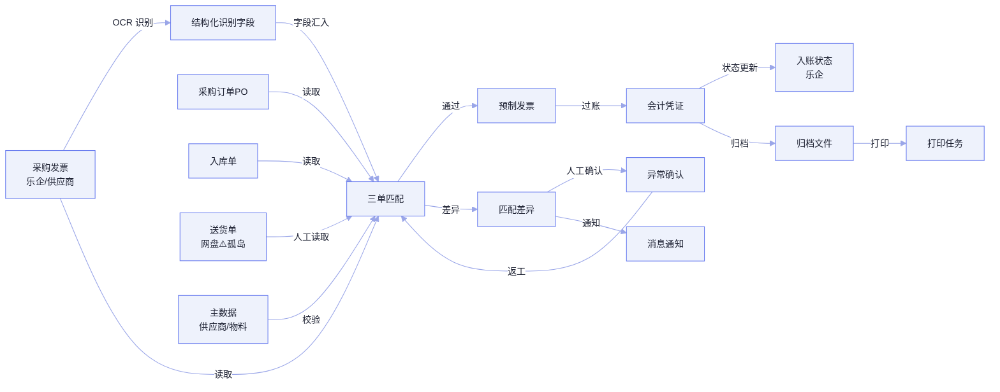

# 采购发票校验助手 · 数据与知识资产盘点（草稿）

> **版本：** v1.2 | **更新日期：** 2026-09-09
>
> **对应业务阶段：** 理需求 — SRP — 阶段2 数据与知识资产需求盘点
>
> **方法论依据：** SRP 阶段2方法（数据血缘图 / 数据实体清单 / 知识资产清单）
>
> **输入依据：** 01_场景定义画布（草稿）、系统/服务清单与接口清单（客户调研材料）、采购发票校验业务流程图（客户提供）

---

## 1 总览

本清单为「采购发票校验助手」场景盘点落地所依赖的数据资产与知识资产：先用「数据血缘图」建立发票从采集到入账的数据流转全景，再对每个数据实体逐一登记形态、需求、质量与可获取性，最后对阶段 1 标记的隐性经验逐条判定知识类型并登记加工需求。

**主线判断**：数据层面，采购侧集成基础较好——乐企发票拉取（IF001）、ERP PO/入库单查询（IF003/IF004）、预制/过账（IF005/IF006）、OCR（IF013）、主数据（IF014）均有接口，数据就绪度整体落在 B「可整理」；唯一的显著缺口是「送货单」仍依赖公共网盘人工读取（无 API，⚠️ 系统孤岛）。知识层面，隐性经验集中在「金额比对、差异容忍判定、异常沟通」三处，类型以决策模型类为主，是需要业务专家二轮访谈萃取的高价值资产。

**当前洞察**：数据层「能不能做」的结论偏正面，但「送货单」的数字化程度与「金额比对规则」是否真正落地在 ERP 模拟校验接口，是两处需要客户确认的关键盲区；知识层三类隐性经验的类型判定为初判，仍需专家二轮验证与伪经验筛查。

**FDE 下一步**：① 向客户确认送货单数据源（是否有 API 或仍需人工网盘读取）；② 预约业务专家二轮访谈，验证知识类型与伪经验；③ 回填基线数据（耗时/错误率/量级）。

---

## 2 数据血缘图

> 数据实体节点用业务命名；边标注处理动作。⚠️ 系统孤岛＝跨系统无接口、依赖人工搬运（送货单经公共网盘人工读取）。

---

## 3 数据实体清单

| 数据实体名称 | 关联任务 | 数据形态 | 来源系统 | 数据需求 | 质量评级 | 可获取性 | 物理证据 |
|---|---|---|---|---|---|---|---|
| 采购发票 | 发票拉取与读取 | 半结构化（数电票 XML + PDF/OFD 影像），量级待回填 | 乐企平台（IF001）、供应商数电文件/平台上传 | ①格式：XML/PDF/OFD ②完整性：发票号、金额、税额、供应商税号、开票日期必填 ③合规：影像保留期 ④安全：票面信息脱敏 ⑤性能：批量拉取 ⑥实时性：定时/批量 | B | 直接获取 | 接口清单 IF001 |
| 采购订单（PO） | 采购订单读取、三单信息汇入与匹配 | 结构化（PO 主信息 + PO 行） | ERP/SAP MM（IF003） | ①格式：结构化 ②完整性：PO 号、行项、数量、单价、金额 ③合规：— ④安全：按采购员 PO 权限隔离 ⑤性能：实时/缓存 ⑥实时性：实时/缓存 | A | 直接获取 | 接口清单 IF003 |
| 入库单 | 入库单/送货单读取识别、数量核对 | 结构化（入库单 + 入库行） | ERP/SAP MM（IF004） | ①格式：结构化 ②完整性：入库数量、批次 ③合规：— ④安全：权限隔离 ⑤性能：实时/缓存 ⑥实时性：实时/缓存 | A | 直接获取 | 接口清单 IF004 |
| 送货单 | 入库单/送货单读取识别、数量核对 | 非结构化/半结构化（扫描件/文件） | 公共文件夹/网盘（无 API）⚠️系统孤岛 | ①格式：扫描件/文件 ②完整性：送货数量 ③合规：— ④安全：权限控制 ⑤性能：— ⑥实时性：人工读取 | C | 需导出 | 系统/服务清单「公共文件夹/网盘」[无接口·待验证] |
| 结构化识别字段 | 发票拉取与读取 | 结构化字段 + 置信度 | OCR/AI识别服务（IF013） | ①格式：结构化 ②完整性：关键字段召回 ③合规：— ④安全：识别异常需人工复核 ⑤性能：文件入库后触发 ⑥实时性：准实时 | B | 直接获取 | 接口清单 IF013 |
| 主数据 | 三单信息汇入与匹配（供应商/税号校验） | 结构化（供应商、物料、组织） | 主数据服务（IF014） | ①格式：结构化 ②完整性：唯一性、口径一致 ③合规：— ④安全：数据范围隔离 ⑤性能：实时/缓存 ⑥实时性：实时/缓存 | A | 直接获取 | 接口清单 IF014 |
| 预制发票 | 发票校验记账 | 结构化（发票 + PO + 入库行） | ERP/SAP FI（IF005，出站） | ①格式：结构化 ②完整性：税码、成本中心、付款条件 ③合规：— ④安全：权限控制 ⑤性能：手工触发 ⑥实时性：实时 | A | 直接获取 | 接口清单 IF005 |
| 会计凭证 | 发票校验记账、台账更新·单据归档·状态更新 | 结构化 | ERP/SAP FI（IF006，出站） | ①格式：结构化 ②完整性：凭证号、借贷项 ③合规：— ④安全：权限控制 ⑤性能：财务触发 ⑥实时性：实时 | A | 直接获取 | 接口清单 IF006 |
| 入账状态 | 台账更新·单据归档·状态更新 | 结构化 | 乐企平台（IF002，出站） | ①格式：结构化 ②完整性：发票号、凭证号、入账状态 ③合规：— ④安全：权限控制 ⑤性能：过账后触发 ⑥实时性：准实时 | A | 直接获取 | 接口清单 IF002 |
| 归档文件 | 台账更新·单据归档·状态更新 | 文件（ID、文件名、预览 URL） | 文件服务/对象存储（IF012） | ①格式：PDF/影像 ②完整性：按发票编号索引 ③合规：保留期 ④安全：权限控制 ⑤性能：手工/系统 ⑥实时性：批量 | A | 直接获取 | 接口清单 IF012 |
| 权限/数据范围 | 跨任务权限控制 | 结构化（用户、角色、数据范围） | AD/权限系统（IF015） | ①格式：结构化 ②完整性：角色-数据范围映射 ③合规：— ④安全：认证/授权 ⑤性能：登录/查询 ⑥实时性：实时 | A | 直接获取 | 接口清单 IF015 |
| 打印任务 | 台账更新·单据归档（打印） | 结构化（打印任务、模板、结果） | 打印服务（IF016） | ①格式：结构化 ②完整性：文件、模板、打印结果 ③合规：— ④安全：权限控制 ⑤性能：手工触发 ⑥实时性：实时 | A | 直接获取 | 接口清单 IF016 |
| 消息通知 | 异常确认与返工（待办/提醒） | 结构化（消息模板、接收人、任务链接） | 消息/IM（IF017） | ①格式：结构化 ②完整性：接收人、任务链接 ③合规：— ④安全：权限控制 ⑤性能：状态/异常触发 ⑥实时性：准实时 | A | 直接获取 | 接口清单 IF017 |

### 3.1 接口覆盖核对

采购侧接口 IF001–IF006 与公共侧接口 IF012–IF017 已全部映射至数据实体，无遗漏：

- 采购：乐企发票拉取（IF001→采购发票）、乐企入账状态更新（IF002→入账状态）、ERP PO 查询（IF003→采购订单）、ERP 入库单查询（IF004→入库单）、ERP 采购预制发票（IF005→预制发票）、ERP 采购发票过账（IF006→会计凭证）
- 公共：文件上传保存（IF012→归档文件）、OCR/AI 识别（IF013→结构化识别字段）、主数据查询（IF014→主数据）、权限查询（IF015→权限/数据范围）、打印服务（IF016→打印任务）、消息通知（IF017→消息通知）

销售侧接口 IF007–IF011 与 ERP/SAP SD/FI、公共邮箱属 A2「销售收入确认助手」，不在本场景范围。公共文件夹/网盘的「文件、路径、元数据」已作为「送货单」的承载来源登记，不单列为数据实体。

---

## 4 知识资产清单

| 经验名称 | 关联任务 | 关联数据 | 业务专家持有人 | 触发场景 | 知识类型 | 知识需求 | 获取策略 | 预计加工工作量 | 状态 |
|---|---|---|---|---|---|---|---|---|---|
| 金额比对规则 | 金额/差异核对（ERP接口） | 采购发票、采购订单（PO） | 资深应付会计（姓名待确认） | 发票金额与合同/PO 金额比对出现差异时，判断是否异常 | 决策模型类 | ①覆盖度：覆盖金额>合同、数量不符、单价不符等差异分支 ②更新频率：季度（随 ERP 规则变化） ③质量评估：专家盲测一致率 ≥ 90% | 访谈萃取（主导）+ ERP 规则参考 | 2–3 人天 | 已识别 |
| 差异容忍与异常判定经验 | 匹配结果判定 | 采购发票、采购订单（PO）、入库单、送货单 | 应付会计（姓名待确认） | 三单匹配出现数量/金额差异时，判定哪些可容忍、哪些必拉人 | 决策模型类 | ①覆盖度：覆盖数量差异、金额尾差、异常分支 ②更新频率：季度 ③质量评估：专家盲测一致率 ≥ 90% | 访谈萃取 + 历史数据训练 | 3–4 人天 | 已识别 |
| 异常沟通与升级路径 | 异常确认与返工 | 采购发票、归档文件 | 应付会计/采购业务员（姓名待确认） | 异常需补单/换票/冲红时，判断沟通对象与升级路径 | 操作流程类 | ①覆盖度：覆盖常见异常类型与处理路径 ②更新频率：季度 ③质量评估：SOP 完整覆盖典型异常 ≥ 80% | 访谈萃取 + SOP 转化 | 2 人天 | 已识别 |
| 发票票面关键字段提取要点 | 发票拉取与读取 | 采购发票、结构化识别字段 | 应付会计（姓名待确认） | 识别发票时确定关键字段与易错点（版式差异、模糊票） | 关键信息提取要点 | ①覆盖度：覆盖各类发票版式 ②更新频率：实时跟随新票样 ③质量评估：关键字段抽取准确率 ≥ 95% | 访谈萃取 + 历史数据训练 | 2 人天 | 已识别 |

> **说明**：以上为隐性经验（口传、无书面标准）的初判，类型为「决策模型类/操作流程类/关键信息提取要点」，不涉及技术承载形态（技术选型由下游 SDP 决定）。显性知识（三单匹配口径、预制/过账 SOP、归档命名规则、供应商/税号映射字典）已见诸文档或 ERP 主数据，属「已获得」，不在此列。

---

## 5 待确认问题清单

| # | 问题 | 用途与影响 |
|---|---|---|
| 1 | 送货单是否有 API 可读取，还是仍依赖公共网盘人工搬运 | 决定「送货单」数据实体的可获取性评级与系统孤岛是否成立 |
| 2 | 金额比对规则是否已完全落地在 ERP 模拟校验接口，还是仍有隐性判断 | 决定「金额比对规则」这条隐性经验是否需继续萃取 |
| 3 | 业务专家二轮访谈安排（验证知识类型 + 伪经验筛查） | 决定三条隐性经验的状态能否从「已识别」推进到「已获得」 |
| 4 | 采购发票月度量级、单票校验耗时、三单匹配错误率基线 | 影响数据实体量级标注与阶段 1 验收指标标定 |
| 5 | 发票影像/归档文件的合规保留期与脱敏要求 | 影响采购发票、归档文件的安全与合规需求填写 |
