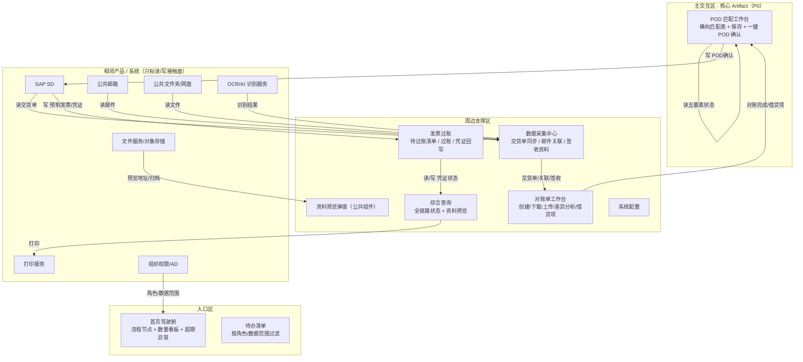

# X销售收入确认 · Agent 产品方案：销售POD收入确认

> **版本：** v1.0 | **更新日期：** 2026-09-10
>
> **对应业务阶段：** 设计方案（SDP-Product）· 阶段1 Agent产品方案设计 · 步骤1.1~1.6
>
> **方法论依据：** SDP-Product 阶段1方法（产品定位 → 形态架构 → 故事线 → 功能清单 → Agent行为 → 规则消费门禁）
>
> **输入依据：** 场景定义《X销售收入确认-POD收入确认-AI画布》《X销售收入确认-POD收入确认-CKD矩阵分析》、挖知识《X销售收入确认-POD收入确认-To-be流程》《X销售收入确认-POD收入确认-任务流程拆解》《X销售收入确认-POD收入确认-业务规则挖掘》、梳理本体《X销售收入确认-POD收入确认-本体设计》

## 1 总览

**这份方案做了什么：** 把「销售POD收入确认」上游的场景定义（AI 画布）、挖知识（To-be 流程 / 25 个 L5 深度任务 / 五类规则）与本体（4 条执行流 / 4 组行动边界）整体聚合，翻译成一份原型作者可照单施工的产品方案：产品定位、形态架构图、4 条演示故事线、9 项功能与 UI 组件、Agent 行为设计、五类规则消费门禁。

**重点看什么：** 核心交付载体是「POD 匹配工作台」——它是销售POD收入确认多能力编排的交付载体（Artifact），全场景唯一 P0（对应任务流程拆解 S4「POD确认」的 L4「POD匹配与确认」，L5 最密集处）。本版关键承接有三点：① 故事线 mock 数据对齐挖知识已深挖的决策因子（物流关联匹配因子、对账差异因子、POD 确认五条件、超期阈值）；② 「一键 POD 确认」是**对外确认收入的强制人工闸门**，规则与本体 action_boundaries 的硬约束一一对应；③ 财务过账不提供预制按钮，预制发票由 POD 确认自动触发。

**为什么关注：** 收入确认时效、采集自动化率、对账差异处理效率、POD 确认合规率、超期异常积压五项 KPI 全由该 Agent 的采集→对账→确认→过账主链路决定。价值主张是把「人工在邮件/文件夹/对账单之间收集核对」升级为「AI 自动采集识别 + 规则校验 + 人工放行确认」，而规则/护栏承接是否「挖到位」，直接决定物流关联、对账差异、POD 确认、财务过账是否可解释、可复核、可审计。

**当前洞察：** 挖知识与本体揭示的规则结构高度统一——决策模型类经验集中在「物流发运关联 / 对账差异 / POD 确认条件 / 超期阈值」四个环节，且集中在「资料采集与对账」「POD 确认」两段。其中「物流发运单号不得手工改写」「五要素不齐不得 POD 确认」「借贷项未完成不得放行」「过账失败不得自动无限重试」是硬约束（不可突破），「金额以 SAP 为准 / 数量以签收为准」是软优先级（可冲突仲裁）。这意味着 HITL 设计只需覆盖 1 个对外闸门（POD 确认）+ 少量高风险动作（过账、特殊审批、差异裁决），不必事无巨细拦截。

**需要 FDE 做什么：** ① 核对故事线 mock 数据与挖知识阈值的一致性（对账容差口径、POD 五条件判定、四类超期天数阈值）；② 确认「收入确认时效」「POD 确认合规率」的度量口径；③ 视觉基底与相邻系统（SAP SD / 公共邮箱 / 公共文件夹 / 文件服务 / AI 识别服务 / 打印服务）边界，属阶段2 原型前置项。

## 2 产品定位

### 2.1 迭代范围

**功能迭代优化（挖知识 + 本体精化）**：在概念级方案基础上，用已完成的挖知识「To-be 流程（23 任务）+ 任务流程拆解（25 个 L5）+ 五类规则挖掘（11 条）」与本体「四执行流 + 行动边界」回填精化。首版 PoC 范围：以交货单/DN 为主线的收入确认主链路「采集 → 物流关联 → 签收识别 → 对账 → 差异/借贷项 → POD 匹配确认 → 预制发票 → 过账 → 归档」，聚焦 POD 匹配与确认一步（P0），验证「人工收集核对 → AI 自动采集 + 规则校验 + 人工放行」能否在采集自动化率、对账差异处理效率、POD 确认合规率之间取得平衡。

### 2.2 产品形态

**B2B 自用型工作台**：客户 = X（销售/收入确认业务）；用户 = CS / CS 经理 / 物流 / 财务 / 财务主管 / 系统管理员；交付物为内嵌企业门户的 Web 工作台（六个一级页面 + 资料预览弹窗），资料不外流，审计链完整留存。

### 2.3 四件套

| 子项 | 内容 |
|---|---|
| 产品定位一句话 | 为 CS、物流与财务，在「销售 POD 收入确认」全链路上，通过 AI 自动采集识别 + 规则校验，把采集自动化率、对账差异处理效率、POD 确认合规率、收入确认时效一起往上拉。 |
| 非目标 | ① 不做行项目级 POD 确认（首版按交货单/DN 颗粒度）；② 不做复杂归档包/下载包；③ 不替代 SAP 做账与会计凭证生成；④ 不允许系统自动确认收入（对外动作必须人工放行）；⑤ 不做物流发运单号的人工直接改写。 |
| 主要使用者 | CS——把「待处理交货单」变成「已对账、已 POD 确认、已触发预制发票」；物流——把「关联异常/缺失签收资料」变成「补件留痕的关联与有效签收」；财务——把「已预制发票」变成「已过账凭证并归档」。 |
| Agent 人格 | 身份定位：收入确认链路的「资料管家 + 条件校验官」；语气基调：严谨、可追溯、有据可查；能力边界：能做——自动拉取与识别邮件/签收资料、自动比对对账差异、校验 POD 确认条件并解释缺口；不能做——代替人工确认收入、手工改写物流发运单号、在条件不齐时强行放行、代替财务过账。 |

## 3 产品形态架构图

> 三大区齐全；相邻产品 7 个，均只标接触面（读/写），不画协议与字段。

## 4 原型演示故事线

> 共 4 条，1:1 对应阶段2 `moments/*.html`。mock 数据均取自「业务规则挖掘清单」的真实决策因子/阈值（脱敏）。

### 故事线 1 · 邮件识别与物流发运关联

| 字段 | 内容 |
|---|---|
| 业务价值高光 | 物流发运单号从人工翻邮件走向自动识别关联，采集自动化率提升。 |
| 对应阶段 | S1 数据采集 / S2 物流关联（L5：识别邮件关键字段 → 建立交货单-发运单关联） |
| 演示剧本 | 系统定时拉取公共邮箱 → Agent 提取「交货单号 DN / 承运商 / 发运单号」（#3 思考折叠、#2 工具调用）→ 一封邮件含 3 个 DN 时逐单拆分（#4 内联组件）→ 低置信度条目标黄并提示复核（#5 HITL）→ 物流补邮件留痕（#6 撤销窗口）→ 回写关联并刷新驾驶舱（#8 状态徽章）。 |
| UI 组件 + 必备交互 | 采集进度流（#1 流式）；识别结果卡（#2/#7 出处引用悬浮展示邮件原文）；拆分确认内联表（#4）；低置信度拦截（#5）；补邮件留痕（#6）。 |
| 业务内容来源 | L5「识别邮件关键字段」「建立交货单-发运单关联」+ 规则 rt「物流发运关联匹配规则」（因子：交货单号/承运商/发运单号；仲裁：以邮件原文为准）。 |

### 故事线 2 · 对账差异自动分析

| 字段 | 内容 |
|---|---|
| 业务价值高光 | 客户反馈与 SAP 自动比对归因，对账差异处理效率提升。 |
| 对应阶段 | S3 对账（L5：自动比对差异并归因 → 生成/关联借贷项建议） |
| 演示剧本 | CS 创建对账单并下载（#5 对外发送必停）→ 客户反馈上传 → Agent 按客户一致性/交货单存在性/数量金额一致性/重复缺失/容差比对（#2 工具调用）→ 差异逐条归因并建议借贷项（#4 内联表、#7 出处）→ 超容差差异拦截转人工裁决（#5）→ CS 确认差异并处理借贷项（#6 撤销）。 |
| UI 组件 + 必备交互 | 对账单明细表（#4）；差异归因卡（#7）；借贷项建议（#4）；超容差拦截（#5）；空态（#10 无差异）。 |
| 业务内容来源 | L5「自动比对差异并归因」「生成/关联借贷项建议」+ 规则「对账差异规则」（仲裁：金额以 SAP 为准、数量以签收/对账确认为准）。 |

### 故事线 3 · POD 匹配与一键确认（P0）

| 字段 | 内容 |
|---|---|
| 业务价值高光 | 五要素一屏匹配 + 一键确认，收入确认时效与合规率同时提升。 |
| 对应阶段 | S4 POD确认（L5：汇总横向匹配表 → 校验POD确认条件 → 一键POD确认） |
| 演示剧本 | CS 选择交货单 → Agent 横向拉齐交货单/物流关联/签收/对账/借贷项五要素状态（#2 工具调用）→ 逐条校验 POD 条件并给出匹配结论与缺口（#8 状态徽章、#7 出处）→ 条件齐备时高亮「一键 POD 确认」，缺口时阻断并生成待办（#5 HITL 闸门）→ CS 确认（#6 撤销窗口）→ 自动触发 SAP 预制发票（#2 工具调用）。 |
| UI 组件 + 必备交互 | 横向匹配表（#4）；条件校验结论卡（#7/#8）；缺口待办（#9 错误态/缺口态）；一键确认闸门（#5）；确认日志（#8）。 |
| 业务内容来源 | L5「汇总横向匹配表」「校验POD确认条件」「一键POD确认」+ 规则「POD 确认条件规则」（五要素硬校验；任一不满足阻断）。 |

### 故事线 4 · 发票过账与归档

| 字段 | 内容 |
|---|---|
| 业务价值高光 | 预制发票自动生成、财务过账回写凭证，收入确认闭环可审计。 |
| 对应阶段 | S4 预制发票 / S5 过账归档（L5：自动生成SAP预制发票 → 执行发票过账 → 回写凭证号 → 打印与归档） |
| 演示剧本 | POD 确认后系统自动生成预制发票（#8 状态徽章）→ 财务在过账页选择待过账记录（#4）→ 权限校验后执行过账（#5 高风险必停）→ SAP 返回凭证号并回写（#2）→ 过账失败时记录返回信息并转人工确认后重试（#9 错误态）→ 打印归档并更新综合查询（#8）。 |
| UI 组件 + 必备交互 | 待过账清单（#4）；过账确认（#5）；凭证回写卡（#2/#7）；失败重试（#9）；归档记录（#8）。 |
| 业务内容来源 | L5「自动生成SAP预制发票」「执行发票过账」「回写凭证号与过账状态」「打印与归档」+ 规则「POD 确认条件规则」（预制发票由确认自动触发）。 |

## 5 业务功能与 UI 组件清单

| 功能名 | 一句话价值 | 绑定角色 | 渲染层 | 触发方式 | UI 组件名 + 组件内容 | 用户操作 | 关联故事线 | 上游来源 |
|---|---|---|---|---|---|---|---|---|
| 首页驾驶舱 | 全局状态与超期异常一屏可见 | CS 经理/财务主管/全员 | Artifact | 登录/定时刷新 | 流程节点卡（物流三分支/对账两分支/POD/过账）+ 数量看板 + 超期异常区 | 查看、点击下钻待办 | 故事线 3/4 | L5「更新驾驶舱与超期预警」+ 规则「超期异常阈值规则」 |
| 数据采集中心 | 交货单/邮件/签收资料自动采集 | 物流/CS | Artifact | 定时/手工刷新 | 采集进度流 + 识别结果卡（含邮件原文出处）+ 拆分确认内联表 | 刷新、复核、补邮件留痕 | 故事线 1 | L5「同步SAP待处理交货单」「读取公共邮箱邮件」「OCR识别签收/POD字段」+ 规则「物流发运关联匹配规则」 |
| 对账单工作台 | 对账差异自动比对归因 | CS/财务 | Artifact | 手工创建/上传 | 对账单明细表 + 差异归因卡 + 借贷项建议 + 状态徽章 | 创建、下载、上传、确认差异 | 故事线 2 | L5「创建对账单」「自动比对差异并归因」「确认差异并处理借贷项」+ 规则「对账差异规则」 |
| POD 匹配工作台（P0） | 五要素一屏匹配 + 一键确认 | CS/CS 经理 | Artifact | 选择交货单 | 横向匹配表 + 条件校验结论卡 + 缺口待办 + 一键确认闸门 | 校验、保存、POD 确认、升级审批 | 故事线 3 | L5「汇总横向匹配表」「校验POD确认条件」「一键POD确认」+ 规则「POD 确认条件规则」 |
| 发票过账 | 预制发票过账并回写凭证 | 财务 | Artifact | 手工触发 | 待过账清单 + 过账确认 + 凭证回写卡 + 失败重试 | 过账、重试、打印 | 故事线 4 | L5「执行发票过账」「回写凭证号与过账状态」 |
| 资料预览弹窗 | 全链路资料一处预览 | 全员 | Artifact | 点击资料 | 公共预览弹窗（交货单/邮件/签收/POD/对账单/POD日志/预制发票/凭证） | 预览、下载、打印 | 故事线 1/2/3/4 | L5「打印与归档」+ 规则模板 rt_03 |
| 综合查询 | 一行一单全链路状态 | 全员 | Artifact | 查询/筛选 | 全链路状态表 + 筛选排序 + 资料预览 + 补充资料上传 | 查询、筛选、补充资料 | 故事线 3/4 | L5「回写凭证号与过账状态」+ 本体 relation rrel_01 |
| 系统配置 | 阈值/频率/规则可配置 | 系统管理员 | Artifact | 手工 | 参数配置表单（拉取频率/异常天数/差异规则/POD条件/打印规则/重试参数） | 配置、保存 | 故事线 1/2/3 | 规则「超期异常阈值规则」+ CKD 配置类资产 |
| 权限与审计 | 页面/按钮/字段/数据范围可控 | 系统管理员 | Artifact | 登录/操作 | 角色权限矩阵 + 操作日志表 | 授权、审计查询 | 故事线 3/4 | 本体 workstreams 护栏 + CKD 权限资产 |

**必备交互 10 项（产品承诺）：** #1 流式输出 / #2 工具调用可视化 / #3 思考过程可折叠 / #4 内联组件 / #5 HITL 拦截 / #6 撤销回滚 / #7 出处引用 / #8 状态徽章 / #9 错误态 / #10 空态。

## 6 Agent 行为设计

### 6.1 Agent 是谁
- **开场话术草稿**：我是销售POD收入确认助手，帮你自动采集物流发运与签收资料、比对对账差异、校验 POD 确认条件。确认收入前我会把五要素状态和缺口一次列清楚，放行前一定停下来等你确认。
- **语气基调**：严谨、简洁、有据可查；每个结论都标注来源与置信度，不做无依据的推断。
- **能力边界承诺**：我能——自动拉取与识别邮件/签收资料、自动比对对账差异并归因、校验 POD 确认条件并解释缺口、自动触发预制发票与回写凭证。我不能——代替你确认收入、手工改写物流发运单号、在条件不齐时强行放行、代替财务执行过账。

### 6.2 Agent 让用户看到什么

| 事件类型 | 默认行为 | 来源 / 落到交互 |
|---|---|---|
| 采集/对账/确认进度 | 实时可见 | #8 状态徽章 |
| 邮件/签收/对账数据与规则依据 | 始终标注来源与置信度 | #7 出处引用（悬浮展示邮件原文/单证/规则） |
| 识别置信度低 | 显式标注并转人工复核 | #5 HITL + #7 |
| 触发工具（SAP/邮箱/OCR/文件服务） | 告知并展示调用结果 | #2 工具调用卡片 |
| 校验推理过程 | 默认折叠，可展开 | #3 思考可折叠 |

### 6.3 Agent 何时停下等用户

| 触发类别 | 触发条件 | 默认拦截形态 | 理由/来源 |
|---|---|---|---|
| 对外确认收入 | 一键 POD 确认（对外确认收入） | 确认前必停（撤销窗口） | L5「一键POD确认」+ 本体 ab_pod_confirm 硬约束 |
| 修改关键业务数据 | 物流发运单号修正、借贷项处理、过账 | 写入前必停 | 本体 ab_email_relation / ab_posting 硬约束 |
| Agent 自判不确定 | 识别冲突/低置信度、超容差差异 | 提示用户决策 | 规则仲裁/无法求解 |
| 连续失败/重试超限 | SAP 过账失败、接口连续失败 | 给降级建议 + 升级人工 | 数据缺失/高风险动作 → 人工确认后重试 |

### 6.4 用户怎么撤销与兜底

| 问题 | 内容 | 落到交互 |
|---|---|---|
| 撤销范围 | 当前动作（POD 确认撤销窗口内可撤回）/ 本轮会话（采集复核可重跑） | #6 撤销/回滚 |
| 追问深度 | 可追问「为什么判定条件不满足 / 为什么这笔是差异」到一层依据（规则 + 出处） | #7 出处引用 |
| 完全失败时怎么办 | ≥2 明确选项：切人工处理 / 按历史口径估算并标注 / 放弃并保留上下文 | #9 错误态 |

## 75 类规则消费门禁

| 规则类型 | 是否识别 | 产品方案承接点 | 承接的业务内容 | 备注 |
|---|---|---|---|---|
| 决策模型类 | ✅ | 第6章·何时停下等用户；第5章·出处引用；POD 匹配表 | 物流发运关联匹配、对账差异规则、POD 确认条件（五要素）、超期异常阈值 | 必须承接 |
| 模版范例类 | ✅ | 第5章·核心交付载体（对账单/差异说明/POD日志凭证，可变字段可编辑） | 对账单模板固定部分 + 可变字段；客户反馈/差异说明模板；POD日志与凭证打印模板 | 必须承接 |
| 术语字典类 | ✅ | 第5章·术语 hover 卡 | 8 个口径：DN/POD/PID/借贷项/预制发票/过账/对账单/客户自提 | 必须承接 |
| 关键信息提取要点 | ✅ | 第5章·出处引用悬浮卡（识别结果 + 置信度） | 物流邮件字段（交货单号/承运商/发运单号/自提确认）；签收单/POD 字段（签收人/时间/结果/单号） | 必须强化承接 |
| 关联关系类 | ✅ | 第5章·综合查询/横向匹配表 | 交货单—物流—签收—对账—借贷项—POD确认—预制发票—凭证关联（DN 为主键锚点） | 必须承接 |

> 操作流程类（交货单同步、邮件读取、创建对账单、POD 确认流程等）已由阶段1「深度任务序列」承载，本表不重复；其在第5章功能清单的「上游来源」列通过深度任务业务名引用。

## 8 待确认问题清单

| # | 待确认问题 | 用途与影响 |
|---|---|---|
| 1 | 对账差异容差口径与差异归因规则是否与业务专家一致 | 决定故事线 2 mock 与 HITL 是否可信 |
| 2 | POD 确认五条件的判定口径与「客户自提视同签收」的审计要求能否坐实 | 影响规则承接与合规率指标 |
| 3 | 四类超期异常天数阈值与预警升级规则 | 决定驾驶舱预警是否可信 |
| 4 | 借贷项由系统创建/关联/仅记录状态，是否需要自动过账回写 | 影响对账→POD确认的阻断逻辑 |
| 5 | SAP 接口能力（交货单查询/预制发票/过账/凭证查询/借贷项）与公共邮箱/文件夹读取权限范围 | 决定采集与过账链路能否落地 |
| 6 | 视觉基底与相邻系统边界（SAP/邮箱/文件夹/文件服务/AI识别/打印） | 决定阶段2 原型视觉来源与接触面准确性 |
