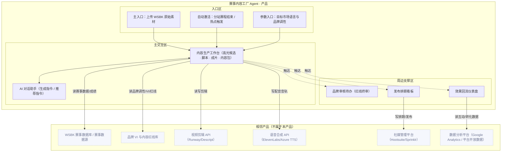

# 张雪机车海外销售 · Agent 产品方案：赛事内容工厂

> **版本：** v1.0 | **更新日期：** 2026-09-10
>
> **对应业务阶段：** 设计方案（SDP-Product）· 阶段1 Agent产品方案设计 · 步骤1.1~1.6
>
> **方法论依据：** SDP-Product 阶段1方法（产品定位 → 形态架构 → 故事线 → 功能清单 → Agent行为 → 规则消费门禁）
>
> **输入依据：** 场景定义《张雪机车-赛事内容工厂-AI画布》《张雪机车-赛事内容工厂-机会点定义》《张雪机车-赛事内容工厂-CKD矩阵分析》、挖知识《张雪机车-赛事内容工厂-To-be流程》《张雪机车-赛事内容工厂-任务流程拆解》《张雪机车-赛事内容工厂-业务规则挖掘》、梳理本体《张雪机车-赛事内容工厂-本体设计》

## 1 总览

**这份方案做了什么：** 在已有 AI 场景画布、机会点定义与 To-be 流程的基础上，用已完成的「任务流程拆解（19 个 L5 深度任务）+ 五类规则挖掘（11 条规则/样本）+ Agent 本体（11 实体 / 13 关系 / 5 行动边界 / 4 工作流状态机）」整体回填精化，把「赛事内容工厂 Agent」翻译成一份原型作者可照单施工的产品方案：产品定位、形态架构图、4 条演示故事线、10 项功能与 UI 组件、Agent 行为设计、五类规则消费门禁。

**重点看什么：** 核心交付载体是「赛事内容生产工作台」——它是内容工厂 Agent 多能力编排的 Artifact，全场景唯一 P0（对应任务流程拆解 S2「高光识别与脚本生成」，L4 最密集、专家判断最重处）。本版关键升级在两点：① 故事线 mock 数据从画布口径对齐到已深挖的决策因子（高光打分四因子、平台适配三因子、排期三因子）；② 「五类规则消费门禁」用业务规则挖掘清单的真实承接——决策模型类经验逐一落到 HITL 拦截与出处引用。

**为什么关注：** 北极星「海外月度新增车主数」的内容获客底盘由本 Agent 决定，直接支撑增长维度 KPI（社媒粉丝 500,000+、官网月访问 100,000+）与画布收益「3 天→30 分钟 / 成本↓90% / 互动↑35% / 5 人→1 人」。本产品的价值主张是把内容生产从「人工剪辑 + 外包本地化 + 手工适配」升级为「Agent 主驱动流水线」，而规则承接是否「挖到位」直接决定高光选择、脚本本地化、平台适配、对外发布是否可解释、可复核、可验收。

**当前洞察：** 规则结构高度统一——决策模型类经验集中在「高光打分 / 平台适配 / 发布时间 / 品牌红线 / 效果归因」五个环节；硬约束（对外发布必停、品牌红线一票否决、平台时长/编码硬限、素材授权未清不得发布）与软优先级（品牌相关度 > 叙事价值 > 精彩度 > 历史互动偏好；热点时效 > 本地活跃时段）分布清晰。这意味着 HITL 只需覆盖两类 gate（品牌红线终审、多平台自动发布）+ 少量软优先级冲突点，不必事无巨细拦截。

**需要 FDE 做什么：** ① 核对故事线 mock 数据与决策阈值一致性（尤其高光分阈值、文化禁忌改写口径、平台时长上限）；② 确认「单站素材体量 / 历史高互动内容条数」等 `[待确认]` 口径；③ 视觉基底（ZXMOTO 品牌设计系统 vs 社媒内容平台）与相邻系统只读/写边界仍待确认，属阶段2 原型前置项。

## 2 产品定位

### 2.1 迭代范围

**功能迭代优化（精化）：** 在 v1.0 概念级方案基础上，用已完成的「深度任务序列（19 个 L5）+ 任务处理规则挖掘清单（五类规则）」回填精化。首版 PoC 范围不变：赛事内容主链路「素材接入 → 高光识别 → 多语言脚本 → 剪辑配音 → 平台适配 → 审核发布 → 效果回流」，聚焦 S2 高光识别与脚本生成一步（P0），验证「赛事热点分钟级出片 + 6 语言同步产出」能否在内容时效、单位成本、互动率、合规通过率之间取得平衡。

### 2.2 产品形态

**B2B 自用型内容生产工作台（Web 端）+ 发布自动化插件 + 效果追踪仪表盘**：客户 = 张雪机车（ZXMOTO）海外市场部，用户 = 品牌内容经理 / 社媒运营专员为主、海外市场营销 / 赛事运营负责人为辅；交付物为品牌自用的赛事内容生产工作台，内容成品经审核后对外发布到 YouTube/TikTok/Instagram/Reels。

### 2.3 四件套

| 子项 | 内容 |
|---|---|
| 产品定位一句话 | 为张雪机车海外市场的内容团队，在「WSBK 赛事热点转瞬即逝」场景下，通过 Agent 主驱动的内容工厂，把赛事内容产出时效（3 天→30 分钟）、多语言单位成本（↓90%）、内容互动率（↑35%）、内容合规通过率一起往上拉。 |
| 非目标 | ① 不做赛事直播推流与版权转授权（本 Agent 只消费已授权素材）；② 不做付费投放与广告算法优化（属「智能投放与算法优化」画布）；③ 不做 KOL 对接与达人合作管理（属「KOL 网络识别与对接」画布）；④ 不做动态定价 / 众筹 / 生产排程等相邻画布；⑤ 原型阶段不接真实剪辑 API / TTS / 社媒平台，用 Mock 服务。 |
| 主要使用者 | 品牌内容经理——设定品牌调性与内容红线，对对外内容做终审放行（gate）；社媒运营专员——选择目标市场与语言、抽检脚本、审核排期；海外市场营销——内容策略与投放协同、复盘裁决；赛事运营负责人——上传 WSBK 原始素材。 |
| Agent 人格 | 身份定位：一名懂赛事叙事、多语言本地化与社媒平台规则的「赛事内容工厂主编」；语气基调：专业、克制、赛事感（用高光分/叙事价值/平台规范说话，不夸大、不标题党）；能力边界：我能做——多模态理解赛事素材、高光识别打分、6 语言脚本生成与本地化改写、自动剪辑配音包装、平台格式适配与排期、效果归因；我不能做——替你放行对外发布（品牌红线必停）、绕过品牌 VI 或内容红线出片、把某市场合规版本跨市场照搬、未经事实核对就成片、触碰红线仍强行发布。 |

## 3 产品形态架构图

> 三大区齐全；相邻产品 6 个，均只标接触面（读/写），不画协议与字段。核心交付载体为「内容生产工作台」（M1），其中「高光识别与脚本生成」为全场景唯一 P0。

## 4 原型演示故事线

> 共 4 条，1:1 对应阶段2 `moments/*.html`。mock 数据均取自「任务处理规则挖掘清单」的真实决策因子/阈值（脱敏）。

### 故事线 1 · 赛事素材接入与高光识别（分站赛后分钟级）

| 字段 | 内容 |
|---|---|
| 业务价值高光 | 上传一整站 WSBK 素材，Agent 自动切分镜头、关联赛事数据并按高光分排序，省去逐帧人工看片 |
| 对应阶段 | S1 素材接入与理解 + S2 高光识别与脚本生成（P0） |
| 演示剧本 | 用户：上传「WSBK 荷兰站 全程素材 42GB」并设定英/法/德/西/意/葡 6 语言 → Agent 思考（拉取赛事数据库关联车手/成绩/对战，按精彩度/叙事价值/品牌相关度/历史偏好打分）→ 调工具（多模态视频理解 + WSBK 赛事数据库）→ 输出高光候选清单：夺冠冲线 96 分（品牌相关度 高）/ 贴身超车 91 分 / 极限压弯 84 分；低置信度镜头标注待复核、不进入候选 → **HITL 提示**：「3 条候选高光品牌露出已标注，请确认高光选择」 |
| UI 组件 + 必备交互 | 素材上传卡（Dragger）+ 高光候选表（含高光分/事件类型/品牌露出）+ 出处引用悬浮卡；#1 流式输出 #2 工具调用可视化 #3 思考过程可折叠 #7 出处引用 #8 状态徽章 |
| 业务内容来源 | 深度任务·上传 WSBK 原始赛事素材 / 多模态理解赛事素材 / 关联赛事数据库上下文 / 高光片段识别与打分；决策模型类·高光片段判定与打分规则（因子：精彩度、叙事价值、品牌相关度、历史互动偏好；仲裁：品牌相关度 ＞ 叙事价值 ＞ 精彩度 ＞ 历史互动偏好） |

### 故事线 2 · 多语言解说脚本生成与抽检（含文化禁忌改写 + HITL）

| 字段 | 内容 |
|---|---|
| 业务价值高光 | 一次生成 6 语言解说脚本，事实一致、逐语言本地化，命中文化禁忌自动改写 |
| 对应阶段 | S2 高光识别与脚本生成 |
| 演示剧本 | 用户：「为夺冠高光生成 6 语言脚本。」→ Agent 思考（先锁定叙事要素：车手/名次/超车/圈速，再逐语言本地化改写）→ 调工具（赛事数据 → 叙事要素提取 + 文化偏好与禁忌库）→ 输出脚本卡：开场钩子 + 高潮叙述 + 结果情绪 + 品牌 CTA；事实一致、表达本地化 → **HITL/错误态**：某语言命中宗教禁忌 → 自动改写或降级，仍冲突则拉人；**HITL 抽检**：「请抽检事实与调性后放行」 |
| UI 组件 + 必备交互 | 多语言脚本卡（分语言 Tab）+ 术语 hover 卡（高光/叙事要素/内容包）+ 出处引用悬浮卡；#4 内联组件 #5 HITL 拦截 #7 出处引用 #8 状态徽章 #9 错误态 |
| 业务内容来源 | 深度任务·赛事数据到叙事要素提取 / 多语言解说脚本生成 / 脚本抽检确认；模版范例类·多语言解说脚本模板（骨架：钩子→高潮→结果→CTA）；术语字典类·赛事与品牌业务口径词典；关键信息提取要点·赛事素材与叙事要素抽取要点 |

### 故事线 3 · 自动剪辑配音与多平台格式适配

| 字段 | 内容 |
|---|---|
| 业务价值高光 | 脚本确认后自动剪辑、6 语言配音字幕、品牌包装并按各平台硬规范一键适配内容包 |
| 对应阶段 | S3 智能剪辑与配音 + S4 平台适配与内容包 |
| 演示剧本 | 用户：「按已确认脚本出片并适配全平台。」→ 调工具（视频剪辑 API + TTS + 品牌 VI 资源）→ 输出成片：粗剪高光 + 6 语言配音字幕 + 品牌角标/封面 → Agent 思考（按平台时长/比例/编码规则适配）→ 输出多平台内容包：YouTube 16:9 横屏 58s / TikTok 9:16 竖屏 34s / Instagram Reels 9:16 30s + 标签集与 SEO 图文 → **错误态降级**：「编码转换失败，已重试 2 次 → 降级标准编码并标注」 |
| UI 组件 + 必备交互 | 剪辑进度 Timeline + 成片预览卡 + 多平台适配表（平台/比例/时长/状态）+ 标签 SEO 卡；#2 工具调用可视化 #4 内联组件 #7 出处引用 #8 状态徽章 #9 错误态 |
| 业务内容来源 | 深度任务·自动剪辑高光片段 / 多语言配音与字幕合成 / 品牌元素与封面包装 / 平台格式适配 / 标签与 SEO 图文生成；决策模型类·平台适配规则（时长/比例/编码/拆条）；模版范例类·短视频品牌包装与封面模板、平台标签与 SEO 图文模板 |

### 故事线 4 · 品牌红线终审与发布排期 + 效果回流（含对外必停/撤销）

| 字段 | 内容 |
|---|---|
| 业务价值高光 | 品牌红线一票否决、对外发布前人工放行、按市场热点窗口排期，效果数据回流优化下轮高光偏好 |
| 对应阶段 | S5 品牌审核与发布 + S6 效果追踪与反馈 |
| 演示剧本 | 用户：「内容包已适配，安排发布。」→ Agent 思考（品牌调性一致性 / 内容红线命中 / 事实准确性三级校验）→ **HITL 必停（gate）**：「品牌调性与内容红线终审：调性一致、无红线命中、事实准确 → 请放行；若触碰红线将拦截升级。」→ 用户放行 → Agent 按排期发布（热点时效 ＞ 本地活跃时段，抢黄金窗口）→ **撤销兜底**：「发布失败自动重试 2 次→转人工；排期冲突/热点过期→顺延或提示调整。」→ 效果数据回流：互动率归因 → 更新高光偏好权重 |
| UI 组件 + 必备交互 | 审核待办卡（调性/红线/事实三级校验）+ 发布排期表 + 效果归因卡 + 撤销 Toast；#5 HITL 拦截 #6 撤销回滚 #7 出处引用 #8 状态徽章 #9 错误态 #10 空态 |
| 业务内容来源 | 深度任务·品牌调性与内容红线终审 / 发布排期与最佳时间选择 / 多平台自动发布 / 互动数据采集 / 效果归因与内容策略优化 / 策略复盘与下轮调整；决策模型类·品牌红线与合规分级规则、最佳发布时间与排期规则、效果归因与内容策略优化规则；关联关系类·赛事—车手—成绩—高光—内容—平台—效果关联 |

## 5 业务功能与 UI 组件清单

| 功能名 | 一句话价值 | 绑定角色 | 渲染层 | 触发方式 | UI 组件名 + 组件内容 | 用户操作 | 关联故事线 | 上游来源 |
|---|---|---|---|---|---|---|---|---|
| 素材接入与多模态理解 | 上传即切分镜头、关联赛事数据 | 赛事运营负责人 | Artifact Pane | 用户点击召唤 | 素材上传卡（Dragger + 市场语言/调性表单）+ 镜头语义标签表 | 上传/只读 | 故事线1 | 深度任务·上传 WSBK 原始赛事素材 / 多模态理解赛事素材 / 关联赛事数据库上下文 |
| 高光识别与打分（P0） | AI 按四因子打分排序高光候选 | 社媒运营专员 | Artifact Pane | Agent 主动渲染 | 高光候选表（高光分/事件类型/品牌露出/置信度）+ 高光分雷达 | 只读/可确认 | 故事线1 | 深度任务·高光片段识别与打分；决策模型类·高光片段判定与打分规则 |
| 多语言解说脚本生成 | 一次生成 6 语言、事实一致本地化 | 社媒运营专员 | Artifact Pane | Agent 主动渲染 | 多语言脚本卡（分语言 Tab + 钩子/高潮/结果/CTA） | 只读/可编辑 | 故事线2 | 深度任务·多语言解说脚本生成；模版范例类·多语言解说脚本模板 |
| 自动剪辑与配音字幕 | 脚本确认即自动出片配音 | 社媒运营专员 | Artifact Pane | Agent 主动渲染 | 剪辑进度 Timeline + 成片预览卡 + 配音字幕轨 | 只读 | 故事线3 | 深度任务·自动剪辑高光片段 / 多语言配音与字幕合成 |
| 品牌元素与封面包装 | 按 VI 自动叠加品牌元素与封面 | 品牌内容经理 | Artifact Pane | Agent 主动渲染 | 品牌包装预览卡（角标/字幕样式/片尾/封面） | 只读 | 故事线3 | 深度任务·品牌元素与封面包装；模版范例类·短视频品牌包装与封面模板 |
| 平台格式适配与内容包 | 按各平台硬规范一键适配 | 社媒运营专员 | Artifact Pane | Agent 主动渲染 | 多平台适配表（平台/比例/时长/编码/状态）+ 内容包清单 | 只读/可微调 | 故事线3 | 深度任务·平台格式适配；决策模型类·平台适配规则（时长/比例/编码/拆条） |
| 标签与 SEO 图文生成 | 自动生成标签集与 SEO 图文 | 海外市场营销 | Artifact Pane | Agent 主动渲染 | 标签集卡（品牌/赛事/品类/热点四类）+ SEO 图文卡 | 只读/可编辑 | 故事线3 | 深度任务·标签与 SEO 图文生成；模版范例类·平台标签与 SEO 图文模板 |
| 品牌调性与红线终审 | 三级校验、红线一票否决 | 品牌内容经理 | Artifact Pane | Agent 主动渲染 | 审核待办卡（调性/红线/事实三级 + 放行/退回/拦截） | 放行/退回/拦截 | 故事线4 | 深度任务·品牌调性与内容红线终审；决策模型类·品牌红线与合规分级规则 |
| 发布排期与多平台发布 | 抢热点窗口、按排期自动发布 | 社媒运营专员 | Artifact Pane | Agent 主动渲染 | 发布排期表（市场/时区/热点窗口/状态）+ 发布状态卡 | 确认/调整/撤销 | 故事线4 | 深度任务·发布排期与最佳时间选择 / 多平台自动发布；决策模型类·最佳发布时间与排期规则 |
| 效果回流与策略优化 | 互动数据归因、更新高光偏好 | 海外市场营销 | Artifact Pane | Agent 主动渲染 | 效果回流仪表盘（互动率/归因结论/偏好权重）+ 策略建议卡 | 只读/采纳 | 故事线4 | 深度任务·互动数据采集 / 效果归因与内容策略优化；决策模型类·效果归因与内容策略优化规则 |
| 术语口径卡 | 悬停看懂赛事与品牌口径 | 全体 | Conversation Pane | 自动激活 | 术语 hover 卡（WSBK/ZXMOTO/高光/叙事要素/内容包/内容红线） | 只读 | 故事线1/2/3 | 术语字典类·赛事与品牌业务口径词典 |
| 出处引用 | 决策依据可追溯 | 全体 | Conversation Pane | Agent 主动渲染 | 出处引用悬浮卡（决策因子确定性 + 字段典型位置） | 只读 | 故事线1/2/3/4 | 关键信息提取要点·赛事素材与叙事要素抽取要点；决策模型类·决策因子确定性 |

**必备交互 10 项（产品承诺）：** #1 流式输出 / #2 工具调用可视化 / #3 思考过程可折叠 / #4 内联组件 / #5 HITL 拦截 / #6 撤销回滚 / #7 出处引用 / #8 状态徽章 / #9 错误态 / #10 空态。

## 6 Agent 行为设计

### 6.1 Agent 是谁

- **开场话术草稿**：「我是赛事内容工厂主编，能帮你把一整站 WSBK 素材变成高光短视频、6 语言解说与多平台内容包。高光选择和对外发布我会给建议，红线与放行由你拍板。」
- **语气基调**：专业但不死板（用高光分/叙事价值/平台规范说话）；克制不夸大（不说「必爆」，说「按历史互动偏好更可能引发传播」）。
- **能力边界承诺**：我能——多模态理解赛事素材、高光识别打分、6 语言脚本生成与本地化改写、自动剪辑配音包装、平台格式适配与排期、效果归因；我不能——替你放行对外发布、绕过品牌 VI 或内容红线出片、把某市场合规版本跨市场照搬、未经事实核对就成片、触碰红线仍强行发布。

### 6.2 Agent 让用户看到什么

| 事件类型 | 默认行为 | 来源 / 落到交互 |
|---|---|---|
| Agent 正在做什么（进度） | 实时可见 | #8 状态徽章（idle/thinking/tool_calling/awaiting_human/error） |
| 使用了哪些数据/知识 | 始终标注来源 | 术语字典类/关键信息提取要点 → #7 出处引用 |
| Agent 不确定/置信度低 | 显式标注 | 决策模型类·决策因子确定性 → #5 HITL + #7 |
| 触发工具/外部行为 | 告知 + 可查看 | #2 工具调用卡片 |
| 思考过程 | 默认折叠可展开 | #3 思考过程可折叠 |

### 6.3 Agent 何时停下等用户

| 触发类别 | 触发条件 | 默认拦截形态 | 理由/来源 |
|---|---|---|---|
| 对外发送/下发 | 多平台自动发布（内容已获放行后） | 发布前必停（对外必停确认 + 撤销窗口） | 深度任务·多平台自动发布（HITL gate）；本体行动边界·发布对外动作 |
| 修改关键业务数据 | 品牌调性/内容红线终审（红线命中/事实重大错误） | 写入（发布）前必停，红线一票否决 | 决策模型类·品牌红线与合规分级规则；本体·品牌合规护栏 |
| Agent 自判不确定 | 高光分低于阈值/候选不足、文化禁忌无法改写、事实与画面不一致 | 提示用户决策（回退候选/拉人裁决） | 决策模型类·高光打分、多语言本地化禁忌；本体·低置信度待复核 |
| 连续失败/重试超限 | 剪辑/TTS/编码转换失败、数据延迟缺失、发布失败 | 给降级建议 + 升级人工 | 决策模型类·平台适配/配音兜底；#9 错误态 |

### 6.4 用户怎么撤销与兜底

| 问题 | 内容 | 落到交互 |
|---|---|---|
| 撤销范围 | 当前动作（发布前放行可撤回、排期未发布可改期、高光选择可重选）/ 本轮会话 | #6 撤销/回滚 |
| 追问深度 | 可追问「为什么选这个高光/这条排期」到一层依据（决策因子 + 来源字段） | #7 出处引用 |
| 完全失败时怎么办 | 给 ≥2 明确选项：转人工处理 / 按历史高互动偏好降级生成 / 放弃并保留上下文 | #9 错误态 |

## 75 类规则消费门禁

|规则类型 |是否识别 | 产品方案承接点 | 承接的业务内容 | 备注 |
|---|---|---|---|---|
| 决策模型类 | ✅ | 第6章·Agent 何时停下等用户；第5章·出处引用悬浮卡 | 高光片段判定与打分（精彩度/叙事价值/品牌相关度/历史偏好，仲裁：品牌相关度 ＞ 叙事价值 ＞ 精彩度 ＞ 历史偏好）、平台适配规则（时长/比例/编码/拆条）、最佳发布时间与排期规则（时区/历史互动/热点窗口，仲裁：热点时效 ＞ 本地活跃时段）、品牌红线与合规分级规则（调性/红线/事实三级，红线一票否决）、效果归因与内容策略优化规则（样本充分性为前置门槛）的 HITL 触发与决策因子确定性 | 必须承接 |
| 模版范例类 | ✅ | 第5章·内容生产工作台（Artifact，可变字段可编辑） | 多语言解说脚本模板（钩子→高潮→结果→CTA 固定骨架 + 动态字段）、短视频品牌包装与封面模板（片头/字幕/片尾/封面固定规则 + 动态填充）、平台标签与 SEO 图文模板（标题/描述/标签结构） | 必须承接 |
| 术语字典类 | ✅ | 第5章·术语 hover 卡 | 6 个口径：WSBK、ZXMOTO、高光（Highlight）、叙事要素、内容包、内容红线 | 必须承接 |
| 关键信息提取要点 | ✅ | 第5章·出处引用悬浮卡（字段典型位置 + 易错变体） | 5 个字段：高光事件类型、车手与车队、名次与成绩、品牌露出、对战/历史上下文的典型位置与易错点（如慢镜重复计数、号码混淆、露出过短） | 必须强化承接 |
| 关联关系类 | ✅ | 第5章·效果回流仪表盘（赛事—车手—成绩—高光—内容—平台—效果关联展示） | 赛事—车手—成绩—高光片段—内容成品—发布平台—效果指标关联网络（赛事ID=素材→高光→叙事主键；内容ID=内容→平台→效果主键） | 必须承接 |

> 操作流程类（赛事内容生产流程、审核发布流程、补件校验规则等）已由阶段1「深度任务序列」承载（19 个 L5 深度任务），本表不重复；其在第5章功能清单的「上游来源」列通过深度任务业务名引用。

## 8 待确认问题清单

| # | 待确认问题 | 用途与影响 |
|---|---|---|
| 1 | 高光打分「高光分阈值」与四因子权重口径是否与资深剪辑/编导一致 | 决定高光候选与 HITL 回退是否可信；不确认会导致高光选择不可复核 |
| 2 | 目标市场文化偏好与禁忌库的 6 语言覆盖范围与「命中禁忌必须改写」判定口径 | 影响多语言脚本本地化承接；不确认会导致跨市场合规边界悬空 |
| 3 | 单站 WSBK 素材体量、历史高互动内容条数、各平台内容规范版本 | 决定 mock 数据与 CKD 资产规划；`[待确认]` 项影响原型数据量级与存储设计 |
| 4 | 视觉基底（ZXMOTO 品牌设计系统 zxmoto-tokens.css / 社媒内容平台）与相邻系统只读/写范围 | 决定阶段2 原型视觉来源与形态架构接触面是否准确；不确认会导致集成路径错误或重复建设 |
