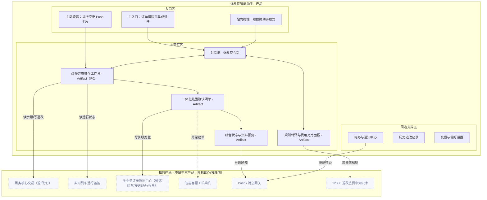

# 铁路订票服务 · Agent 产品方案：退改签智能助手

> **版本：** v1.0 | **更新日期：** 2026-09-10
>
> **对应业务阶段：** 设计方案（SDP-Product）· 阶段1 Agent产品方案设计 · 步骤1.1~1.6
>
> **方法论依据：** SDP-Product 阶段1方法（产品定位 → 形态架构 → 故事线 → 功能清单 → Agent行为 → 规则消费门禁）
>
> **输入依据：** 场景定义《铁路订票服务-退改签智能助手-AI画布》《铁路订票服务-退改签智能助手-机会点定义》、挖知识《铁路订票服务-退改签智能助手-To-be流程》《铁路订票服务-退改签智能助手-任务流程拆解》《铁路订票服务-退改签智能助手-业务规则挖掘》《铁路订票服务-退改签智能助手-CKD矩阵分析》、梳理本体《铁路订票服务-退改签智能助手-本体设计》

## 1 总览

**这份方案做了什么：** 把「退改签智能助手」上游的场景定义（AI 画布）、挖知识（To-be 流程 / 18 个 L5 深度任务 / 五类规则）与本体（4 条执行流 / 3 组行动边界）整体聚合，翻译成一份原型作者可照单施工的产品方案：产品定位、形态架构图、4 条演示故事线、7 项功能与 UI 组件、Agent 行为设计、五类规则消费门禁。

**重点看什么：** 核心交付载体是「退改签处置工作台」——它是本 Agent 多能力编排的交付载体（Artifact），全场景唯一 P0（对应任务流程拆解 S3「方案推荐」的 L4「方案寻优」，L5 最密集处）。本版关键承接有三点：① 故事线 mock 数据对齐挖知识已深挖的决策因子（阶梯费率档位、方案寻优因子、关联处置协议）；② 「选择改签方案」「发起主票退改交易」是**对外承诺/交易动作，强制人工闸门**，与本体 action_boundaries 的硬约束一一对应；③ 计费走确定性规则引擎，LLM 只做规则转译与说明，不算钱。

**为什么关注：** 退改签自助率（目标 ≥95%）、决策耗时（15–20 分钟 → 秒级）、高峰期改签成功率、客服进线量、关联服务遗漏损失五项 KPI 全由该 Agent 的识别→转译→推荐→处置主链路决定。价值主张是把高焦虑、高复杂度的退改签售后从「人工介入」升级为「AI 引导自助 + 人工只兜复杂异常」，而规则/护栏承接是否「挖到位」，直接决定规则转译、方案推荐、一体化处置是否可解释、可复核、可验收。

**当前洞察：** 挖知识与本体揭示的规则结构高度统一——决策模型类经验集中在「阶梯费率 / 场景识别 / 方案寻优 / 关联处置」四个环节；其中「计费不由 LLM 算」「对外承诺必须人工放行」「交易失败不得无限制自动重试」「关联服务未校验通过不得标记完成」是硬约束（不可突破），「偏好冲突优先级（尽早出发 > 席别一致 > 不换乘）」是软优先级（可冲突仲裁）。因此 HITL 设计只需覆盖 2 个对外闸门（方案选定、退改交易）+ 少量异常兜底，不必事无巨细拦截。

**需要 FDE 做什么：** ① 核对故事线 mock 数据与挖知识阈值的一致性（阶梯费率档位、方案寻优优先级、关联处置协议）；② 确认「退改签自助率 ≥95%」「高峰期改签成功率」的度量口径；③ 视觉基底与相邻系统（票务核心 / 运行监控 / 订单协同中心 / 客服工单）边界，属阶段2 原型前置项。

## 2 产品定位

### 2.1 迭代范围

**功能迭代优化（挖知识 + 本体精化）**：用已完成的挖知识「To-be 流程（18 任务）+ 任务流程拆解（18 个 L5）+ 五类规则挖掘（10 条）」与本体「四执行流 + 行动边界」回填精化。首版 PoC 范围：退改签主链路「场景识别 → 规则转译 → 方案推荐 → 一体化处置 → 确认后续」，聚焦方案寻优一步（P0），验证「人工客服介入 → AI 引导自助」能否在退改签自助率、决策耗时、高峰期改签成功率之间取得平衡。

### 2.2 产品形态

**B2C 自助服务型**：客户 = 铁路订票服务平台；用户 = 核心票务旅客（日常/通勤/商务）、节假日高峰期旅客为主，车站窗口/热线一线客服为辅；交付物为 12306 App/Web 订单详情页深度集成组件 + 运行变更 Push 通知卡片 + 站内智能终端助手模式，数据不外流。

### 2.3 四件套

| 子项 | 内容 |
|---|---|
| 产品定位一句话 | 为铁路旅客，在「退票 / 改签 / 运行变更」场景下，通过规则实时转译 + 方案智能寻优 + 一体化处置，把退改签自助率（≥95%）、高峰期改签成功率、决策效率一起往上拉，把客服进线量、关联服务遗漏损失往下压。 |
| 非目标 | ① 不做票务核心交易系统本身的改造（沿用票务核心退/改/订接口）；② 不替代人工客服处理复杂争议与仲裁（仅自动建单并附上下文转人工）；③ 不计算或伪造票价（计费走确定性规则引擎）；④ 不做动态定价与收益管理（另属其他场景）；⑤ 原型阶段不接真实票务核心/运行监控/订单协同，用 Mock 服务。 |
| 主要使用者 | 核心票务旅客——JTBD：在退改签时快速搞清楚损失、锁定最优方案并一次办完，不被流程碎片化和关联服务拖住；协作角色：一线客服（仅承接复杂异常）、站内窗口人员（辅助引导）。 |
| Agent 人格 | 身份定位：一名懂铁路退改签规则与出行权衡的「退改签搭档」；语气基调：清晰、克制、数字驱动（用费用/时间/余票说话）；能力边界：我能做——规则实时转译、费用对比、方案寻优推荐、主票与关联服务一体化处置、异常建单转人工；我不能做——替你拍板选方案（对外必停）、在未经确认时发起退改交易、跳过一致性校验强制放行、无依据地乐观标注风险。 |

## 3 产品形态架构图

**图注**：三大区齐全。主交互区按 5 个业务阶段（P1 场景识别 → P2 规则转译 → P3 方案推荐 → P4 一体化处置 → P5 确认后续）布局，核心交付载体为「改签方案推荐工作台」（M3）。相邻系统 6 个，均只标接触面（读/写/推送），不画协议与字段。

## 4 原型演示故事线

> 共 4 条，1:1 对应阶段2 `moments/*.html`。mock 数据取自「业务规则挖掘清单」的真实决策因子/阈值（脱敏）。

### 故事线 1 · 运行变更下的最优改签推荐（P0）

| 字段 | 内容 |
|---|---|
| 业务价值高光 | 列车晚点触发，Agent 秒级给出 Top 3 改签方案，把 15–20 分钟的人工比对压缩到秒级。 |
| 对应阶段 | S3 方案推荐（L5：并发检索改签方案 → 结合偏好与成功率排序 → 生成风险评估 → 选择改签方案） |
| 演示剧本 | 运行变更 Push 卡片唤醒 → Agent 流式推进：「正在读取运行状态…列车 G1234 晚点 95 分钟」「正在并发检索直达/候补/换乘方案…」→ 结合旅客偏好（尽早出发、席别一致）与历史改签成功率排序（#3 思考可折叠）→ 输出 Top 3 方案卡片（含风险与票价差）→ ⚠️ **HITL**：旅客选定方案（对外承诺前放行）→ 进入一体化处置。 |
| UI 组件 + 必备交互 | 改签方案推荐工作台（Top 3 卡片 + 风险/损失标注）+ 对话流；#1 流式输出 + #2 工具调用可视化 + #3 思考可折叠 + #5 HITL + #7 出处引用。 |
| 业务内容来源 | L5「并发检索改签方案」「结合偏好与成功率排序」「生成风险评估与损失评估」「选择改签方案」+ 规则「改签方案寻优排序规则」（偏好冲突优先级）。 |

### 故事线 2 · 规则实时转译与费用对比

| 字段 | 内容 |
|---|---|
| 业务价值高光 | 生涩的阶梯费率被转译为「大白话 + 费用对比」，消除「退费陷阱」误解。 |
| 对应阶段 | S2 规则转译（L5：计算阶梯费率 → 规则转译 → 输出费用对比表 → 确认费用理解） |
| 演示剧本 | 旅客点「退票」→ Agent 调用确定性规则引擎算出费率档位（#2 工具调用）→ LLM 转译为「结论-依据-建议」三段说明（#3 思考可折叠）→ 输出「退票损失 vs 改签成本」可视化对比（#4 内联组件）→ 术语 hover 卡解释「阶梯费率」（#7 出处引用）→ 旅客确认（#5 HITL）。 |
| UI 组件 + 必备交互 | 规则转译与费用对比面板 + 术语 hover 卡 + 出处引用悬浮卡；#1/#2/#3/#4/#5/#7。 |
| 业务内容来源 | L5「计算退改签阶梯费率」「规则转译为大白话」「输出可视化费用对比表」+ 规则「退改签阶梯费率规则」（8天/48h/24h 档位、最低 2 元、铁路责任免费）。 |

### 故事线 3 · 一体化关联服务同步处置

| 字段 | 内容 |
|---|---|
| 业务价值高光 | 主票退改后，餐饮/约车/行程单自动同步处置，关联服务不再遗漏。 |
| 对应阶段 | S4 一体化处置（L5：发起主票退改 → 识别关联服务 → 同步注销/更新 → 一致性校验） |
| 演示剧本 | 方案选定后 Agent 发起主票退改（#2 工具调用）→ 依据跨业务关联协议识别出 3 项延伸服务（#7 出处）→ 自动同步注销/更新（#4 内联清单）→ 一致性校验通过 → 输出处置确认清单（#8 状态徽章）→ 异常项自动建单转客服（#9 错误态）。 |
| UI 组件 + 必备交互 | 一体化处置确认清单 + 状态徽章；#2/#4/#7/#8/#9。 |
| 业务内容来源 | L5「识别关联延伸服务」「同步注销/更新关联服务」「跨业务一致性校验」+ 规则「关联延伸服务处置规则」。 |

### 故事线 4 · 复杂异常自助兜底与转人工

| 字段 | 内容 |
|---|---|
| 业务价值高光 | 复杂异常不再让旅客打客服电话排队，Agent 自动建单并附上下文，复杂问题一次性解决。 |
| 对应阶段 | S5 确认与后续（L5：输出确认清单 → 承接复杂异常 → 通知推送与行程更新） |
| 演示剧本 | 处置过程中出现争议（如特殊票种计费存疑）→ Agent 标注「规则盲区·待确认」（#7）→ 给 ≥2 个选项：转人工 / 稍后重试（#9）→ 选择转人工后自动建单并附完整上下文摘要（#2）→ 通知推送处置结果并更新行程（#8）。 |
| UI 组件 + 必备交互 | 待办与通知中心 + 错误态选项；#2/#7/#8/#9/#10 空态。 |
| 业务内容来源 | L5「承接复杂异常」「输出处置结果与确认清单」「通知推送与行程更新」+ 规则「退改签场景识别规则」（异常分支）。 |

## 5 业务功能与 UI 组件清单

| 功能名 | 一句话价值 | 绑定角色 | 渲染层 | 触发方式 | UI 组件名 + 组件内容 | 用户操作 | 关联故事线 | 上游来源 |
|---|---|---|---|---|---|---|---|---|
| 运行变更入口卡片 | 晚点/停运一键进入处置 | 旅客 | Artifact | Push 主动唤醒 | 运行变更 Push 卡片（车次/晚点时长/一键处置入口） | 点击进入 | 故事线 1 | L5「监听运行变更与用户操作」+ 画布 productType |
| 规则转译与费用对比 | 生涩规则变大白话 + 费用对比 | 旅客 | Artifact | 用户点击 / Agent 渲染 | 费用对比面板（退票损失 vs 改签成本）+ 大白话说明 | 查看、确认 | 故事线 2 | L5「计算退改签阶梯费率」「规则转译为大白话」+ 规则「退改签阶梯费率规则」 |
| 改签方案推荐工作台（P0） | Top 3 方案 + 风险一目了然 | 旅客 | Artifact | Agent 主动渲染 | Top 3 方案卡片（车次/席别/匹配度/风险/票价差） | 选择方案、放宽条件重算 | 故事线 1 | L5「并发检索改签方案」「结合偏好与成功率排序」「生成风险评估」+ 规则「改签方案寻优排序规则」 |
| 一体化处置确认清单 | 主票 + 关联服务同步处置 | 旅客 / 客服 | Artifact | 方案选定后 | 一体化服务同步清单（主票结果 + 关联服务处置状态） | 确认、查看异常 | 故事线 3 | L5「发起主票退/改交易」「同步注销/更新关联服务」「跨业务一致性校验」+ 规则「关联延伸服务处置规则」 |
| 术语 hover 卡 | 术语悬停即见标准口径 | 旅客 | Conversation Pane | 用户悬停 | 术语卡（车次/席别/改签/候补/阶梯费率/运行变更/行程单） | 只读 | 故事线 2 | 规则字典 rdict_01 |
| 出处引用悬浮卡 | 每个结论都能追到来源 | 旅客 | Conversation Pane | 用户点击 | 出处卡（费率档位依据、方案排序依据、关联协议来源） | 只读 | 故事线 1/2/3 | 规则「阶梯费率规则」「方案寻优排序规则」+ 提取要点 rext_01 |
| 待办与通知中心 | 处置结果与异常主动推给我 | 旅客 / 客服 | Shell | Agent 主动触达 | 待办中心（处置结果通知、异常建单、行程更新） | 跳转处理 | 故事线 4 | L5「承接复杂异常」「通知推送与行程更新」+ 规则「退改签场景识别规则」 |

**必备交互 10 项（产品承诺）：** #1 流式输出 / #2 工具调用可视化 / #3 思考过程可折叠 / #4 内联组件 / #5 HITL 拦截 / #6 撤销回滚 / #7 出处引用 / #8 状态徽章 / #9 错误态 / #10 空态。

## 6 Agent 行为设计

### 6.1 Agent 是谁
- **开场话术草稿**：我是你的退改签搭档。告诉我是想退还是想改，或列车有变动时我会主动提醒你。我会先把要花多少、为什么算清楚，再把最优的几个方案摆给你选，选完主票和餐饮、约车这些一起帮你办妥。
- **语气基调**：清晰、克制、数字驱动；报金额必带档位依据，给方案必带风险与票价差，不卖弄术语。
- **能力边界承诺**：我能——规则实时转译、费用对比、方案寻优推荐、主票与关联服务一体化处置、异常建单转人工。我不能——替你拍板选方案、未经确认发起退改交易、跳过一致性校验强制放行、无依据地乐观标注风险。

### 6.2 Agent 让用户看到什么

| 事件类型 | 默认行为 | 来源 / 落到交互 |
|---|---|---|
| 识别/检索/处置进度 | 实时可见 | #8 状态徽章 |
| 费用与方案依据 | 始终标注来源 | #7 出处引用（费率档位/排序依据/关联协议） |
| 风险与损失 | 每个方案显式标注 | #4 内联组件 + #8 状态徽章 |
| 触发工具（票务核心/运行监控/协同中心） | 告知并展示调用结果 | #2 工具调用可视化 |
| 推理过程 | 默认折叠，可展开 | #3 思考可折叠 |

### 6.3 Agent 何时停下等用户

| 触发类别 | 触发条件 | 默认拦截形态 | 理由/来源 |
|---|---|---|---|
| 对外承诺 | 选择改签方案、发起主票退改交易 | 确认前必停 | L5「选择改签方案」「发起主票退/改交易」+ 本体 ab_refund_change_execute |
| 修改关键数据 | 关联服务处置确认 | 写入前必停 | 本体 ab_related_dispose |
| Agent 自判不确定 | 特殊票种/规则盲区、偏好冲突 | 标注待确认并请用户决策 | 规则仲裁/无法求解 |
| 连续失败/接口异常 | 交易失败、协同处置失败 | 给降级建议（转人工/稍后重试）+ 建单 | 本体 ab_refund_change_execute |

### 6.4 用户怎么撤销与兜底

| 问题 | 内容 | 落到交互 |
|---|---|---|
| 撤销范围 | 当前动作（方案选择窗口内可改选、关联处置登记可撤回）；退改交易已执行不可在产品内撤销，走票务核心规则 | #6 撤销/回滚 |
| 追问深度 | 可追问「为什么算这个费用 / 为什么推荐这个方案」到一层依据（规则 + 出处） | #7 出处引用 |
| 完全失败时怎么办 | ≥2 明确选项：转人工（附上下文）/ 稍后重试 | #9 错误态 |

## 75 类规则消费门禁

| 规则类型 | 是否识别 | 产品方案承接点 | 承接的业务内容 | 备注 |
|---|---|---|---|---|
| 决策模型类 | ✅（4 条） | 第6章·何时停下等用户；第5章·出处引用；方案推荐工作台 | 阶梯费率规则、方案寻优排序规则、场景识别规则、关联服务处置规则 | 必须承接 |
| 模版范例类 | ✅（3 条） | 第5章·核心交付载体 | 规则转译话术、费用对比表、方案卡片模板 | 必须承接 |
| 术语字典类 | ✅（1 条） | 第5章·术语 hover 卡 | 车次/席别/改签/候补/阶梯费率/运行变更/行程单 | 必须承接 |
| 关键信息提取要点 | ✅（1 条） | 第5章·出处引用悬浮卡 | 订单关键字段（订单号/车次/席别/票价/乘车人） | 必须承接 |
| 关联关系类 | ✅（1 条） | 第5章·一体化处置确认清单 | 票务订单—延伸服务关联关系 | 必须承接 |

> 操作流程类（异常升级路径）已由阶段1「深度任务序列」承载，本表不重复。

## 8 待确认问题清单

| # | 待确认问题 | 用途与影响 |
|---|---|---|
| 1 | 阶梯费率档位与特殊票种规则是否与最新 12306 政策一致 | 决定规则转译与费用对比的准确性 |
| 2 | 方案寻优偏好优先级（尽早出发 > 席别一致 > 不换乘）是否符合业务预期 | 影响 Top 3 排序与 HITL 设计 |
| 3 | 跨业务关联协议（餐饮/约车/接送站/行程单）的处置口径 | 影响一体化处置与一致性校验 |
| 4 | 退改签自助率 ≥95%、高峰期改签成功率的度量口径 | 影响 KPI 验收标定 |
| 5 | 票务核心退/改/订接口、运行监控 API、订单协同中心的接口能力与权限 | 决定链路可落地性 |
| 6 | 视觉基底与相邻系统边界 | 决定阶段2 原型视觉来源与接触面准确性 |
